# Graph Editor Manual

[English](graph_viewer_manual_en.md) | [日本語](graph_viewer_manual.md) · [Documentation / 文書一覧](index.md)

**Applies to:** 0.14.7

**Updated:** 2026-10-29

Prepare data, create graphs, analyze, finish and export: this guide follows the working process. Screenshots use synthetic demonstration data.

The wheel scrolls panels without changing dropdown or numeric values. Use clicks, typing, keyboard
arrows or field step buttons to edit values. Plot zoom gestures remain available.

## Contents

- [1. Getting started and the workspace](#section-1)
- [2. Importing and organizing waves](#section-2)
- [3. Viewing and editing tables](#section-3)
- [4. Wave calculations and signal processing](#section-4)
- [5. Creating graphs, traces and axes](#section-5)
- [6. Formatting lines, markers, axes and text](#section-6)
- [7. Annotations, legends, drawing and mouse controls](#section-7)
- [8. Images, ColorScales and regions of interest](#section-8)
- [9. Distribution plots and contours](#section-9)
- [10. Fitting and hypothesis tests](#section-10)
- [11. Composing figures, insets and layouts](#section-11)
- [12. Saving, exporting, sending to Igor and sharing](#section-12)
- [13. Automation with Command and Python](#section-13)
- [14. Igor / IPF conversion and troubleshooting](#section-14)

## 1. Getting started and the workspace

Graph Editor is an independent workspace for waves (numeric or text data), graphs and tables.
Open it from **Tools > Graph Editor / Igor Import**, or use **File > Open experiment / graph…** in the editor.
You can also drop `.pxp`, `.h5xp` or `.mdsg` files onto either window.

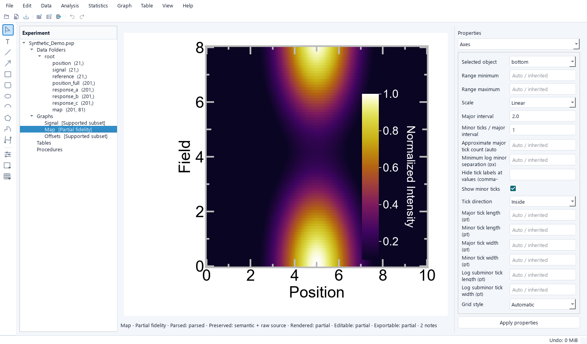

Choose a wave, graph, table or procedure in the left tree. Its contents appear in the center.
Selecting a graph object opens **Properties** on the right. Drag pane dividers to resize the workspace.
The upper toolbar provides Open, Save, Import, Export Data, Export Figure, Send to Igor Pro and Undo/Redo.

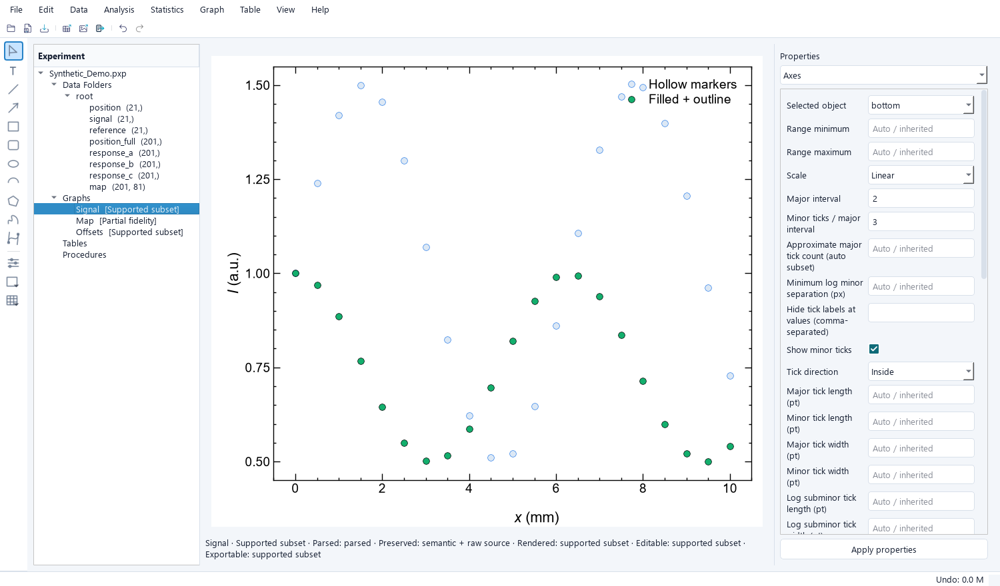

The original PXP is not changed. Use **MDSG** to resume editing, **H5XP** to transfer to Igor, and **Export Figure** for a finished image.
Reopen saved work through **File > Open Graph Document (.mdsg / .h5xp)**.
Save Session in the main window does not save an independent Graph Editor.
Undo/Redo (Ctrl+Z/Ctrl+Y) applies to this editor. `[Modified]` indicates unsaved edits.

Open **Help > Graph Viewer Manual (English)** (F1), or its Japanese counterpart, for this guide.
**Help > Python / mds Help…** covers automation. Help stays open while you work.

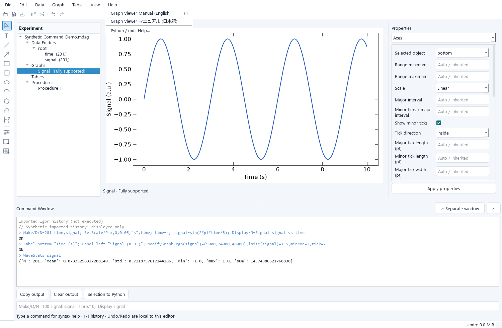

Use **View**, immediately left of **Help**, for **Datasets panel**, **Settings panel**,
**Focus graph**, **Reset layout** and **Restore panels**. The previous row of display
buttons has been removed. **Focus graph** hides side columns and the Command / Procedure
docks without discarding data, history or procedure text. **Restore panels** returns
the previous dock arrangement. The **Command Window** and **Procedure Window** checkboxes
in View reopen or hide either dock. Separate-window and dock-back actions are also in
View. Dock size, position and visibility are retained when this editor closes.
Double-clicking a column divider also restores column widths.

## 2. Importing and organizing waves

### Load text data

Use **Data > Load General Text…** (Ctrl+I), or drop a DAT/CSV/TSV/TXT/XY file.
Check the delimiter, first data row (1-based), and optional preceding header row.
Set each column to Number / Text / Skip and choose its wave name. Empty numeric cells become NaN.
Replacing an existing wave requires Overwrite and confirmation. Use Stop to cancel an import.

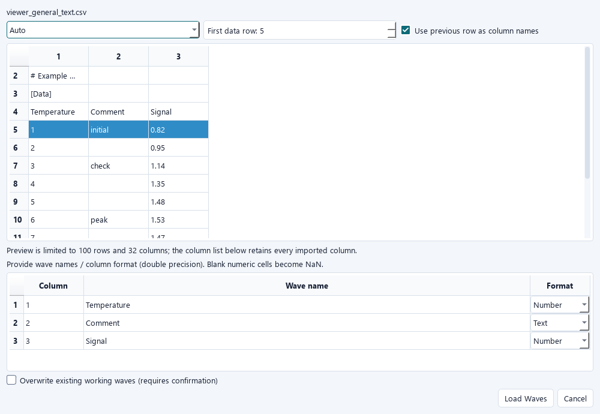

Quantum Design DAT files use the headers and measurements after `[Data]`.
Check alignment when Comment fields or trailing values are empty.

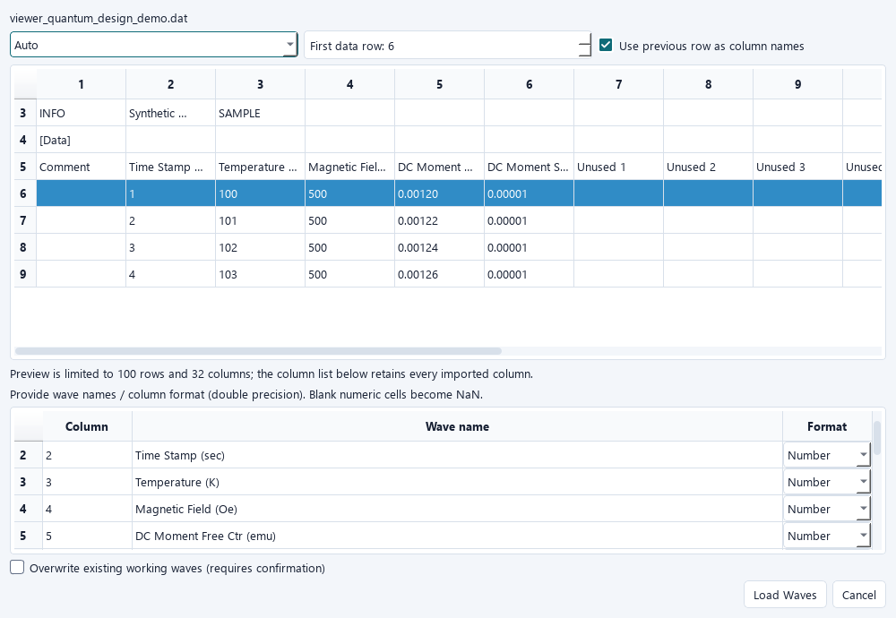

### Create, edit, name and scale waves

Use **Data > Make / Duplicate / Rename / Delete** to organize waves.
Open **Edit Wave…**, or right-click a wave, to edit cells; commit with **Apply to Working Wave**.
Ctrl+C/Ctrl+V copies and pastes rectangular selections. Editing retains more precision than the displayed digits.
For 3D/4D data, choose the layer/chunk to edit.

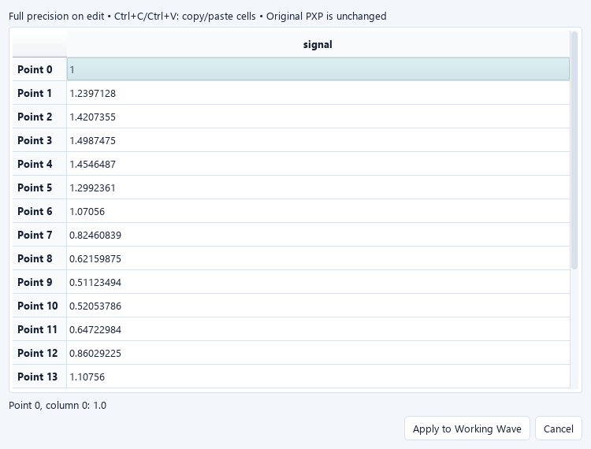

**Scaling** changes coordinate offset, interval and units; **Redimension** changes size.
Changes that would break X/Y/error-wave lengths are rejected. Review dependent graphs before deleting a wave.
Removing a trace alone leaves its wave intact.

**SetDimLabel…** edits dimension/position labels; **Note…** replaces or appends a note.
Label index -1 names the whole dimension; an empty label clears it.
Renaming/moving a Data Folder or moving a wave updates graph and table references.

## 3. Viewing and editing tables

Choose a table under Tables. **Table > New Table…** selects waves; drag to order columns.
**Modify Columns…** changes the name and columns. Shorter columns end in blank cells.
Double-click a cell or use **Edit cells…** to edit the wave. Apply commits; Cancel discards.
Deleting a table leaves its waves intact. Wave edits also update graphs using those waves.

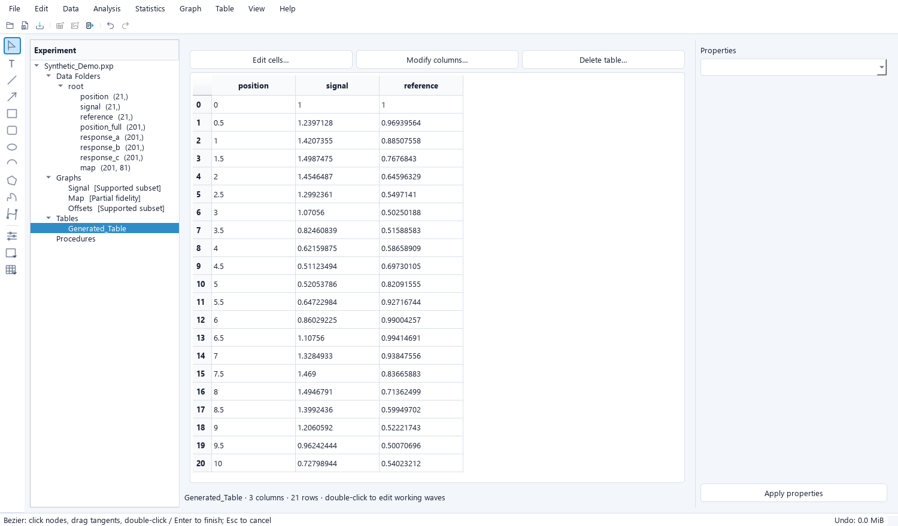

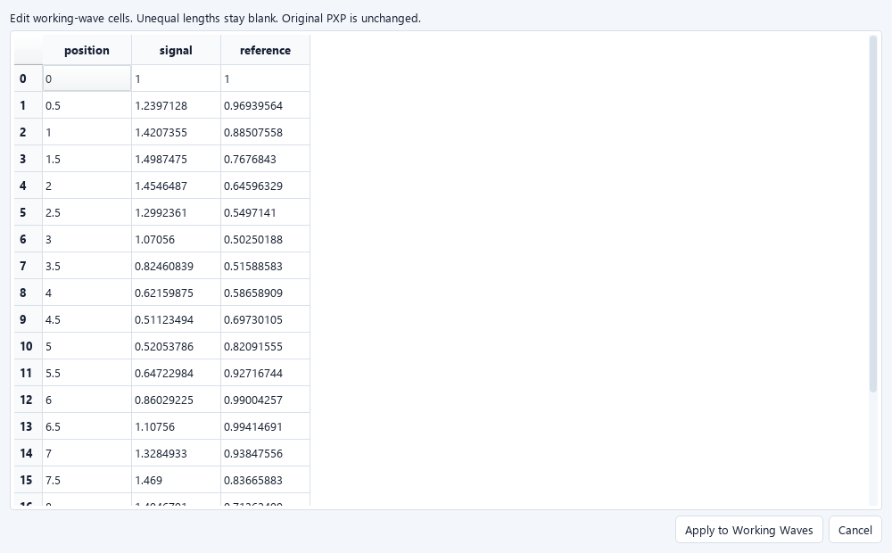

Use **Data > Table Format…** for digits, numeric format, width and unit headings.
Changing display digits does not round stored values. Command also offers fonts, colors, alignment and titles.
Tables can include scaled-index (`.i`) and dimension-label (`.l`) columns. These derived columns are read-only.

## 4. Wave calculations and signal processing

### Create a calculated wave

Use **Data > Calculate Wave…** for expressions such as `signal - reference`. Copy `w1`, `w2`, etc. from the list.
Check matching coordinates/units; choose point-index arithmetic or interpolation onto the first 1D wave only when appropriate.
Out-of-range interpolation produces NaN. Verify derived physical units. Input waves are retained.

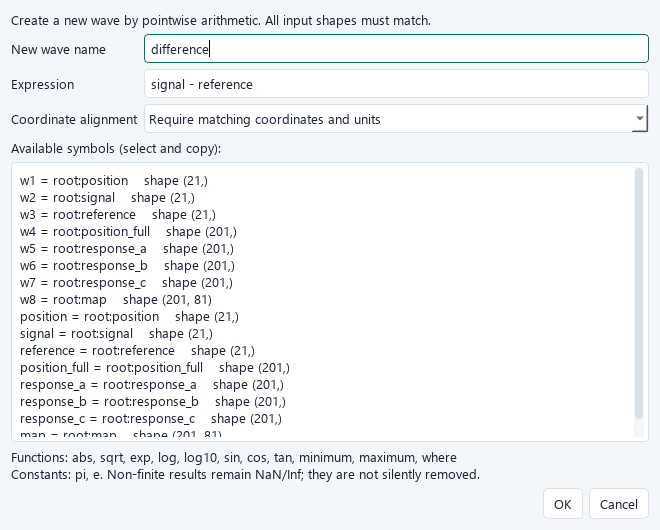

### Combine, split and resample

**Data > Concatenate… / SplitWave…** selects input order, output names and label/note handling; inspect Preview result.
Default Concatenate combines equal-length 1D waves as columns of a 2D wave. Use `/NP` for flat 1D concatenation.
SplitWave separates matrix columns or other dimensions into individual waves.

**Analysis > Resample…** selects interpolation/decimation factors, dimension, filter, window and endpoint handling.
Preview the shape and command before applying. Duplicate a wave first if changing one member would break an X/Y pair.
Resample updates the selected wave and its coordinate interval.

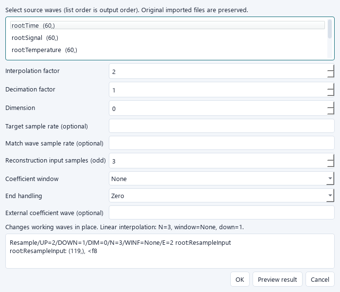

**Rotate** shifts values and coordinate offset. **Unwrap** removes phase jumps using a positive period.
NaN positions remain unchanged, and accumulated corrections continue across gaps.

### Statistics, smoothing, FFT and histograms

Command provides WaveStats, Smooth, FindLevel, FFT and Histogram. Use `Help commandName` for exact arguments.
`Smooth 3,signal` updates the working wave; Duplicate it first to retain the input.
FFT supports finite even-length 1D input. For Histogram, distinguish range/bin width/count and count/density/cumulative modes.
Density normalization includes finite observations outside explicit bins, so a truncated range need not integrate to one.

## 5. Creating graphs, traces and axes

Use **Graph > New Graph…** to choose a plot type, Y waves, X wave (or scaling), axes and name. Multiple Y waves can be selected.
**Append Traces / Images…** adds to the current graph. **Replace X / Y Waves…** changes data while retaining styles.
**Reorder Traces…** lists BACK at the top and FRONT at the bottom.

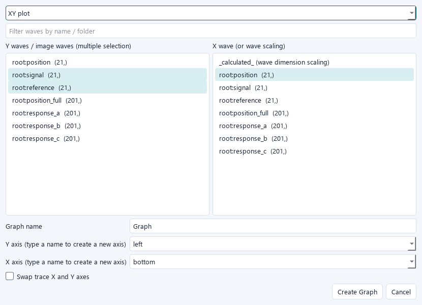

Right-click a trace for Browse, Edit, Hide, Remove, Duplicate, Replace Wave, Modify or Quick Fit.
Remove deletes only the trace. Restore hidden traces with **Show Hidden Trace** in the blank-area menu.

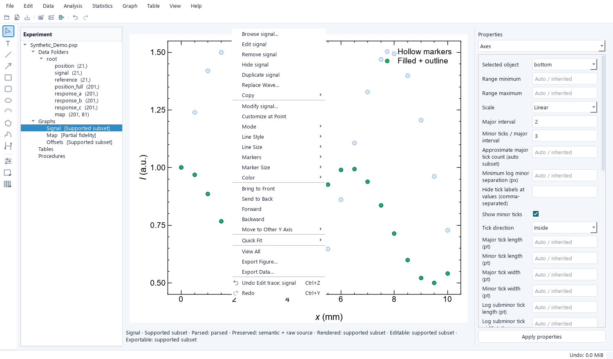

### Error bars, point ranges and multiple axes

**Graph > XY Error Bars…** selects asymmetric X/Y error waves, width, caps and color.
Trace Properties also offers cap thickness and clipping. Error-wave lengths must match the trace.
**Display points first,last** selects an index range without cutting the source. Displayed-data export and Quick Fit use this range.

Trace Properties selects X and Y axes independently. A top X axis is separate from a mirrored bottom frame.
Use left/right Y axes, named free axes, enabled intervals and crossing positions.
For image/trace overlays, the image uses bottom/left while traces use their selected axes.

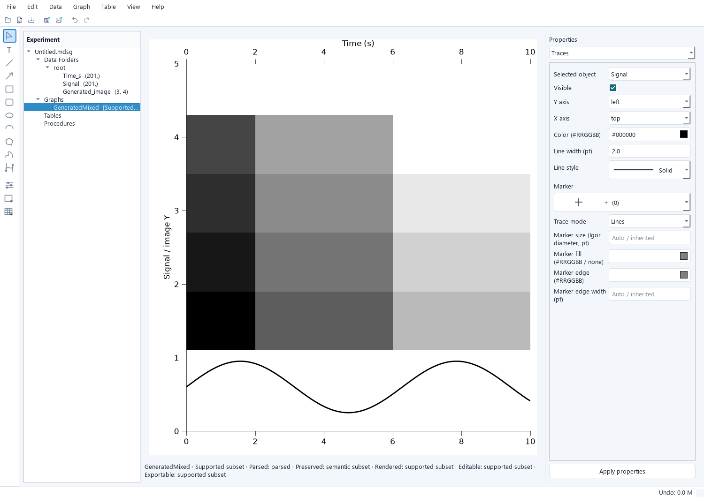

Text X waves create category axes. **Graph > Date Axis…** displays dates/times from the 1904 epoch or elapsed time.
Labels use ISO/English formatting rather than every OS-specific format.

### Zoom and cursors

Drag a rectangle inside the plot, then right-click for Expand / Shrink and Horiz / Vert variants.
**View All** restores autoscaling. Log/reversed axes are supported; zoom is undoable.
**Graph > Cursor…** places persistent A–J cursors on trace points with position and color.

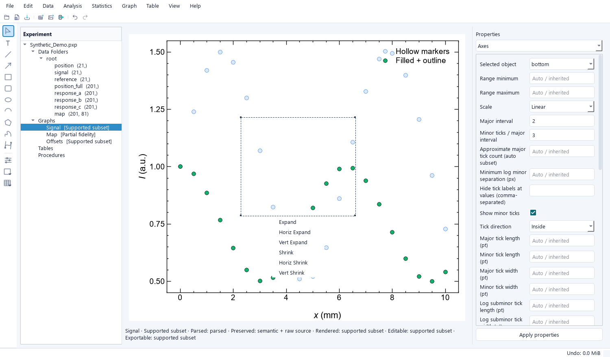

## 6. Formatting lines, markers, axes and text

Select an object, edit Properties, then press **Apply properties**. Only changed fields are applied.
Set color, line width/pattern, marker shape/size, fill/outline and display mode. Choose markers and patterns from visual samples.

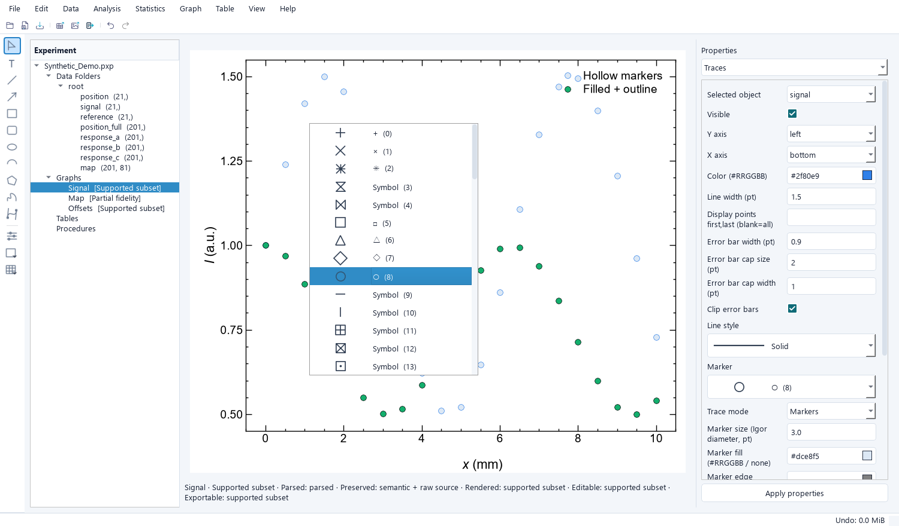

### Per-point colors, sizes and markers

Point-color, point-size and marker-wave fields take waves matching the trace length.
Choose bounds, reversal, log colors and ColorScale visibility. Log colors hide nonpositive values.
Direct RGB uses an N×3/4 channel wave. Use these channels with line/marker modes.

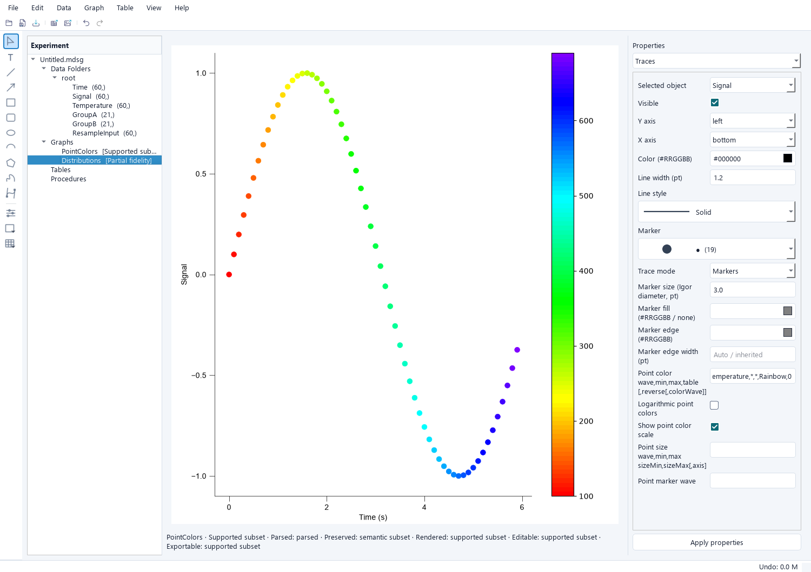

### Axes, ticks and physical size

Axes controls range (both ends blank for auto), linear/log scale, major interval, minor count, tick direction/length/width and mirroring.
Axis lines, labels, ticks and tick labels have separate colors; a blank color inherits the default.
Tick / label lower bound and upper bound restrict ticks/labels by coordinate without changing data or axis range.

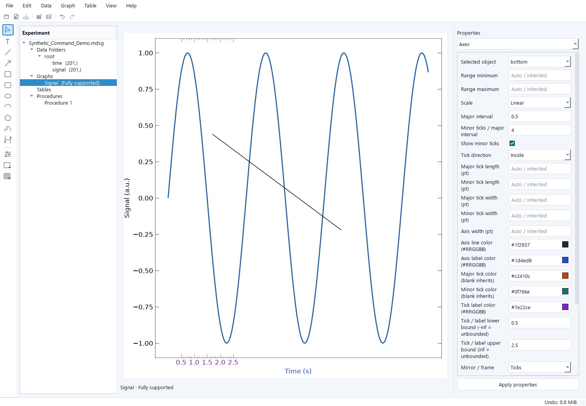

Edit label text, font, size, rotation and position. Type a font name or choose an installed font.
Graph defaults and individual axis/annotation fonts are separate settings.
**Geometry** changes plot width/height, aspect and margins. Specify fonts and point dimensions for reproducible figures.
Automatic font sizing/tick placement and unavailable fonts may cause appearance differences between environments.

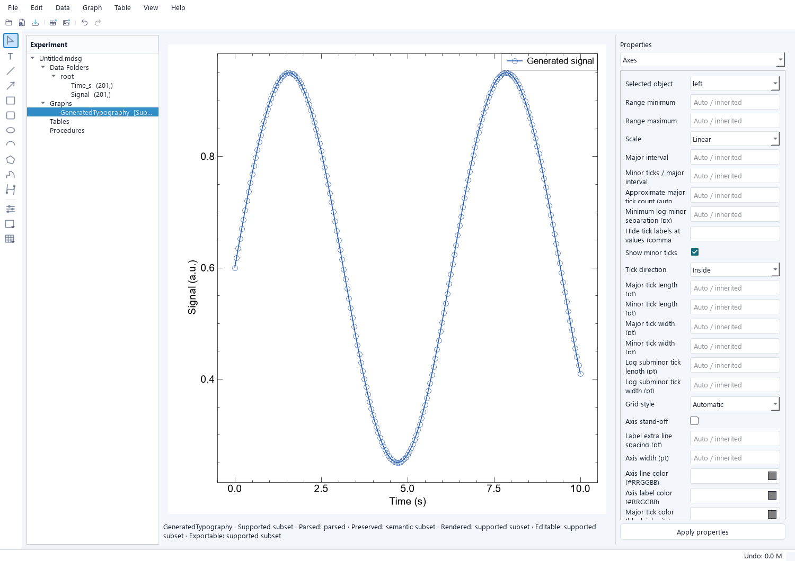

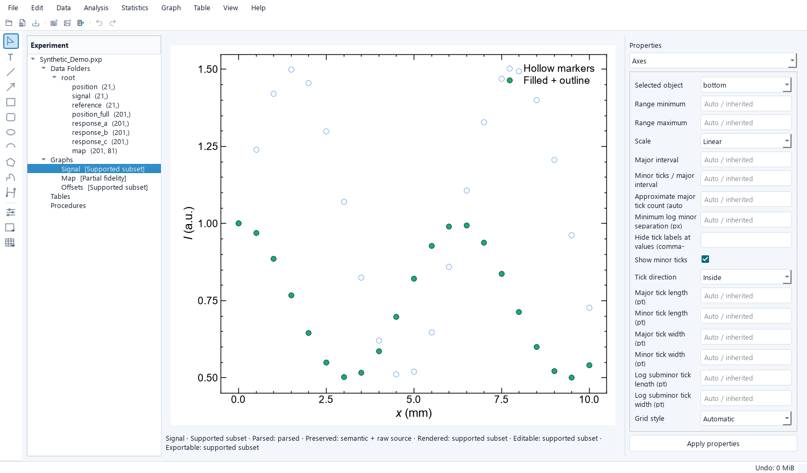

## 7. Annotations, legends, drawing and mouse controls

### Annotations and Tags

Use **Graph > Add Annotation…** or the blank-area menu to add text.
Double-click labels to edit text; double-click a legend/textbox or choose Modify for full editing.
Text / Frame / Position / Symbols controls text, spacing, border, background, shadow, anchor, rotation and symbols.
Change commits; Cancel discards. Annotations can be duplicated.

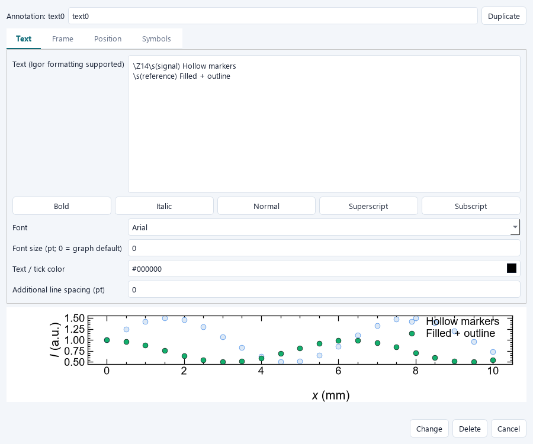

Igor `\s(trace)` symbols, bold/italic and superscript/subscript formatting are supported.
**Graph > Tag…** attaches text to a trace point with arrow and offset settings.
Use `\ON`, `\OP`, `\OX` and `\OY` for names, indices and coordinates. Arbitrary expressions and image Tags are unavailable.

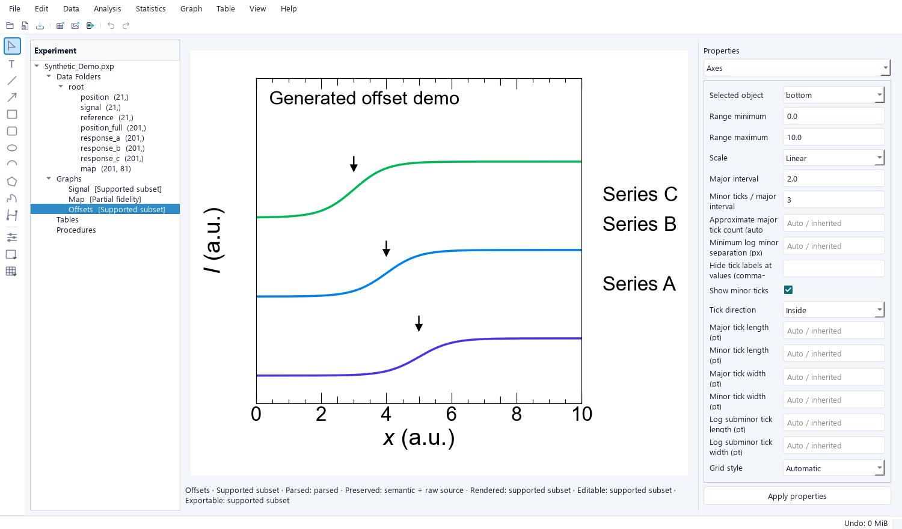

### Draw objects

The vertical Text and Draw toolbar provides text, line/arrow, rectangle, oval/arc, polygon/freehand and Bezier tools.
Click to place text; drag to create shapes. Esc cancels.

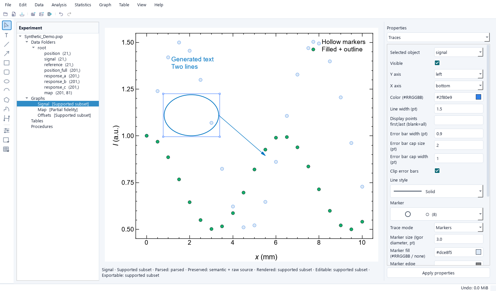

For polygons, click vertices and finish with a double-click, Enter or right-click.
For Bezier curves, click a node and drag to set its tangent. Double-click the final node, or press Enter, to finish.

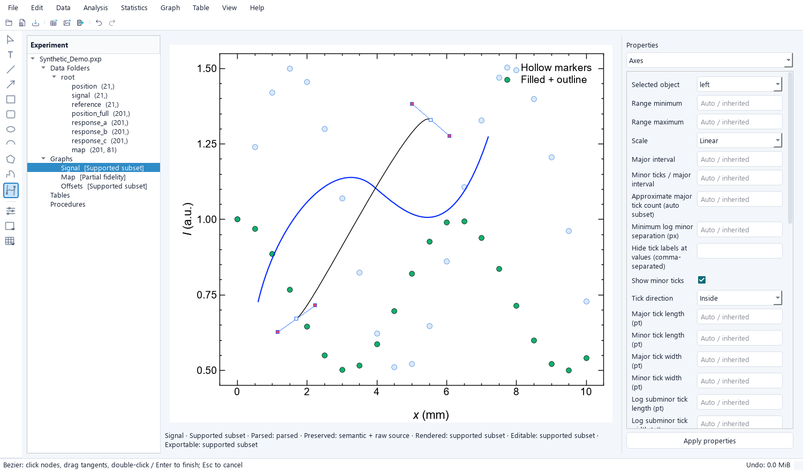

Select an existing Bezier curve to edit nodes/tangents. Alt makes a tangent independent of the opposite handle.
Pointer selects and moves objects. Selection outlines and handles are excluded from figure exports.

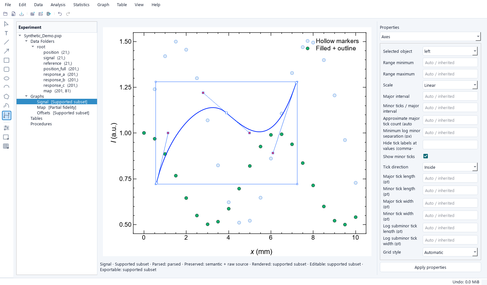

Double-click or right-click drawings to edit coordinates/styles. Use Cut / Copy / Clear / Duplicate or **Edit > Paste Drawing**.
Layer / Arrange changes stacking; Grid controls guides/snap. Shift constrains moves horizontally/vertically; Alt temporarily bypasses snap.
Drag labels, legends, textboxes and ColorScales to move them. A completed move is one Undo step.

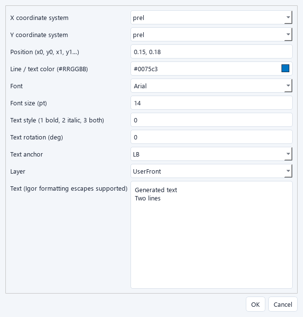

## 8. Images, ColorScales and regions of interest

### Image display and colors

Choose Image plot in New Graph, or append a numeric 2D wave through Append Traces / Images.
RGB/RGBA waves are supported: uint8 channels use 0–255, other types use 0–65535.
**Graph > Image Coordinates…** selects edge waves for uneven pixels.
Edges must be strictly monotonic with one more value than the corresponding image dimension.

Images Properties sets colormap, bounds, reversal, log colors, interpolation and visibility. Log limits must be positive.
NaN pixels are normally transparent. Some Igor color tables are approximations; review important figures visually.

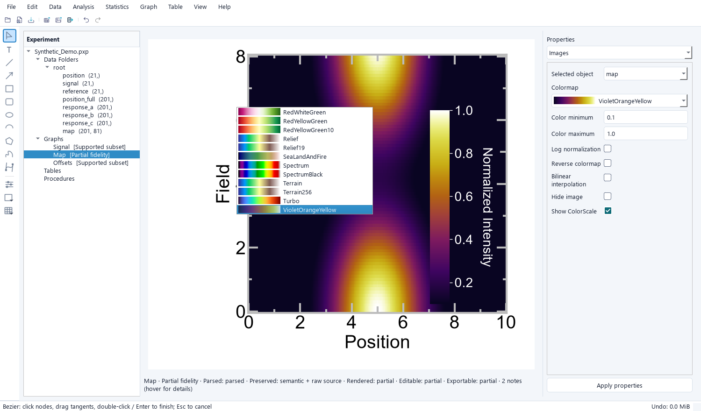

Double-click or Modify a ColorScale. Axis Labels / Frame / Position / ColorScale Main / Ticks controls position,
width/height, orientation, label, font and major/minor ticks.
Log image colors and a logarithmic ColorScale axis are separate settings. Wave-based ColorScale user ticks and a second scale axis are unavailable.

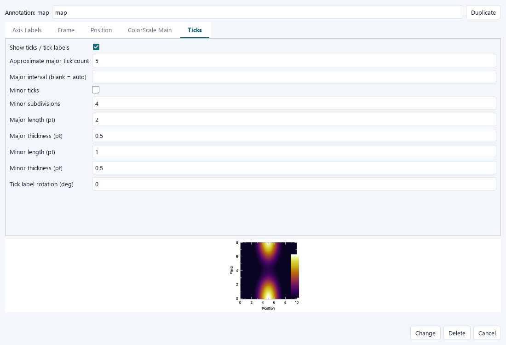

### ROI profiles and integration

**File > Image ROI / line profiles…** creates X/Y mean profiles, ROI means, sample sums or physical integrals.
Bounds use native wave coordinates independently of Swap X/Y. Physical integration requires at least 2×2 finite samples.

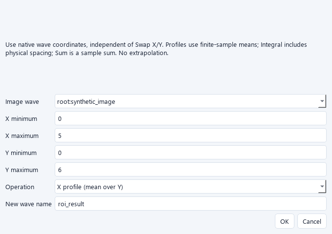

### Thresholds and masks

**Data > Rectangular ROI…** creates a mask from row/column index bounds: zero inside, one outside.
**Analysis > Image Threshold / ROI Mask…** selects the image, manual / Iterative / Otsu method, inversion, outside-ROI behavior and output.
Inspect Preview result. Default output is 0/255, with 64 for nonfinite pixels. Manual threshold equality belongs to the zero side.
Preserving original outside pixels also retains their type and NaNs.

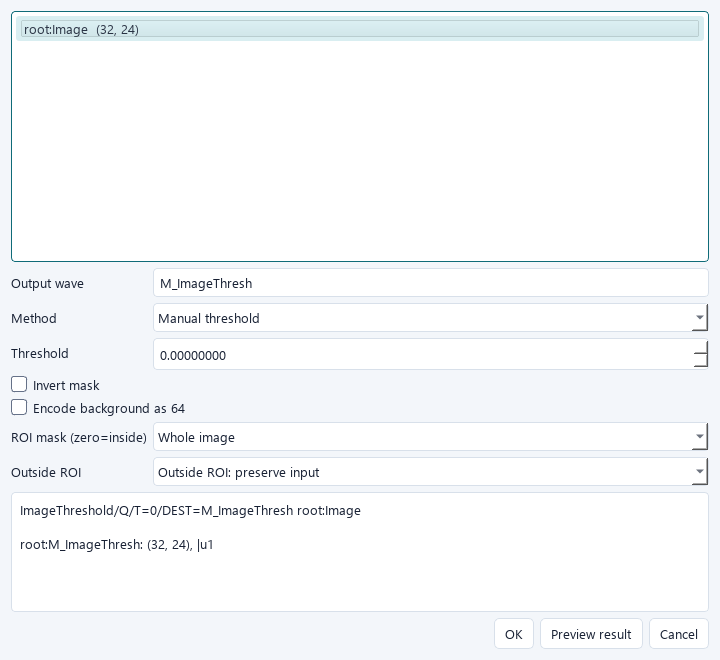

## 9. Distribution plots and contours

### Box Plot

Choose **Graph > New Graph… > Box plot**, then select 1D groups or a 2D wave whose columns are groups.
Trace Properties controls quartiles, whiskers, outliers, notch, raw points, mean, fences and jitter.
Statistics update when source waves change. Width and jitter placement may differ from Igor.

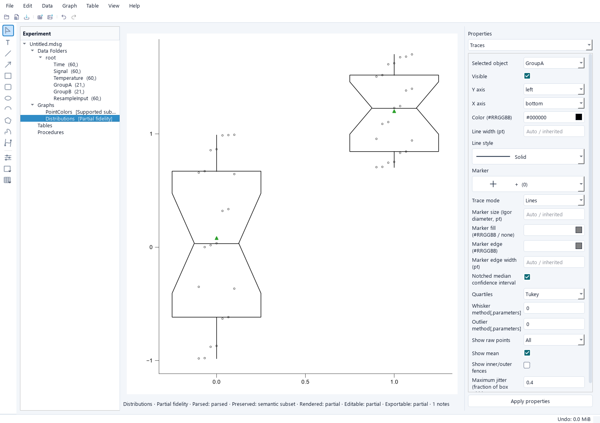

### Violin Plot

Choose groups through **Graph > New Graph… > Violin plot**.
Set bandwidth, method, kernel, extension, density, side, outline, raw points, mean/median, jitter, colors and width.
Use consistent bandwidth/density when comparing distributions. Automatic bandwidth and screen width/jitter may differ from Igor.

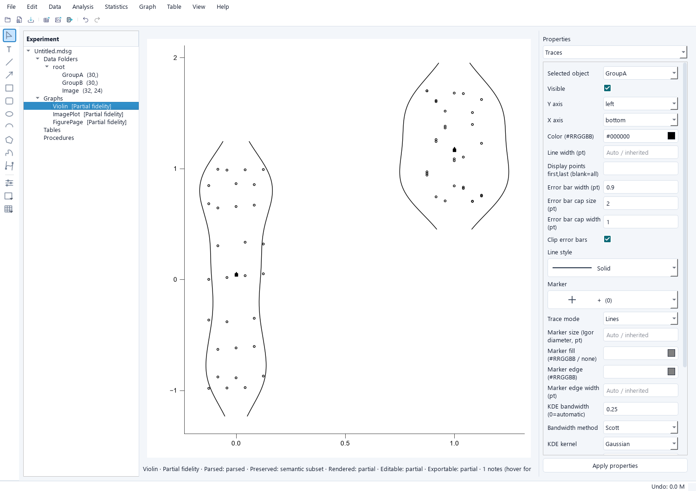

### Contour

**Graph > Contour…** adds matrix contour lines or fills.
Use automatic or explicit levels. Filled contours require at least two explicit levels.
XYZ triangulation and the complete set of native contour-label/style options are unavailable.

## 10. Fitting and hypothesis tests

### Quick Fit and Curve Fitting

Choose a model in **Analysis > Quick Fit** to add a fit directly to the current graph. The trace context menu offers the same workflow.
For multiple traces, select the target. With **Fit Between Cursors / Selected Region** enabled, A and B on that trace define the inclusive fit interval.
Otherwise a selected rectangle is used, or all points if neither is available. Cursor fitting requires monotonic X.
**Weight From Error Bar Wave** uses available Y error waves as one-standard-deviation sigma; disable it when inappropriate.
Coefficients/errors appear in Command history. Curves, residuals and fit conditions are retained in the document and can be undone together.
**Add Coefficient Textbox** also adds an annotation.

For more options open **Analysis > Curve Fitting…**: choose trace, model, X limits, weights, comma-separated initial coefficients,
zero-based coefficient indexes to hold, a nonzero-inclusion mask, and whether the model curve spans the full source X range.
Blank initial coefficients request automatic guesses. Run Quick Fit, inspect coefficients/errors and the curve/residual preview,
then choose **Add Fit to Graph**. Stop interrupts the fit.
Models include line, polynomial orders 2–10, Gaussian, Lorentzian, Voigt, exponentials, sin, Hill, Sigmoid and Power.

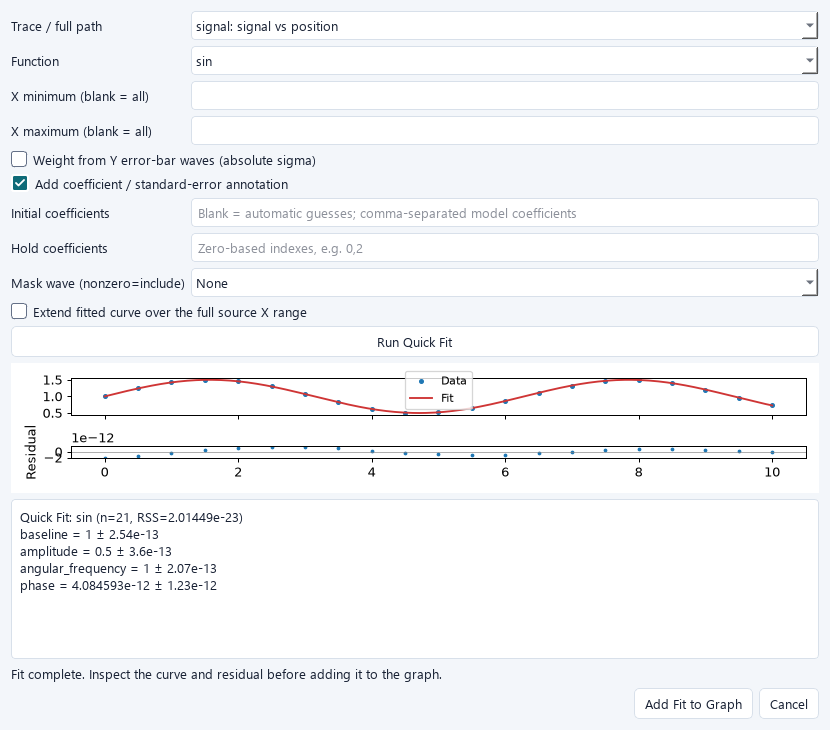

Use **Analysis > Quick Fit > poly2D… / Gauss2D…** for a numeric image matrix. Fit a total-degree polynomial of order 1–4 or a rotated elliptical Gaussian.
The workflow creates fit, residual and coefficient waves. Display the result through New Graph > Image plot.
The complete set of Igor surface models and constraints is unavailable.

### Analysis wave processing

**Data** organizes and edits waves, **Analysis** performs calculations/signal processing, and **Statistics** provides statistical reports/tests.

- Differentiate / Integrate use wave X scaling and create a derivative or cumulative trapezoidal integral.
- Smooth offers binomial, boxcar and order-2/4 Savitzky-Golay methods with endpoint handling. It changes working waves and supports Undo.
- Convolve / Correlate select the kernel/reference first and signal second. Choose linear/acausal/circular modes, DC removal or autocorrelation as offered.
- Interpolate takes Y and optional X, producing evenly spaced linear/cubic-spline/PCHIP results. X must be strictly monotonic.
- Filter takes signal, numerator coefficients and, for IIR, denominator coefficients. Initial conditions are zero.
- Resample, Sort, Histogram, FindLevel and Compose Expression are also in Analysis. Sort reorders the optional associated wave with the key.
- Image Threshold / ROI Mask has moved to Analysis.

Check input order and use Move input up/down where needed. Preview result leaves the document unchanged; Do It applies the result.
Imported PXP files are preserved.

**Analysis > Transforms** contains FFT/Inverse FFT, Periodogram, Lomb, MultiTaper PSD, Haar DWT, Morlet CWT, Wigner-Ville and STFT.
FFT frequencies use the wave sample interval. Lomb takes Y then strictly increasing X and produces normalized power.
MultiTaper uses NW=3 and five DPSS tapers. Haar DWT requires a power-of-two length; coefficient order is final approximation followed by coarse-to-fine details.
CWT scales run from 1 to the specified maximum. STFT uses a Hann window, 50% overlap and PSD scaling.
Wigner-Ville uses the analytic signal and may contain negative values and cross terms. Display 2D results as image plots.
Normalization, methods and output layouts can differ from Igor; matching menu names do not imply numerical parity.

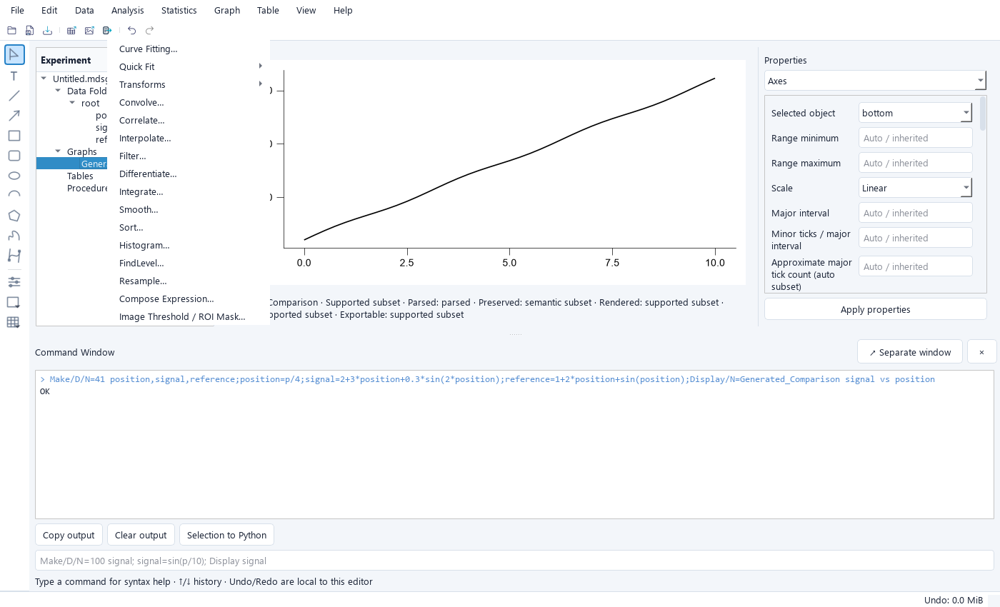

### Statistics and t tests

**Statistics > T-Test…** selects one-sample, independent two-sample or paired testing.
Set the null mean, two-sided/greater/less alternative, alpha and output name. Independent groups offer fractional, integer or n1+n2-2 degrees of freedom.
One-sample CI is supported. Igor-specific two-sample CI and paired CI/DF options are unavailable.
Independent groups omit nonfinite values per group; paired/correlation workflows retain only jointly finite pairs.

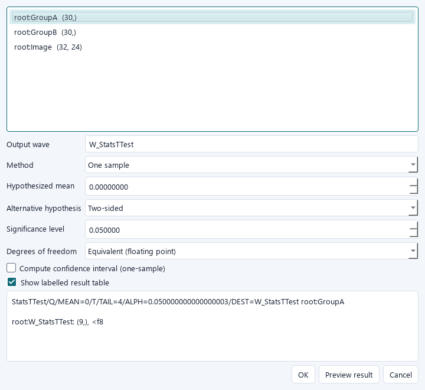

The Statistics menu also provides these workflows:

| Entry | Methods / input |
|---|---|
| Wave Stats | N, missing count, mean, SD, SEM, min/max, median, sum |
| F-Test / Variances Test | Variance ratio, Bartlett, Levene mean/median/10% trimmed |
| One-way ANOVA | Standard, Welch, Brown-Forsythe; Igor integer DF and fractional DF are distinguished |
| Two-way ANOVA | Complete matrix without replication or balanced 3D replicated data; no missing cells |
| Correlation Tests | Pearson, Spearman, Kendall with equal-length pairs |
| Multi-Comparison Tests | Tukey HSD on independent groups |
| Normality Tests | Jarque-Bera and Shapiro-Wilk; observe small-sample limitations |
| Circular Statistics Tests | Rayleigh uniformity in radians; approximate P |
| Chi Squared / Contingency | Observed/expected counts; integer matrix chi-square, Yates or 2x2 Fisher |
| Resampling Statistics | Bootstrap percentile CI for the mean, with resample count and seed |
| Kolmogorov-Smirnov / Two Sample Tests | Two-sample KS, one-sample KS against standard normal, Mann-Whitney, Wilcoxon, Kruskal-Wallis |
| Waves Average | Pointwise mean, SD and SEM of equally shaped/scaled waves |
| ANOVA Power | Power from degrees of freedom, noncentrality and alpha |

Results are labelled waves/tables. P is not the probability that the null hypothesis is true.
Choose assumptions and tails for the scientific question; account for multiplicity when running multiple tests.
MDS reports do not use Igor's exact result-wave layout. Unavailable methods/options are not silently substituted.

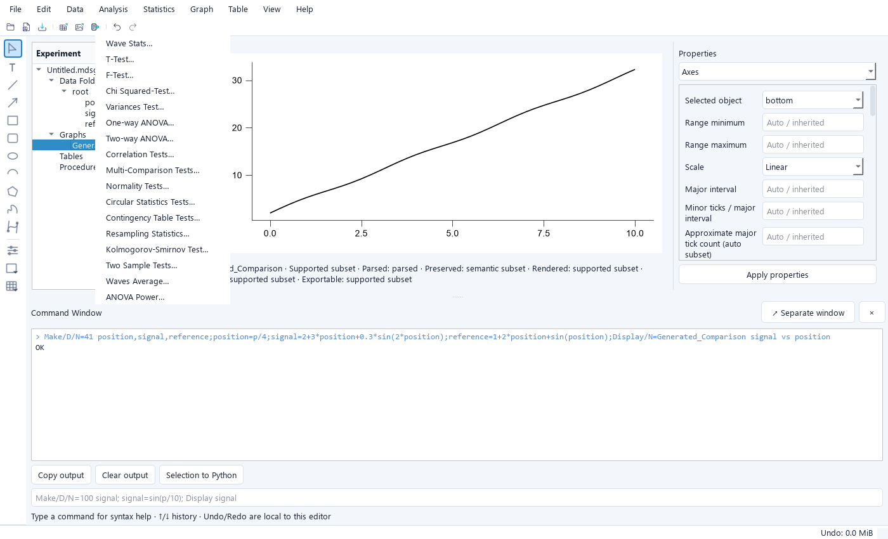

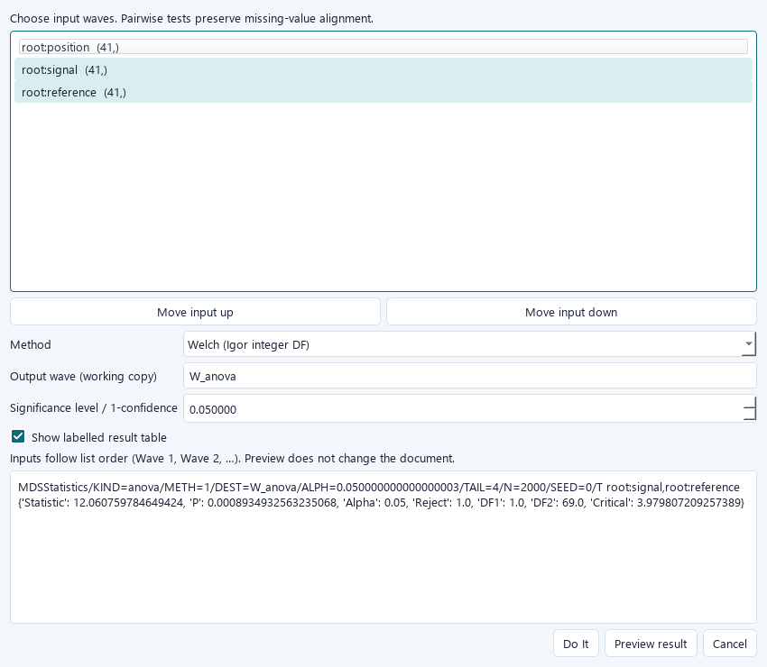

## 11. Composing figures, insets and layouts

**Graph > Subwindow…** creates one level of graph insets.
Adjust each graph's data, axes and text separately. Nested insets, panels and guides are unavailable.

**Graph > Layout…** composes up to 32 graphs on one 612×792 pt page.
Specify each graph's rectangle in points. Editing a source graph updates the layout.
Align widths, fonts and label margins, then check the finished figure through Export Figure.

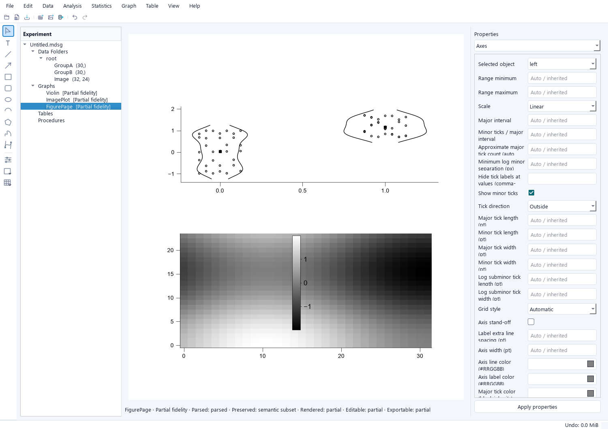

## 12. Saving, exporting, sending to Igor and sharing

### Save editable work

Use **File > Save Graph Document / Save Graph Document As…** for MDSG.
It retains waves, graphs, tables and edits, and opens without the original PXP or Igor.
Existing MDSG files can be replaced. After an abnormal exit, use **Recover Graph Document…** and save the recovered work.

### H5XP and Send to Igor Pro

Save As offers **Igor HDF5 Experiment (*.h5xp)** for working waves, graphs, annotations, drawings and tables.
The entire document is included, not just the selected graph. Choose a new filename each time.
H5XP export does not change your MDSG save target or unsaved state.
Original user procedures, notebooks and unsupported objects are excluded. Save an MDSG editable master too.

The editor's **Send to Igor Pro** button or File menu creates a temporary H5XP and opens it in Igor.
It uses the Igor executable setting shared with the main window. If launch fails, open the retained H5XP at the reported path.
Review lines, text, axes, colors and unsupported settings in Igor. Use Export Figure to transfer the rendered appearance.

### Export figures and numeric data

**File > Export Figure…** opens Save Graphics File.
Same retains original dimensions; Custom sets cm/mm/in/pt dimensions. Choose SVG/PDF/EPS or PNG/JPEG/TIFF/Bitmap,
DPI, transparency, color/monochrome and destination, then Do It.
JPEG/Bitmap/EPS cannot retain transparency. EMF and To Cmd Line are unavailable.

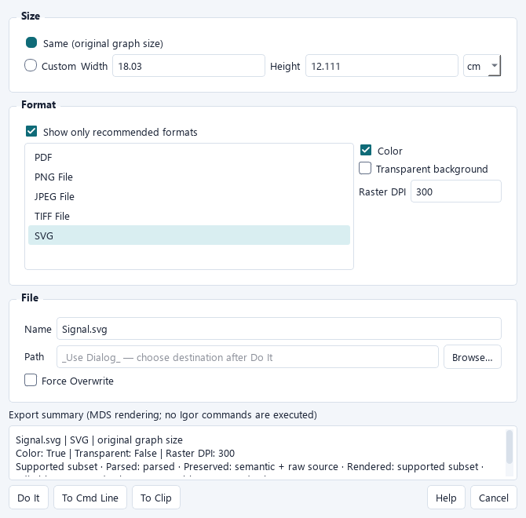

**File > Export Data…** (Ctrl+E) saves CSV/TSV. Select traces/images and displayed or raw values.
Displayed values include offsets, multipliers, Swap X/Y and trace point ranges. Axis range alone does not truncate exported values.
Each trace has X/Y/error columns; images use X/Y/value columns (separate components for RGB).

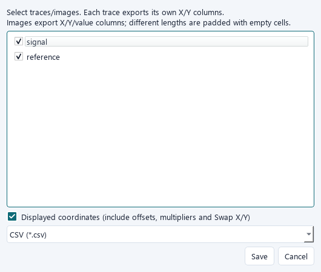

### Main-window transfer and reviewed sharing

**File > Edit current plot in Graph Editor**, or the graph-and-pencil button, transfers the displayed plot to an independent editor.
Igor is not required. Subsequent edits do not change the main analysis workspace.

Ordinary MDSG may contain original experiments, notes and source text.
Use **Create reviewed sharing copy…** to select required graphs and waves.
The copy excludes original PXP bytes, unused waves, wave notes, procedures, history and source paths.
Graph text and wave names remain: review them for sample identifiers before saving.

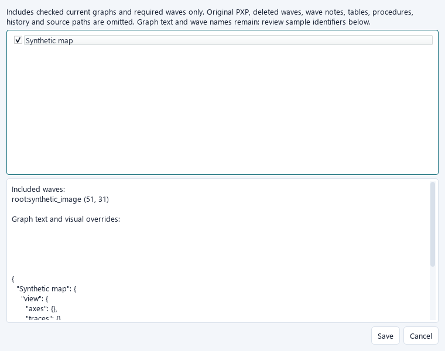

## 13. Automation with Command and Python

### Command Window

Open **View > Command Window / Procedure Window**. Separate window floats a dock; Dock back returns it.
Reopen hidden docks through View.

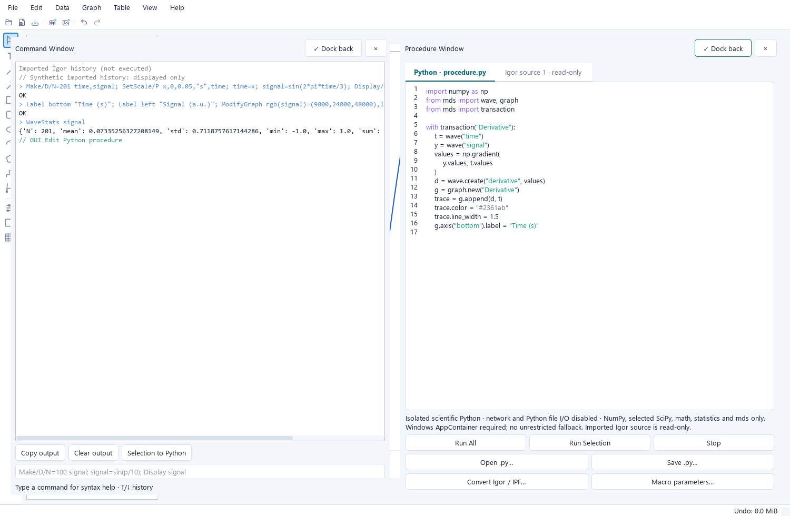

Enter a command and press Enter. Select completion suggestions with arrows and Enter; consult the syntax hint.
Up/Down recalls earlier input. Copy output copies results. Enter `Help` or `Help ModifyGraph` for supported commands and settings.

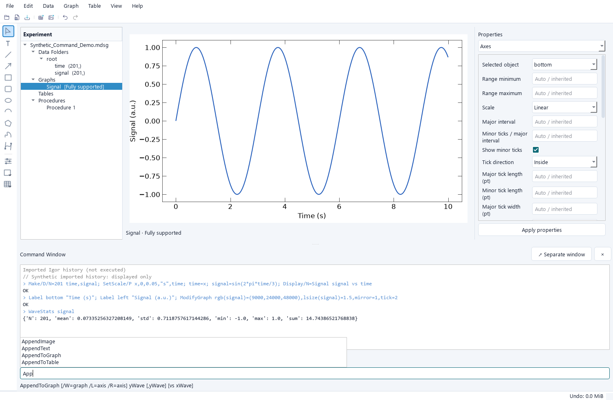

```igorpro
Make/D/N=201 time,signal
SetScale/P x,0,0.05,"s",time
time=x
signal=sin(2*pi*time/3)
Display/N=Signal signal vs time
Label bottom "Time (s)"
Label left "Signal (a.u.)"
```

Semicolon-separated commands form one Undo step; a failed input is not applied.
GUI edits also display corresponding operations. The log never runs automatically.
In **Processing history / command recipe…**, copy a script marked replayable, review it, then run it explicitly.

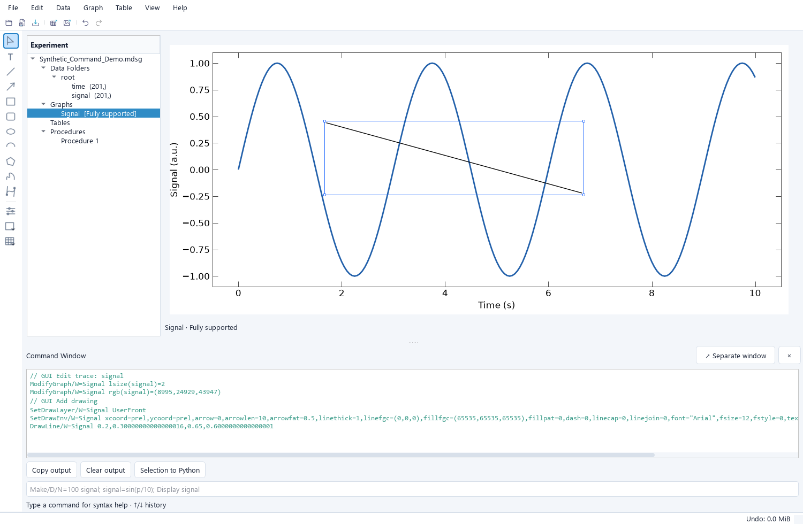

### Python Procedure

The editable Procedure tab uses Python. Use **Open .py / Save .py / Run All / Run Selection / Stop**.
Imported Igor source appears on read-only tabs and never runs merely by opening it.
Successful results apply together; Stop, exceptions or conflicting edits during a run discard its results.

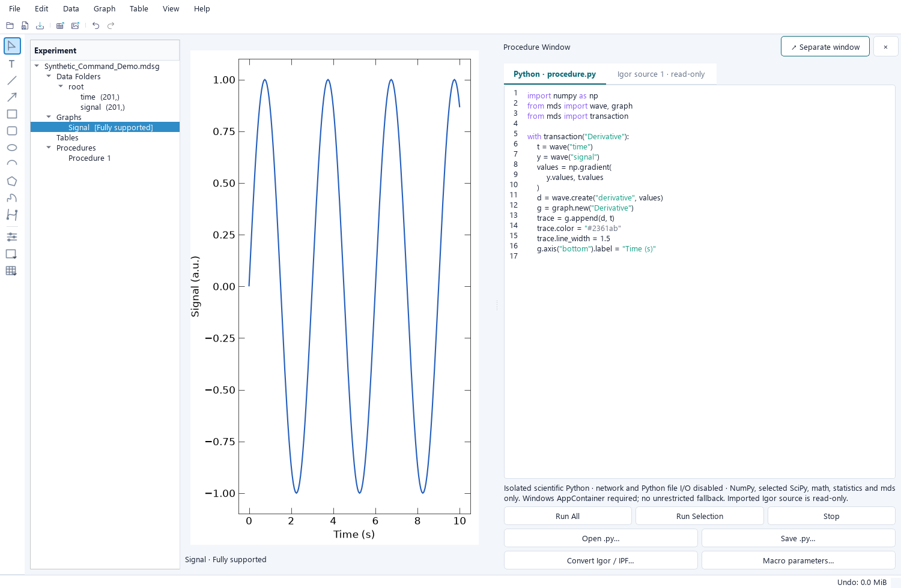

```python
import numpy as np
from mds import wave, graph, transaction

with transaction("Derivative"):
    t = wave("time")
    y = wave("signal")
    d = wave.create("derivative", np.gradient(y.values, t.values))
    g = graph.new("Derivative")
    g.append(d, t)
```

Python uses the offered scientific modules and mds API in a restricted environment. Network and arbitrary file operations are unavailable.
Use working waves/explicit inputs and the editor's Export actions. The first run may take longer to prepare.
See **Help > Python / mds Help…** for available functions and examples.

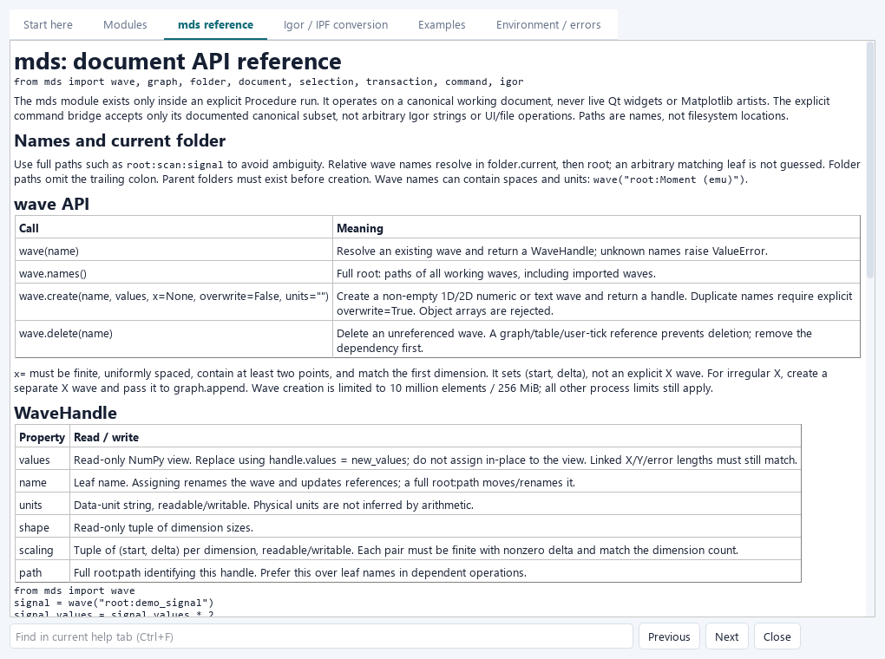

## 14. Igor / IPF conversion and troubleshooting

### Convert a reviewed copy

1. Use **Convert Igor / IPF…** and choose imported source, pasted text or Open .ipf.
2. Press **Analyze / Convert**; select an Entry routine and arguments (a JSON list).
3. Review Diagnostics / limits and Python preview. Unsupported operations show original source-line numbers.
4. Choose **Insert into Python (not run)** for a working copy.
5. Review code, wave names and units, then explicitly choose **Run All** if required.

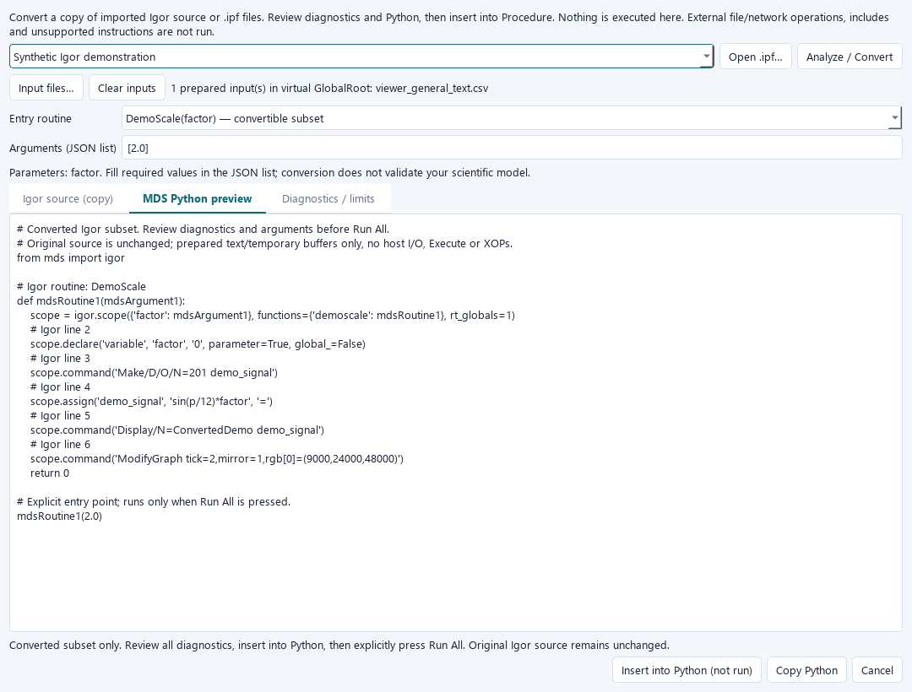

Conversion does not provide full Igor execution. Unsupported operations cannot be run.
Numeric text import through `LoadWave/G` treats empty fields differently from GUI Load General Text.
Use the GUI preview for CSV files with missing columns, and verify shapes, column order, values and units after conversion.

### Input files, dialogs and parameters

During execution, Open/D opens a file chooser; NewPath asks for a folder and confirmation of text inputs.
Original inputs are not changed. Cancel or Stop aborts the operation. Input files… can prepare inputs in advance.

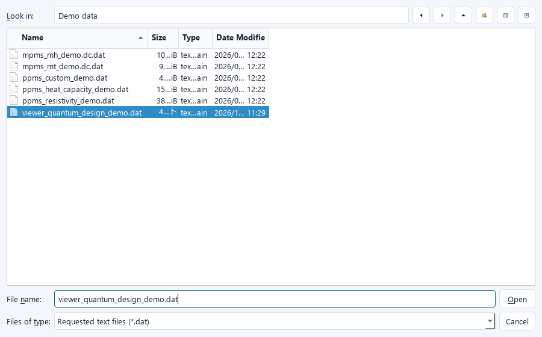

Prompt / DoPrompt offers numeric, text and popup inputs; DoAlert displays messages and response buttons.
Parameter panels appear after initialization. Apply updates values; each named button explicitly runs its associated action.
Reopen a closed panel with Macro parameters….

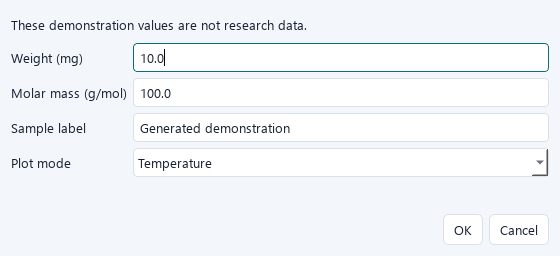

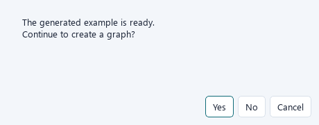

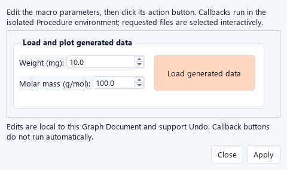

### If import or appearance differs

- Check graph status and **Compatibility report…** for unsupported settings and approximations.
- Keep the original PXP and save an MDSG copy before editing. Check fonts, ranges, scaling and units.
- Export a new H5XP with the current MDS version and inspect any error line reported by Igor.
- Use PDF/SVG/PNG for rendered appearance, and MDSG for continued editing.
- Check missing values, selected ranges, interpolation, weights and test conditions when numeric results differ.
