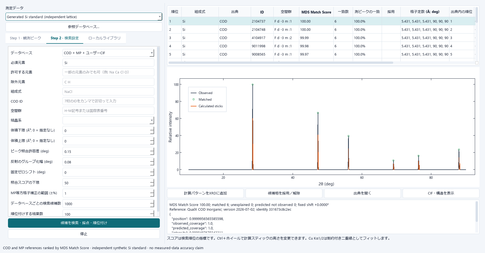

# Materials Data Studio ユーザーマニュアル

[English](user_manual_en.md) | [日本語](user_manual.md) · [Documentation / 文書一覧](index.md)

**対象バージョン:** 0.15.0

**更新日:** 2026-10-30

Materials Data Studio は、研究室で取得した XRD、MPMS、PPMS データを読み込み、
比較表示、前処理、フィッティング、図・数値出力まで行うデスクトップアプリケーションです。
このマニュアルは、実装済みの画面と計算処理をソースコードおよび実機で照合して作成しています。
掲載画面のデータは、マニュアル専用に生成した匿名の合成データです。

このマニュアルはメイン解析画面のガイドです。独立したGraph Viewerの詳しい操作は、
Viewer内の **Help** にある日本語・英語マニュアルとPython / mds Helpに分けています。
機能の概要と開き方は8.4節を参照してください。

Graph Editorの詳しい手順は[専用マニュアル](graph_viewer_manual.md)を参照してください。
wave準備・演算、graph・画像の作成、書式と注記、解析、保存・Igor連携の目的別に説明しています。
図出力が大きすぎて拒否された場合はサイズまたはdpiを下げてください。

> **解析上の注意**
>
> 本ソフトは解析作業を支援しますが、試料の同定や物理モデルの妥当性を保証するものでは
> ありません。単位、組成式、試料重量、測定条件、フィット範囲、残差を必ず利用者が確認し、
> 元データと解析条件を保存してください。

## 目次

- [1. 起動と終了](#section-1)
- [2. メイン画面](#section-2)
- [3. XRD](#section-3)
- [4. MPMS](#section-4)
- [5. PPMS Heat Capacity](#section-5)
- [6. PPMS Electrical Resistivity](#section-6)
- [7. PPMS Custom Plot](#section-7)
- [8. Tools](#section-8)
- [9. セッション](#section-9)
- [10. アプリ内ユーザーマニュアル](#section-10)
- [11. 出力](#section-11)
- [12. トラブルシューティング](#section-12)
- [13. 入力ファイルと単位の要約](#section-13)
- [14. 再現性のために保存するもの](#section-14)
- [15. 共通解析ワークフロー](#section-15)

Graph EditorではDataでwaveを整理し、隣のAnalysisでfit・信号処理、Statisticsで統計・検定を実行します。

PPMS Resistivityのfit曲線と残差、Heat Capacityの低温fit曲線は、実行済みfitの温度範囲内だけ表示します。
範囲入力を編集しただけでは、以前のfitの表示範囲は変更されません。新しい範囲を適用する場合は再fitしてください。
Custom PlotでもDatasetsのファイル名を右クリックし **Manually configure branches…** を選ぶと、
生データの表・簡易グラフを見ながら行範囲と名前を設定できます。行番号は0始まりで両端を含みます。
**Apply** で確定し、各子ブランチを選択してスタイル・fitを設定します。**Cancel** は変更を確定しません。
元のファイルデータは保持され、ブランチはセッションに保存されます。

## 1. 起動と終了

### 1.1 配布版を起動する

GitHub Releasesから `MaterialsDataStudio-v<バージョン>-Setup.exe` を取得し、実行します。
Windows 10/11の64ビット版にユーザー単位でインストールされます。
Pythonや.NETの別途導入は不要です。スタートメニューの **Materials Data Studio** から起動します。
併記されたSHA-256ファイルと照合すると、ダウンロード結果を確認できます。

更新する際は、作業を保存してMDSを終了し、新しいバージョンのSetup.exeを実行します。
インストーラで導入済みのMDSが更新され、設定、保存したセッション、外部の参照DBは保持されます。
0.15.0以降のインストーラ導入版では、下記のソフト内更新も利用できます。
旧ZIP版を使用していた場合はSetup.exeで初回インストールします。旧ZIPフォルダは自動削除されません。

初回起動時は空のセッションが開きます。通常は次の順で作業します。

1. `XRD`、`MPMS`、`PPMS` のタブから測定種を選ぶ。独立した補助計算は最上部の
   `Tools` メニューから選ぶ。
2. `File > Import Data`、クイックツールバー、または各測定画面の読込ボタンで
   ファイルを開く。
3. 左側の `Datasets` で対象を選び、右側の設定を変更する。
4. 必要な解析を行い、`File` メニューまたはクイックツールバーの
   `Export Data`、`Export Figure`、`Save Session` で保存する。現在のグラフをIgor Proで
   続けて編集する場合は `File > Send to Igor Pro`、またはExport Figure右側のSend to Igor
   アイコンを使う。
5. 操作方法を確認するときは `Help > User Manual (English)` または F1 キーで既定の英語版を
   開く。日本語版は `Help > ユーザーマニュアル (日本語)` から開く。

起動時は最初に表示するXRDワークスペースだけを準備します。MPMS／PPMS画面、Matplotlib、
SciPyを使うフィット処理、XRDピークフィット画面は、該当タブまたは機能を初めて選んだ時点で
読み込みます。初回選択時に短い待ち時間が生じる場合がありますが、解析内容、セッション、
Undo／Redoの動作は変わりません。

終了はウィンドウ右上の閉じるボタンを使います。未保存の変更がある場合は確認ダイアログが
表示されるため、`Save`、`Discard`、`Cancel` のいずれかを選択します。
異常終了後の次回起動では、残っている自動復旧コピーを新しいものから順に提示します。
`No`はそのコピーを残して次の候補へ、`Cancel`は残りをすべて保持して通常起動へ進みます。
復旧に失敗してもファイルは削除しません。復旧成功後も明示的な保存・終了まで元コピーを保持します。
復旧を選ぶと未保存の新規セッションとして開くため、内容を確認して`Save Session As`で保存します。

### ソフト内での更新

Windowsのインストーラ導入版では、起動時に更新を確認し、新しい版があればリリースノートと選択肢を表示します。**更新をダウンロード** の後、**再起動して更新** を選びます。適用前に未保存のセッション・グラフを確認し、**後で** を選べば現在の版を使い続けられます。**今後は起動時にアップデートを確認しない** で自動確認を止め、**Help → 起動時にアップデートを確認** で再度有効にできます。メイン画面・Graph Editorの **Help → アップデートを確認…** は無効化後も利用できます。ダウンロードと適用には確認が必要で、起動時に黙って更新を適用しません。

0.15.0より前の版にはこの機能がないため、最初の0.15.0導入はSetupを使用してください。ソース版・portable版もSetupで導入します。設定・保存ファイル・参照DBは保持され、更新確認で測定データを送信しません。

### 1.2 開発環境から起動する

リポジトリから起動する場合は Python 3.12 と `uv` を用意し、リポジトリ直下で
次を実行します。

```powershell
uv sync --extra dev
uv run materials-data-studio
```

## 2. メイン画面


画面は主に次の領域で構成されます。

- **最上部メニューバー:** 左から `File`、`Tools`、`Help`。セッション・入出力・
  Undo/Redoは`File`、独立した補助ツールは`Tools`、設定・マニュアル・バージョン情報は
  `Help`から開きます。
- **クイックツールバー:** New、Open、Save、Import、Export Data、Export Figure、
  Send to Igor Pro、Edit current plot in Graph Editor、Undo/Redoの頻用操作だけを
  小型アイコンで配置しています。通常時は囲みを表示せず、マウスを置いたときだけ
  控えめに背景が変わります。アイコンへマウスを置くと操作名とショートカットを確認できます。
  グラフと鉛筆のアイコンは、現在の図を独立したGraph Editorで編集するためのものです。
- **左カラム `Datasets`:** 読み込んだデータの一覧。チェックは表示／非表示、選択色は
  現在の編集対象を表します。
- **中央プロット:** データと計算結果を表示します。
- **右カラム:** `Data`、`Style`、`Analysis`、`Export`に用途別の設定をまとめています。
  内容のないタブは表示しません。CIFの格子・占有率や背景・フィットは`Analysis`を開きます。
- **下部ステータスバー:** 処理状況やエラーの概要を表示します。

`Datasets` の各行に表示される線・マーカー見本は、中央グラフの表示に対応します。
一覧上部の入力欄で名前を絞り込めます。絞り込みは表示チェックやデータそのものを変更しません。
選択データの警告と処理状況を一覧下に表示し、元ファイルや詳細は行のツールチップで確認できます。
線種・マーカーの入力には見本を、塗り色入力にはカラーパレットを用意しています。
ドラッグで並べ替えると、凡例の順序とグラデーションの色割当も同じ順に更新されます。
右クリックまたは一覧下部の操作から `Duplicate`、`Rename`、`Remove` を利用できます。
`Remove` はセッションから取り除く操作なので、必要なら先にセッションを保存してください。

最上位のXRD／MPMS／PPMSはアクセント下線付きタブ、MPMSのM–T／M–H、PPMSの測定種、
比熱・抵抗率の表示種はセグメント型タブです。選択中の階層を色と形で区別し、Light／Dark
テーマのどちらでも同じ位置と操作体系を維持します。

`File` メニューまたはクイックツールバーの `Undo` / `Redo` は、データセットの
読込・複製・削除・名称・並び・表示・
スタイル、および解析設定の変更を元に戻す／やり直す機能です。連続して発生するUI信号は
約0.35秒の待ち時間で1操作にまとめられ、最大20段階を保持します。
読み取り専用の配列は履歴間で共有し、古い配列の保持が256 MiBを超える場合は履歴を整理して通知します。
現在のデータは削除しません。Graph Editorには独立したUndo/Redoがあります。`New Session` または
`Open Session` では別の作業内容になるため履歴を消去します。保存した位置がクリーン状態に
なり、そこから `Undo` / `Redo` で離れると未保存扱いになります。測定中の外部ファイルや
出力済みファイルそのものは変更しません。XRDフィット画面のフィット直前状態だけを戻す
場合は、専用の `Undo Last Fit` も利用できます。


`File` には `New Session` から `Redo` までの操作が並びます。`Save Session As`など
クイックツールバーにない操作も、ここからいつでも実行できます。`Send to Igor Pro`は
Fileメニューとクイックツールバーの両方から実行できます。


`Help` には `Preferences`、`User Manual (English)`、`ユーザーマニュアル (日本語)`、
`Create Diagnostic Bundle`、`About` が並びます。これらはクイックツールバーには表示されません。

### パネルと操作ボタン

ウインドウを広げると中央グラフを優先して拡張します。カラムの境界をドラッグすると幅を調整でき、
境界のダブルクリックまたは **表示 → 配置を初期化** で初期幅へ戻せます。**表示 → データセット欄**・**表示 → 設定欄** で
左右を個別に表示・非表示にでき、**表示 → グラフを広く表示** でグラフに集中できます。
表示（View）メニューはヘルプの左隣にあり、上部の表示切替ボタン列は廃止しました。
操作は現在選択しているXRD／MPMS／PPMSのタブに適用されます。幅と表示状態は記憶され、
保存済みセッションにはそのセッションのカラム幅が適用されます。

設定欄では **現在の編集対象** とデータ／書式／解析／出力タブを固定表示します。対象にはファイル、
必要な場合はBridge、ブランチの順で表示し、ポインタを重ねると完全なパスを確認できます。
適用範囲の表示で、グラフ全体・選択ブランチ・ファイル共通の試料情報を区別します。
スクロールはカテゴリ内で行い、セクションの矢印から内容を折りたためます。
元々非表示の設定項目が、展開だけで表示されることはありません。

データセット欄の **系列の配色** を展開すると、パレットと **配色を適用** を利用できます。
複製・名前の変更と削除は別の操作群です。短く表示した診断メッセージの全文は **詳細…** から確認でき、
読み込みボタンは欄の下部に残ります。配色欄と各セクションの展開状態を記憶します。

長い解析ページでは、下部に対象の解析名と実行ボタンを固定表示します。設定項目をクリックするか
キーボードで移動すると対象が切り替わり、複数の解析がある場合は下部の一覧からも選べます。
実行ボタンは表示した解析だけを選択データ・ブランチに実行します。**結果の詳細…** で現在の要約を確認でき、
解除・リセットは補助操作として区別します。MPMS・PPMSの **表示 → 残差パネル** は表示更新とは独立して切り替えられ、
**表示 → グラフの高さを戻す** で初期の高さ配分へ戻せます。

主操作はアクセント色、補助操作は中立色、削除は赤い輪郭で統一し、停止は実行中だけ強調します。
狭いウインドウでは関連するボタン群をまとめて折り返します。相検索ではXRDへの追加と
出典・CIF情報を分け、ピークフィットでは元に戻す・リセット・保存／出力・閉じるを分けています。
ブランチ編集では追加／選択行の適用、削除、自動分割へのリセットを分離しています。
**適用して閉じる** でブランチ変更を確定して閉じ、キャンセルで変更を破棄します。

### 2.1 グラフ操作

ドロップダウンと数値入力欄は、フォーカス中でもマウスホイールでは値が変わりません。
ホイールは周囲のパネルのスクロールに使えます。値はクリック、キーボード、入力欄の上下ボタンで変更します。
グラフ上のホイールによる拡大・縮小は従来どおり利用できます。

既定の `Mouse mode: 3 button` では、左ドラッグで移動、ホイールで拡大・縮小、
右ドラッグで矩形範囲を拡大します。グラフ上の右クリックメニューで `View All` を選ぶと、
x 軸と y 軸の両方を全データに合わせて自動調整します。`Plot Options` の
`Legends` で凡例の表示／非表示を切り替えられます。上・右の枠線と内向きtickも既定で
表示され、下・左と同じ表示範囲を囲みます。

右クリックメニューの `Export...` は、表示データのCSV／TSV出力と、現在表示しているx/y範囲の
画像出力をまとめたダイアログを開きます。`Data`、`Vector image`、`Raster image` の順に
用途を選んでから、形式と設定を指定します。右・上の枠は専用の描画余白を持つため、ウィンドウ
端や画像出力で線・tickが見切れません。

### 2.2 配色、線、マーカー、テーマ

選択中のデータについて右カラムの `Line style`、`Line width`、`Marker`、
`Marker size`、`Marker fill`、色を変更できます。グラデーションを選ぶと、
`Datasets` の並び順に沿って全データへ色が割り当てられます。プリセットのほか、
開始色と終了色を指定するカスタムグラデーションも使用できます。


`Help > Preferences` の `Application color theme` から `Light` または `Dark` を選びます。
Interactive plotの設定は、項目数が多いため次のタブに整理されています。

- `Elements`: title、軸ラベル、tickラベル、凡例、grid、左／下／上／右枠の表示。
- `Ticks`: major／minor tickの表示、x/yそれぞれのmajor／minor間隔。0はzoomに追従する自動間隔。
- `Text & lines`: title・軸・tick・凡例の文字サイズ、枠／tick／gridの太さ、major／minor tick長、grid透明度。
- `Light colors` / `Dark colors`: 背景、title、軸・tick・凡例文字、枠、tick、grid、凡例背景・境界色。
- `Applications`: Igor Pro 10の実行ファイル。未指定時はWindowsの`.h5xp`関連付けを使用。

これらは全Interactive plotへ適用され、テーマとともに次回起動時にも引き継がれます。ワーク
スペース側で凡例やgridを無効にしている場合、Preferencesの`Allow`設定だけでは表示されません。
固定tick間隔は線形軸の表示単位で指定し、対数軸では読みやすさを保つ自動間隔を使用します。

下部の`Apply`を押すとPreferencesを開いたまま現在の設定をグラフへ反映できるため、背景、文字、
枠、tickを実画面で比較しながら調整できます。`OK`は同じ設定を反映してダイアログを閉じ、
`Cancel`は最後に反映した状態を維持して閉じます。Dark colorsの`Plot background`の既定値は
`#111827`で、中央のデータ描画領域を含むプロット全体へ適用されます。

`Reset to Defaults` は確認ダイアログで `Yes` を選んだ場合だけ、テーマ、全プロット設定、
外部アプリケーションのパスを既定値へ戻します。テーマ変更は画面背景と文字色を変更しますが、右カラムから作成する
publication figureの透明背景は`Export Figure`の設定で別に指定します。


Igor Pro 10を明示的に指定する場合は、`Applications`で`Igor64.exe`または`Igor.exe`を選び、
`Apply`または`OK`を押します。設定は次回起動時にも引き継がれます。インストール先を変更した
後に起動できない場合は、ここで新しい実行ファイルを選び直してください。


クイックツールバーには統一された独自のアウトラインアイコンを使用します。Lightテーマでは
濃紺、Darkテーマでは明るいスレート色を主線に使い、テーマ変更時に自動で切り替わります。
アイコンは15 pxで表示し、旧ツールバーよりコンパクトさを保ちながら、囲みを除いた
省スペース表示です。

## 3. XRD

### 3.1 測定データを読み込む

1. 上部で `XRD` を選ぶ。
2. `Import Data` を押し、`.xy`、`.dat`、`.txt`、`.csv`、`.rasx` のいずれかを選ぶ。
3. 3列以上の数値列がある場合は、表示された列選択ダイアログで x 列と y 列を指定する。
4. `Datasets` に追加されたデータを選択し、右カラムで条件を確認する。

空白、カンマ、セミコロン区切りを自動判定します。コメントや数値でない行は読み飛ばされます。
最低限、互いに異なる2つの数値列が必要です。一般的な角度分散 XRD では x が
`2θ (degree)`、y が強度です。

`.rasx` はZIP形式のコンテナとして直接読み込み、展開は行いません。内部の
`Data0/Profile0.txt` の1列目を2θ、2列目をIntensityとして使用し、3列目以降は
プロファイル補助情報として無視します。`Profile0.txt` の欠落、暗号化、破損、128 MiBを
超えるプロファイルは安全上読み込みません。読み込み後のデータセット操作はXY形式と同じです。


### 3.2 x 軸、波長、規格化、スタッキング

`X axis` では `2θ`、`d`、`1/d`、`TOF` を切り替えます。

- `2θ`: 回折角、単位 degree。
- `d`: 面間隔、単位 Å。
- `1/d`: 逆面間隔、単位 Å⁻¹。
- `TOF`: 飛行時間。変換には装置定数 `DIFA`、`DIFC`、`TZERO` を使用します。

角度分散データでは波長 `λ` が必要です。右カラムの `Wavelength` でプリセットまたは
任意値を Å 単位で入力します。`Apply wavelength to all datasets` は現在の値を
全データへ一括適用します。変換式は

`d = λ / (2 sin θ)`

です。波長が不正、または `λ / (2d) > 1` の範囲は変換できません。`TOF` では
`TOF = DIFA·d² + DIFC·d + TZERO` を使うため、少なくとも `DIFA` または `DIFC` が
有効である必要があります。

`Normalization` は `None`、最大値を 1 または 100、積分面積による規格化から選び、
一括適用ボタンで全データに同じ方式を設定できます。処理順は、バックグラウンド差引き、
規格化、`Scale` と `Offset` の順です。`Stacking` は一定間隔、automatic、
個別オフセットを使い分けます。


`Log Y` は強度軸を対数表示します。0以下の値は対数では表示できません。バックグラウンド
差引き後に非正値が多い場合は線が欠けるため、線形表示に戻してデータを確認してください。
対数表示中の `Constant multiplier` / `Automatic multiplier` は加算offsetではなく
正の `Stack factor` 倍で各データを分離します。例えばfactor 10のconstant stackingでは、
データセット順に1倍、10倍、100倍となります。線形表示へ戻すと従来どおり
`Constant offset` / `Automatic offset` と `Stack offset` の加算表示になります。

### 3.3 arPLS バックグラウンド


1. 対象の測定データを `Datasets` で選ぶ。
2. `Background` の arPLS パラメータを設定する。
3. `Estimate Background` を押し、計算線がピークを追従していないか確認する。
4. 問題なければ `Apply Background` を押す。
5. 元に戻す場合は `Clear Background` を押す。

arPLS は反復的な非対称重み付き平滑化です。`λ` を大きくすると一般に背景は滑らかに
なります。収束比は 0 より大きく 1 より小さい値、反復回数は正の整数にします。
`Estimate Background` はプレビューを重ねるだけです。`Apply Background` で
差引きを有効にするとプレビュー線は消えます。鋭いピーク、広い非晶質ハロー、測定端では
結果が物理的背景と一致しない場合があるため、必ず全範囲を目視してください。

### 3.4 CIF の読込、編集、シミュレーション

1. `Import CIF` から CIF ファイルを選ぶ。
2. `CIF Editor` の `Unit Cell`、`Atom Sites`、`Simulation` を確認する。
3. 必要なら格子定数、空間群、原子サイト、波長、2θ範囲を編集する。
4. `Apply and Simulate` を押す。


格子定数には結晶系の制約が適用されます。例えば正方晶では `a = b`、
`α = β = γ = 90°` です。矛盾する値を独立には変更できません。`Revert Changes` は
エディターを読込時の状態へ戻します。`Save Edited CIF As…` は編集結果を別ファイルへ
保存し、元の CIF を自動上書きしません。
格子定数、原子座標、占有率などに `2.38(4)` のような括弧付き標準不確かさが含まれる
CIFも読み込めます。シミュレーションには括弧前の中心値を使用します。


CIF を選択すると右カラムに `Lattice Parameters` が現れます。格子スライダーを動かしている
間は、現在の面指数と格子metricから再計算したピーク位置をグラフへ即時反映します。操作を
90 ms止めるかスライダーを離すと、pymatgenによる厳密なシミュレーションをバックグラウンドで
1回だけ実行し、占有率による強度変化を含む最終結果へ置き換えます。操作途中の古い計算結果は
描画されないため、グラフが過去のスライダー位置へ戻ることはありません。`Relative scale` と
`FWHM` も同じ領域で調整できます。`Minimum 2θ` の初期値は 1 degree です。
スライダーは細かな刻みで追従します。数値欄は不要な末尾ゼロを省略し、入力途中では
再計算しないため、カーソル位置へ数字を挿入してからEnterまたはフォーカス移動で確定できます。
`Site occupancy` では原子サイトを選び、占有率を0から1の数値またはスライダーで変更できます。
占有率の操作中は、pymatgenの基準パターンと一致確認したサイト別構造因子cacheからピーク強度を
即時更新します。cacheもセッションへ保存されるため、開き直した直後から同じライブ表示を利用でき、
操作停止後は厳密計算で確定します。編集済みCIF情報もセッションに保存されます。
シミュレーションの線へカーソルを合わせると、近傍反射の面指数 `hkl` と `d` 値を
表示します。

シミュレーションは設定波長をピーク位置に反映し、対称 Gaussian 広がりで線形プロファイルを
作ります。既定は線のみ、マーカーなしです。これは粉末パターンの比較用であり、装置関数、
選択配向、微視的ひずみなどを自動モデル化しません。`Wavelength preset`で**Cu Kα1/2**を選ぶと、
CIFのGaussianプロファイルにも二重線を反映します。波長欄にはKα1の値を表示します。
CIF Editorの **Simulation → Radiation** でも選択でき、初回計算、CIF再編集、
全データへの波長適用で同じX線源を維持します。広がりなしの表示にもKα1とKα2を表示します。

### 3.5 CIF-constrained peak fitting

この機能は、選択した角度分散 XRD と1つの CIF 相を用いる単相 whole-pattern fitting です。
Le Bail 反復で反射強度を再配分し、対称 pseudo-Voigt プロファイルを用います。
Rietveld 精密化ではありません。


1. 測定 XRD と CIF シミュレーションを読み込む。
2. 測定データを選び、`Peak Fitting` を開く。
3. **Step 1 · arPLS Background**で測定データと平滑度・収束比・最大反復数を確認し、**Apply arPLS Background**を押す。
   メイン画面Analysisと同じarPLSで背景を推定して差し引き、生データは保持します。完了後にStep 2が有効になります。
4. **Step 2 · Fit settings**でCIF相、X線源、`Fit range`、除外範囲を指定する。
   **Cu Kα1/2**はBragg則で結んだ二重線を一組として扱い、Kα2/Kα1強度比（初期値0.5）を変更できます。
5. `Parameters` で精密化する構造・プロファイル項目をチェックし、初期値、上下限を確認する。
6. `Reflection Groups` で各Group areaを精密化するか選ぶ。
7. `Run Fit` を押す。
8. 進捗、パラメータ変化、測定値、計算値、差分を確認する。
9. 必要な結果だけを選択してデータセットへ適用し、結果・図・ログを出力する。

`Reflection Groups` には、常にFit range内かつExcluded ranges外のCIFブラッグピークを表示します。
Group、phase、hkl、計算／fit後の2θとd、強度／area、FWHM、状態を確認でき、Fit rangeまたは
Excluded rangesを変更すると即座に行を再構成します。Group areaの`Refine area`はこの表でのみ
選択します。左側`Parameters`の対応行には`Reflection Groups`と表示され、そこからは切り替えません。

BackgroundはStep 1で適用したarPLS背景を使用し、Step 2で別の背景を重ねて推定しません。
データセットを変更した場合や閉じて開き直した場合はStep 1に戻ります。フィットの反射areaは二重線の合計面積です。


実行中はボタンが赤色の `Stop Fit` に変わります。停止要求は安全な反復境界で処理されるため、
押した瞬間に終了しないことがあります。`Standard Error` はフィット後に `Current Value`
直後へ表示されます。標準誤差が空欄または不安定な場合は、範囲不足、パラメータ相関、
境界への張り付き、信号不足を疑ってください。

ピーク位置は概略的に

`2θ_calc = 2 asin(λ / (2d)) + zero shift + displacement·cos(θ)`

で求め、重なった反射の強度を Le Bail 法で反復再配分します。グラフの residual は
`observed − calculated` です。Rwp は重み付き残差指標であり、小さいことだけを理由に
結晶構造が正しいとは判断できません。

`Undo Last Fit` は直前の `Run Fit` 開始前に保存した状態へ戻します。新しいフィットを
開始する前に、必要な結果やログを保存してください。
`Reset to Initial`はFit range、Excluded ranges、モデル設定、パラメータ、現在のfit結果を破棄する
前に確認ダイアログを表示し、`Yes`を選んだ場合だけリセットします。

**現行の制限:** 単相のみ、対称 pseudo-Voigt のみです。原子座標、占有率、温度因子、
選択配向、異方的広がり、微視的ひずみ、相分率は精密化しません。Pawley および Rietveld
精密化として結果を報告しないでください。

### 3.6 Phase Search–Match：参照DBから既知相を探す


この機能は実測ピークを保存済み参照ピークと照合します。通常の検索でCIFをダウンロードしたり、
COD全構造の回折を再計算したりする必要はありません。元素を指定せず検索できます。

#### 参照データベースを導入する

1. **Open Phase Search–Match > Reference Databases…** を開きます。
2. **Open official download page** から[QualX COD無機DB](https://zenodo.org/records/23297507)の
   `cod_inorg.zip` を取得し、**Install / Import ZIP…** で登録します。約319 MBのZIPを展開する
   空き領域が必要です。DBはEXEに同梱されません。
3. 既に展開済みの場合は **Use database folder…** または **Use existing .sq database…** で
   登録します。QualXの既存DBもコピーせず参照できます。対応する4ファイルを同じ場所に保持します。
4. **Ready** と収録数・版を確認します。**Verify** は整合性確認、**Open Database Folder** は
   保存先を開きます。**Remove registration** は登録だけを解除し、DBファイルを削除しません。
   導入・検証は **Stop** で中止できます。


2026-07版は88,312件のIDを含みます。この配布物では1件（COD 4124738）に参照ピークがなく、
回折で照合できるのは88,311件です。DB情報画面で件数、出典、内容の識別情報、利用条件を確認できます。
加工済みDBはCC BY 4.0、元のCODデータはCC0です。研究成果ではDB情報画面に記載した文献を引用してください。

#### Step 1：実測ピークを確認する

1. XRDのDatasetsで実測パターンを選び、**Analysis > CIF-Constrained Peak Fitting** から
   **Open Phase Search–Match** を開きます。選択中の実測が初期表示されます。
2. **Step 1 · Observed peaks** で放射線・波長・2θ範囲を確認します。
   放射線は先頭・初期値が **Cu Kα1/2** です。測定条件が異なる場合は変更します。
3. 青緑の **Detect peaks** で背景を自動推定・差引きし、ノイズを評価してピークをフィットします。
   元データは変わりません。差引き前の強度も薄い灰色で確認できます。
   同じ測定の既存fit結果がある場合は **Use fitted peaks** を使えます。
4. Cu二重線はKα1/Kα2の位置関係を拘束して同時フィットし、1組を1反射として扱います。
   照合位置はKα1です。代表波長は1.540598 Åと1.544426 Å、初期の強度比は0.5です。
   `Cu Kα average` は単一の有効波長です。
5. ノイズを拾う場合は `Minimum signal / noise` または `Detection prominence` を上げます。
   **Advanced detection settings…** で平滑化σ、Noise σ、最小/最大FWHM、ピークσ、背景の滑らかさ、
   Cu強度比を調整できます。平滑化σ・ピークσ・FWHMはdeg、Noise σは測定強度と同じ単位です。
   Noise σ = 0は自動推定、Peak σ = 0は幅をフィットし、正の値はその幅に固定します。
   条件変更後は再度 **Detect peaks** を押します。検出中の赤い **Stop** で中止できます。
6. 一覧のチェックを外すと照合から除外されます。成功した検出またはfit結果の採用後にだけ
   **Step 2** を選べます。画面を開き直したとき、実測を変更したときはStep 1へ戻ります。


#### Step 2：候補を検索する

1. Databaseの初期値は **COD + MP + User CIF** です。**COD**、**MP**、**User CIF**だけの検索も選べます。
   導入済みの参照先を同列に検索し、出典を混在させてMDS Match Score順に表示します。元素制約は任意です。
   `Required elements` は全指定元素を含むこと、`Allowed elements` は指定集合の部分集合であることを
   意味します。例：Allowedの `Na Ca Cl O` はNa–Cl系も含みます。
   除外元素、化学式、COD ID、空間群、結晶系、格子体積でも絞れます。
2. `Peak tolerance`、反射のまとめ幅、固定ゼロシフトを確認します。
   `Retrieval candidates per database` は詳細照合する候補数（初期値1,000）、
   `Number of ranked results` は保存・表示する順位数（初期値100）です。
   微量相を探す場合や広い検索では候補数・順位数を増やして確認できます。
3. Step 2内の青緑の **Search candidates · score and rank** を押します。
   保存済み参照ピークから候補を抽出し、MDS Match Scoreで詳細採点します。
   赤い **Stop** で中止でき、中断した検索結果は反映しません。
4. `Minimum match score`（初期値50）以上で、一致する反射がある相だけが表示されます。
   一致候補が10件未満の場合は、取得済みの対応付き候補を最大10件表示できるまで閾値を自動で下げます。
   自動変更した値はスコア下限欄と状態表示で確認でき、再検索せず手動調整できます。スコアや元素条件は変更しません。
   同じ化学式でもIDや構造が異なる候補は保持します。
5. 候補行のチェック、または **Ctrl＋クリック** で複数相を選択できます。選んだ全相の計算スティックを相ごとの色で重ねます。
   一致マーカーも相と同じ色です。1ピークに複数相が一致した場合は、共通の強度スケールで計算強度の大きい相の色になります。
   一致・未説明の円は輪郭と同色で塗りつぶされ、実測ピークの少し上方に表示されます。赤は未説明、灰色は除外です。
   紫の「予測されたが観測されない反射」は1相だけ選択したときに表示します。
   **Ctrl + マウスホイール** でスティックの高さだけを連続調整できます。
   **Open source** で出典を、**View CIF / structure** でCIFを確認します。
   参照DBに原子座標は含まれないため、CIFが必要な場合だけ選択した1件をCODから取得します。
6. **Add calculated pattern to XRD** は、
   選択した全相を幅のあるシミュレーション曲線として追加します。必要なCIFはCODまたは対応するローカルDBから取得します。
   Cu Kα1/2ではダブレットの曲線になります。中止・失敗した場合は一部だけを追加しません。
7. **一致ピークのマーカーをXRDに追加** は相色のマーカーを、**相のピーク位置tickをXRDに追加** は
   パターン下方の等長tickを追加します。ダブレットではKα2/Kα1の強度比をtickの長さに反映します。
   どちらもDatasetsの実測データの子として表示され、各子の表示・非表示、色、マーカー、サイズを個別に変更できます。
   **相マーカー・tickの位置** の **ピーク上方への距離 (%)** でマーカーの高さを、**パターン下方への距離 (%)** でtickの基準位置を調整します。
   tickは縦線マーカーとして扱い、**マーカーサイズ（Marker size）** でダブレットの長さ比を保ったまま長さを変えられます。
   **マーカーの塗色（Marker fill）** で内部の色を指定します（`none` は塗りつぶしなし）。一致マーカーでは **dagger（†）** も選べます。
   **反射指数ラベル** の **反射指数ラベルを表示** を有効にすると、一致マーカーの真上に指数を表示します。
   初期状態は非表示、角度は反時計回りに90°です。**組成を含める** を有効にすると「組成, 指数」の順に表示します。
   同じ欄でフォント・フォントサイズ・文字色・角度を変更できます。参照DBに指数がない場合は、初回表示時に対応するCIFから取得します。
   取得できない指数は空欄のままにします。マーカーの高さは実測の局所的な頂点を基準とするため、フィットの高さが不足しても実測曲線に重なりにくくなります。
   マーカーは親の背景差引き・倍率・オフセット・規格化・積み重ねに追随します。子の設定もセッションに保存されます。
   再追加では位置を更新し、変更した書式を保持します。親データを削除すると注釈の子も削除されます。

グラフは背面から、背景除去前の淡い線、背景除去後の測定線、ピークのマーカー、
候補相の計算スティックの順に重ねます。候補選択や表示更新後もこの順番を保ちます。

ローカルCIFは `Local library` の **Register CIF files… / folder…** から登録します。
登録内容をコピーして使用し、変更したCIFは再登録します。必要な計算は登録したユーザーCIFだけに行い、
同じ内容・条件の計算を再利用します。登録解除後は次の検索から除外され、外部へ送信されません。

#### 保存とスコア

メイン画面で`.mdss`に保存すると、ピーク・背景・検索条件・参照DBの版と識別情報・順位・
対応付け・選択相・参照スティックが保存されます。DB全体は含めません。DBが見つからない場合も
保存済み結果を確認できますが、新しい検索にはDBの登録が必要です。

**MDS Match Score** は0–100の検索順位指標で、存在確率やQualX本体のFOMではありません。
位置一致35%、実測強度被覆30%、計算強度被覆20%、強度一致15%を組み合わせます。
一対一で照合し、強い予測反射が見つからない候補を減点します。除外ピークは評価対象外です。
選択配向・ピークの重なり・非Gaussian形状では結果を目視確認してください。
多相の同時最適化、相の定量比率、未知格子のindexingは行いません。

#### COD・Materials Projectをまとめて検索する




GitHub ReleasesからCOD用ZIPをダウンロードできます。MPのDB ZIPは、規約にある謝辞に関する事前連絡を行うまでMDSから配布しません。以下のMP読込手順は、適法に入手した互換索引がある場合の説明です。
CODは **Reference Databases → Install / Import ZIP…** でZIPを選びます。
MPは2つのZIPを名前を変更せず同じフォルダに置き、**Import MP Index…** でどちらか一方を選びます。
手動で展開・結合する必要はありません。MDSが両方の内容と結合後の整合性を検証して登録します。
片方が不足・破損している場合はエラーを表示し、以前の登録を保持します。既存のSQLite索引も直接登録できます。

**COD + MP + User CIF**では導入済みの全参照先を検索し、MDS Match Score順に統合します。
未導入の参照先は状態欄に表示し、利用可能な参照先の検索を続けます。
CODだけを検索したい場合はDatabaseで **COD** を選びます。MPはCODの結果件数にかかわらず検索されます。
登録解除ボタンは赤色です。確認画面で解除を確定しても、ディスク上のDBファイルは削除されません。
検索画面はタイトルバーから最大化できます。

- MP候補は **MP — DFT-relaxed** と表示され、実験で確認された相とは区別されます。
- **MP isotropic lattice range (±%)** はDFT構造と実測格子の差を許容する範囲です。
  初期値は±1%です。補正するとスコアが減点され、補正量は **Cell scale** に表示されます。
  装置の **Fixed zero shift** とは別の設定です。
- 一致マーカーは **一致ピークのマーカーをXRDに追加** を押したときだけメイン画面に追加します。未説明のマーカーは追加しません。
- **Source rank** は各DB内の順位です。統合順位と併せて確認してください。
  **Possible group** が同じ候補は組成・空間群・格子が近い候補で、構造同一性を保証しません。
- **Hull (eV/atom)** は安定性の参考情報です。準安定相を除外する条件にはしていません。
- **View CIF / structure** で元の計算構造を表示し、**Export selected CIF…** で保存できます。
  CIFは元のDFT構造であり、検索時の格子補正を自動適用した構造ではありません。
- 待機中の **Stop** は控えめに表示され、検索を実行すると強調表示されます。

MPの一致も相の存在証明ではありません。測定範囲、格子補正量、未対応ピークを確認してください。
MP索引の導入・作成方法は [Materials Project参照DBガイド](https://github.com/tanabe0719/MaterialsDataStudio-public/blob/main/docs/phase_search/materials_project.md) を参照してください。

## 4. MPMS

### 4.1 DAT の読込と試料情報

`MPMS` を選択し、`Import Data` から Quantum Design の DC DAT を開きます。
`[Header]` の `INFO, WEIGHT` と `[Data]` の温度、磁場、モーメント列を読み取ります。
ファイルに試料重量がない、または正しくない場合は、右カラムで mg 単位の値を確認・修正します。

組成式を入力して適用すると、内蔵原子量表からモル質量を計算し、

`n (mol) = sample weight (mg) × 10⁻³ / molar mass (g mol⁻¹)`

を用います。括弧や元素記号の誤りは計算できません。水和物、混合比、欠損組成などを単純な
化学式で表せない場合は、計算されたモル質量が実試料を表すか別途確認してください。

### 測定ファイルとブランチを選ぶ

左のDatasetsは、親に元ファイル、子にZFC・FC・磁場別またはM–H sweepのブランチを表示します。
チェックで表示を切り替え、子ブランチを選んでStyle・Analysisを編集します。
表示、色・線・マーカー、解析条件、フィット結果はブランチごとに保存されます。
試料重量、組成式、モル質量は同じ親ファイルの全ブランチで共有します。

親ファイル名の右クリック → `Manually configure branches…` で、生データの表と簡易グラフを開きます。
表の行を選ぶかグラフの区間をドラッグし、`Add branch` で追加、`Use selected rows` で範囲変更、
`Delete branch` で削除できます。ブランチ名と開始・終了行は一覧でも直接編集できます。
行番号は0始まりで両端を含みます。`Mode` はM–Tなら `mt`、M–Hなら `mh` にします。
`Apply` で確定し、`Cancel` で編集を取り消します。削除しても親の元データは残ります。
既存セッションの解析結果は親に保持され、異なる範囲の子ブランチへ勝手に転用されません。


### 4.2 M–T、ZFC/FC、Curie–Weiss


上部の M–T 表示では `χ⁻¹–T`、`χ–T`、`Raw M–T` を切り替えます。モル磁化率は

`χ = moment (emu) / [field (Oe) × amount (mol)]`

です。`χ⁻¹` は χ が 0 に近い点で発散するため、異常値をそのまま物理的転移と解釈しないで
ください。

`Automatic` は測定順序から ZFC/FC を分割します。温度が初めて下降する直前の点を
ZFCの終点とし、下降し始めた最初の点をFCの始点にします。自動判定が測定プロトコルと
一致しない場合は、左の親ファイル名を右クリックし `Manually configure branches…` で範囲を編集します。プロットを拡大しても FC 線は
保持されますが、表示範囲外へ移動していないか `View All` で確認できます。


1. 左のDatasetsでZFCまたはFCの子ブランチを選び、表示量を選ぶ。
2. 右のAnalysisで温度範囲を指定する。
3. 必要なら `C fixed`、`χ0 fixed` を有効にする。
4. フィットを実行し、曲線と residual を確認する。

使用式は

`χ = χ0 + C / (T − θ)`

です。表示が逆磁化率の場合は同じモデルの逆数を描きます。キュリー定数 C から
`μeff = √(8C)` を計算します。これは cgs モル磁化率を前提とした換算です。強い温度非依存項、
反強磁性相関、低温秩序、少数不純物を含むデータでは、範囲選択で値が大きく変わり得ます。

### 4.3 M–H


上部タブで M–H を選びます。測定順序から磁場 sweep を検出し、セグメントを表示します。
磁場は `Oe`、`kOe`、`T`、磁化は `emu`、`emu g⁻¹`、`emu mol⁻¹`、
`μB f.u.⁻¹` から選べます。換算は `1 kOe = 1000 Oe`、
`1 T = 10000 Oe` です。質量・モル単位には正しい試料重量・組成式が必要です。

異常な sweep 分割では、元の測定順、磁場の欠損値、保持区間を確認してください。現行版には
反磁場補正、サンプルホルダー差引き、複雑な履歴補正の専用 GUI はありません。

## 5. PPMS Heat Capacity

### 5.1 読込と前処理

`PPMS` → `Heat Cap.` で Heat Capacity DAT を読み込みます。必要列は Field、Sample Temp、
Samp HC です。組成式と試料重量からモル量を設定すると、raw `µJ K⁻¹` を
`J mol⁻¹ K⁻¹` に換算できます。

前処理では、温度差0.1 K以内かつ磁場差100 Oe以内の隣接2点を1組として平均します。
温度、磁場、熱容量などを同じ組で平均します。親ファイル名の右クリックから開く手動ブランチ設定画面で、表とグラフを見ながら各ブランチの `Average adjacent pairs` を切り替えられます。独立な測定誤差は単純平均せず、
`sqrt(σ1² + σ2²) / 2`で伝播し、最後に余った1点は保持します。元の対応行も出力に保持します。
旧セッションの平均化キャッシュ・フィットは再処理して警告を表示するため、必要なフィットを再実行します。
隣接磁場差が100 Oeを超える位置を初期ブランチ境界として表示します。必要な温度範囲への分割は手動設定画面で追加できます。

左のDatasetsでは元ファイルの下に磁場別ブランチが並びます。試料情報は同じファイル内で共通です。
各子ブランチのStyle・Analysisと結果は独立しています。
親ファイルを右クリックしてブランチを追加・削除・改名でき、温度範囲も手動で分割できます。
2点平均はブランチごとに適用され、境界をまたいだ平均は行いません。

### 5.2 Cp–T と C/T–T²


グラフ上部の `Cp–T` と `C/T–T²` タブで表示を切り替えます。`Datasets` と右カラムで、
選択したブランチについて右のStyleで色、線、マーカー、`Marker fill` を設定できます。


低温フィットは

`Cp/T = γ + βT²`

を使います。`Fix gamma to 0` を有効にすると γ を 0 に固定します。β と式単位当たりの
原子数 `n` から

`ΘD = [12π⁴ n R / (5β)]^(1/3)`

を計算します。β は正でなければ実数の Debye 温度を得られません。超伝導転移、磁気秩序、
Schottky 異常、核寄与などが範囲内にある場合は単純な直線モデルが成立しません。

### 5.3 Debye–Einstein と entropy


格子熱容量モデルは

`Cp = γT + wD CD(T, ΘD) + Σ wi CE(T, ΘEi)`

で、Einstein 項は 0～2 個です。Debye 項は

`CD = 9R(T/ΘD)³ ∫[0,ΘD/T] x⁴e⁻ˣ/(1−e⁻ˣ)² dx`

Einstein 項は

`CE = 3R(ΘE/T)²e⁻ΘE/T/(1−e⁻ΘE/T)²`

です。各パラメータは固定または可変にでき、原子数に基づく重み制約、フィット範囲、
除外範囲を設定できます。フィット曲線だけでなく residual を必ず確認してください。

entropy は表示 residual の `ΔCp/T` を温度について台形積分します。同一温度が複数ある場合は
平均してから積分します。これは選択した格子基準との差を積分した値であり、基準モデル、
積分下限、未測定低温部の扱いに依存します。自動的に完全な相転移 entropy を与えるものでは
ありません。

## 6. PPMS Electrical Resistivity

### 6.1 読込、Bridge、幾何補正

`PPMS` → `Resistivity` で DAT を読み込みます。Bridge 1～4 の resistance または
resistivity 列を検出します。GUI の `Bridge Controls` で利用できる幾何補正は
`width × thickness / contact length` のみです。

長さを cm で入力すると

`ρ (Ω cm) = R (Ω) × width × thickness / contact length`

です。入力列が `Ω m` の場合は `×100`、`mΩ cm` の場合は `×10⁻³` で `Ω cm` に換算します。
幅・厚さ・電極間距離の単位を混在させないでください。4端子配置が単純な直方体近似に
合わない場合、この幾何補正は適切でないことがあります。

左のDatasetsは「元ファイル → Bridge → ブランチ」の階層です。全点が無効なBridgeは表示しません。
Bridge内の子を選んでDataで幾何補正、Styleで線・マーカー、Analysisで解析を指定します。
右カラムでBridge・ブランチを選び直す操作は不要です。
親ファイルの右クリックからブランチの追加・削除・名前・範囲を編集できます。
手動設定の `Mode` は温度掃引なら `rho_t`、磁場掃引なら `rho_h` とします。

### 6.2 ρ–T、Arrhenius、VRH


グラフ上部の `ρ–T` と `ρ–H` タブで表示を切り替えます。ρ–T は隣接温度差 0.05 K、
ρ–H は隣接磁場差 50 Oe を閾値として、減少・一定・増加の各区間へ分割します。
閾値以内は一定区間として扱います。測定速度が遅い、ノイズが大きい、温度と磁場を同時に
掃引したデータでは、自動分割後のセグメントを必ず確認してください。


Arrhenius fit は

`ln(ρ) = ln(ρ0) + Ea/(kB T)`

を用い、内部では `ln(ρ)` 対 `1/T` を直線フィットします。表示軸を `1000/T` にしても、
活性化エネルギーの計算は `1/T` 基準です。`Ea = slope × kB`、
`kB = 8.617333262×10⁻⁵ eV K⁻¹` です。`Run selected linearized fit` を有効にするには、
左側で正の有限値を含むBridge内の子ブランチを選び、Analysisで温度範囲を指定してください。


Mott VRH は次元 `d = 1, 2, 3` に対し `p = 1/(d+1)` として

`ln(ρ) = ln(ρ0) + (T0/T)^p`

を使います。直線の傾きから `T0 = slope^(1/p)` を求めます。Arrhenius と VRH のどちらが
妥当かは、決定係数だけでなく、十分に広い温度範囲、残差の系統性、物理的な輸送機構から
判断してください。0以下の抵抗・抵抗率は対数化できません。

### 6.3 ρ–H


ρ–H は磁場を横軸にして sweep segment を比較します。50 Oe 以下の差は一定と判断されます。
現行版には Hall 係数、キャリア密度、超伝導転移温度の専用解析はありません。

## 7. PPMS Custom Plot

### 7.1 任意 DAT を読み込む

`PPMS` → `Custom Plot` を選んでから DAT をドロップ、または読込ボタンで選択します。
このタブで読んだ Heat Capacity 形式の DAT も `Heat Cap.` へ自動移動せず、Custom Plot
として保持されます。

`[Header]` から sample weight / mg、`[Data]` から全列名と値を取得します。数値列は計算と
プロットに使え、文字列列も列一覧に保持されます。組成式から mol を計算する方法は MPMS と
同じです。


列一覧では選択列の `Duplicate`、`Delete`、小ウィンドウでのデータ編集を行えます。
削除は Custom Plot 内の作業列に対する操作で、元 DAT を書き換えません。

### 7.2 Column Calculation

1. 新しい列名を入力する。
2. `Available symbols` から利用可能な列名、`sample_weight_mg`、`sample_moles` などを確認する。
3. 式を入力して計算する。
4. 作成列を x または y に割り当てる。

`Available symbols` は縦並び・縦スクロールで、文字列を選択してコピーできます。
利用可能な関数は画面に表示される `abs`、`sqrt`、`exp`、`log`、`log10`、`sin`、`cos`、
`tan`、`minimum`、`maximum`、`where`、定数 `pi`、`e` です。任意の Python 文、
属性アクセス、ファイル操作は安全上実行できません。0除算、負値の対数、長さの異なる列、
文字列列の算術はエラーまたは非有限値になります。

### 7.3 Curve Fitting


1. 数値列を x、y に指定する。
2. fit 式と x 範囲を入力する。例: `a*x + b`。
3. 実行すると、`x` と既知関数以外の記号が未知パラメータとして推定される。
4. パラメータ、標準誤差、R²、曲線、residual を確認する。

初期値は基本的に 1 から始まります。強く非線形な式、パラメータ相関、特異点を含む式では
収束しないことがあります。式の単位整合性は自動検証されません。

## 8. Tools

ウィンドウ最上部の `Tools` を押すと、実装済みの
`Molecular Weight Calculator`、`Shannon Radii`、`RASX Converter`、
`Graph Editor / Igor Import` をプルダウンから
選べます。未実装・追加予定の項目はメニューに表示しません。


ツールウィンドウは非モーダルです。ツールを開いたまま親ウィンドウのXRD、MPMS、PPMSを
操作でき、同じツールを含む複数ウィンドウを同時に起動できます。ツールで作成した出力
ファイルはセッションのUndo/Redo対象ではありません。各ツールは独立したトップレベル
ウィンドウなので、メイン画面を最小化しても一緒に最小化されません。

### 8.1 Molecular Weight Calculator


組成式を入力して `Calculate` を押すと、MPMS/PPMSと共通の組成式パーサーと原子量表を使い、
モル質量を g/mol で計算します。計算した組成式とモル質量は入力順に
`Calculation history` へ追加されます。不要な行は選択して `Delete Selected`、
全履歴は `Clear History` で削除できます。この履歴は開いているツールウィンドウ内だけで
保持され、セッションには保存されません。

括弧、小数係数、`CuSO4·5H2O` のような中点区切りの付加物を扱えます。電荷記号、角括弧、
任意の変数は扱わないため、エラー表示時は式を通常の元素記号と係数へ直してください。

### 8.2 Shannon Radii


元素周期表の元素ボタンを押すと、酸化数、配位環境、スピン状態ごとの ionic radius と
crystal radiusを Å で一覧表示します。データは同梱されたpymatgenの
`Element.data["Shannon radii"]` から読み取ります。元素によっては登録値がなく、0 entries
と表示されます。配位表記はpymatgen/Shannonデータのローマ数字表記を保持します。

周期表は s、p、d、f blockごとに色分けし、各ボタンに原子番号と元素記号を表示します。
選択中の元素は枠線で強調されます。元素情報欄にはpymatgenの
`Element.data["X"]` に基づくPauling電気陰性度も表示します。定義値がない元素では
`not available` となります。半径表は交互行色、固定ヘッダー、内容に応じた列幅を使用し、
ヘッダークリックによる並べ替えに対応します。
`Coordination`列は文字列順ではなくローマ数字の数値順（I、II、III、IV、…）に並び、
pymatgenのsuffix付き配位表記も同じ基準で扱います。

### 8.3 RASX Converter


1. `.rasx` をウィンドウへドラッグ＆ドロップするか、`Add Files…` で1つ以上選ぶ。
2. `XY file (*.xy)` または `DAT file (*.dat)` を選ぶ。初期値はXY。
3. 元ファイルと同じディレクトリへ出す場合は `Output directory` を空欄のままにする。
4. 必要なら共通の出力ディレクトリを指定し、`Convert All` を押す。

XRDタブと同じ安全なRASXパーサーを使い、ZIP内 `Data0/Profile0.txt` の先頭2列だけを
2θとIntensityとしてタブ区切りで出力します。元RASXは変更しません。既存の同名XY/DATは
既定では上書きせず、そのファイルだけFAILEDとしてログに残します。意図して置き換える場合
のみ `Overwrite existing output files` を有効にしてください。各ファイルの成功・失敗と
出力先、点数は下部ログで確認できます。

### 8.4 Igor PXP Viewer

独立した **Graph Viewer / Graph Editor** はIgor実験ファイルの読込、wave・tableの閲覧、
グラフ編集・描画・演算・fit・図や数値の出力に対応します。元の実験は変更せず、
編集結果は別の `.mdsg` に保存します。

**Tools > Graph Editor / Igor Import** から開くか、メイン画面へ `.pxp`、`.mdsg`、
`.h5xp`、`.ipf` をドロップしてください。IPFは変換確認画面を開くだけで自動実行しません。
表示中の図は **File > Edit current plot in Graph Editor** またはグラフと鉛筆の
アイコンから転送できます。Igor Proのインストールは不要です。

詳しい操作はViewerの **Help > Graph Viewer Manual (English)**（F1）または日本語版を
参照してください。Python環境・許可module・mds APIは同じHelp内の
**Python / mds Help…** にまとめています。

## 9. セッション

Windows配布版を起動すると、`.mdss`（セッション）と`.mdsg`（Graph Editor文書）の対応アプリとしてMDSが登録されます。
Windowsの「設定 → アプリ → 既定のアプリ」で各拡張子にMaterials Data Studioを選んでください。
PreferencesのApplicationsにある `Register MDS / open Windows Default Apps` からも登録と設定画面を開けます。
設定後はエクスプローラーのダブルクリックで開けます。セッションはS、グラフ文書はGのアイコンで区別できます。
配布フォルダを移動した場合は、移動先のMDSを起動して登録を更新してください。


セッションは、読み込んだデータ、表示条件、解析設定をまとめる `.mdss` ファイルです。
以下の操作は `File` メニューから選択でき、New、Open、Saveはクイックツールバーからも
実行できます。`New Session` は現在の内容を閉じて空のセッションを作ります。未保存の変更がある場合は
確認ダイアログが表示されます。
`Save Session` は既存パスへ保存し、未保存の場合は保存先を尋ねます。
`Save Session As` は常に新しい保存先を選びます。


`Open Session` で `.mdss` を選ぶと、現在の画面を保存済み状態へ置き換えます。
必要な現行作業は先に保存してください。ファイルは JSON、NumPy 配列、必要なソースを含む
ZIP コンテナで、Python pickle は使用しません。スキーマ番号は 2 です。安全でない内部パス、
必須配列の欠落、対応バージョンより新しいスキーマに加え、過剰な内部ファイル数・展開サイズ・
manifestサイズ・圧縮率を持つarchiveは、内容を展開する前に読み込みを拒否します。
旧拡張子 `.mdsession` は読込互換性のため開けますが、新規保存は `.mdss` になります。


セッションは長期保存の補助であり、元の装置 DAT/CIF、解析に使ったソフトのバージョン、
出力結果も一緒に保管することを推奨します。

### 9.1 自動復旧

データを含む作業が未保存状態の場合、約60秒ごとにアプリ専用領域へ復旧コピーを作ります。
通常の`.mdss`と同じ原子的保存を使い、現在の保存先や未保存状態を変更しません。`Save Session`、
`New Session`、`Open Session`、正常終了で現在の復旧コピーは削除されます。強制終了やOS停止で
残ったコピーは、書き込んだプロセスが動いていないことを確認したうえで次回起動時に提示されます。
古い候補や復旧に失敗した候補を期限だけで自動削除することはありません。
Windowsではシグナルを送らないプロセス照会を用い、PIDの再利用も確認します。
自動復旧は通常保存や元データ保管の代替ではありません。

### 9.2 ソースリポジトリとデータ公開時の注意

GitHubなどへソースを保存する場合、実測データ、試料名、未公開の測定条件、セッション
（`.mdss` / `.mdsession`）、出力ファイル、認証情報をコミットしないでください。
リポジトリの `.gitignore` は `from_user/`、`user_data/`、`exports/`、セッション、
ビルド成果物、キャッシュ、一般的な秘密鍵・環境設定ファイルを除外します。

`docs/demo_data/` のファイルはマニュアルとテスト専用に生成した合成データです。本ソフトは
ローカルで解析を行い、テレメトリや自動アップロード機能を持ちません。ただし、利用者が
GitHub、クラウドストレージ、メールなどへ手動で置いたファイルは各サービスの公開範囲に
従います。コミット前に `git status` で対象ファイルを必ず確認してください。

## 10. アプリ内ユーザーマニュアル

`Help > User Manual (English)` または F1 キーで、既定の英語版Markdownマニュアルを
アプリ内に表示します。`Help > ユーザーマニュアル (日本語)`では、この日本語版を同じ
閲覧画面で開きます。上部の `Find in manual…` に文字列を入力して Enter または
`Find Next` を押すと、現在位置より後ろの一致箇所へ移動します。末尾まで検索すると先頭へ
戻り、`Match found`、`Wrapped to start`、`No matches` の状態を表示します。Enterで検索しても
マニュアルウィンドウは閉じません。画像も配布フォルダー内の同梱データから表示するため、
通常はインターネット接続を必要としません。

冒頭の目次項目をクリックすると、同じウィンドウ内で目的の章見出しが表示領域の上端付近へ
移動します。目次内にある同名の文字列ではなく、見出しとして書式設定された実際の章ブロックを
特定し、画像を含む文書のレイアウト完了後にも位置を補正します。このため配布版Windowsでも
Markdownのリンク解釈に依存しません。目次リンクはブラウザーを開かず、現在の検索条件も
変更しません。Web／メールへの外部リンクだけは既定の外部アプリケーションへ渡されます。

`Help > Create Diagnostic Bundle`では、問い合わせ用のZIPを任意の場所へ保存できます。ZIPには
アプリのversion、OS／Python等のplatform情報、アプリlogだけが入り、セッション、元ファイル、
測定配列は入りません。ただしlogには読込・保存したローカルpathやエラー文が含まれる可能性が
あるため、第三者へ渡す前に内容を確認してください。予期しない内部エラーが発生した場合も、
再起動後に復旧を確認し、この診断ZIPと再現手順を添えて報告できます。


## 11. 出力

### 11.1 数値データ

`File > Export Data`、Ctrl+E、クイックツールバーの該当アイコンは、グラフ右クリックの
`Export...`と同じ`Export Interactive Plot`ダイアログを開きます。`Data`ページでは、現在の
Interactive plotに表示されているcurveが既定ですべて選択されます。必要に応じてcurveの
チェックを外し、CSV（カンマ区切り）またはTSV（タブ区切り）と保存先を選びます。各curveは
名前付きのx/y列として出力されます。出力後、列名、単位、点数を開いて確認してください。


### 11.2 図

`File > Export Figure` またはクイックツールバーの該当アイコンでは PNG、SVG、PDF、TIFF、JPEG、
図の幅・高さ（cm）、DPI、透明背景を設定できます。
選択した形式に応じて拡張子が補正されます。

- 論文やスライドで後から編集する場合: SVG または PDF。
- 画面・Web用のビットマップ: PNG。
- 印刷・画像解析向けの非圧縮ビットマップ: TIFF。
- 写真中心で容量を抑える場合: JPEG。線図ではPNG／SVGを優先する。
- 透明背景: `Transparent background` を有効にする。PNG と SVG で利用しやすい。
- 印刷用 PNG: 実寸と DPI を指定し、必要画素数を確認する。

透明背景では、白または黒に固定した文字・線が貼付先で見えなくなることがあります。
書き出したファイルを実際の掲載背景上で確認してください。

### 11.3 Interactive plotの右クリック出力


グラフを右クリックして`Export...`を選ぶか、`File > Export Data`／Ctrl+Eを実行すると、
同じダイアログが開き、次の4ページから出力方法を選べます。

- `Data`: Datasetsで表示チェックが付いたデータから作られ、現在グラフに表示中のcurveを
  既定ですべて選択します。不要なcurveだけチェックを外し、CSVまたはTSVへ一括保存します。
  各curveは`名前_x`／`名前_y`の2列になり、点数が違うcurveの不足行は空欄になります。
- `Vector image`: SVGまたはPDF、幅・高さ（cm）、透明背景を指定します。拡大や後編集が
  必要な線図に適します。
- `Raster image`: PNG、TIFF、JPEG、幅・高さ（cm）、DPI、透明背景を指定します。JPEGは
  透明度を持てないため、JPEG選択時は透明背景が無効になります。
- `Igor H5XP`: 現在の表示curve、x/y数値、trace style、軸、範囲、凡例をeditableなIgor waveと
  native graphにして`.h5xp`へ保存します。Igor Proは起動しません。


画像出力は右クリック時の表示範囲と、PreferencesのLight／Dark別プロット外観設定を反映します。
保存できない場合は、選択形式と保存先の書込み権限を確認してください。

### 11.4 Send to Igor Pro

`File > Send to Igor Pro` またはExport Figure右側のSend to Igorアイコンは、現在選択中の
XRD／MPMS／PPMSのInteractive plotを、Igor Pro 9以降の
HDF5 Packed Experiment（`.h5xp`）へ変換し、保存先ダイアログを出さずにIgor Pro 10で開きます。
画面に表示中のcurveだけが対象で、x/y数値、curve名、線・marker・色、軸ラベル、凡例、固定軸範囲、
linear/log状態をnativeなIgor waveとgraphとして復元します。XRDのCIF相が表示中ならBragg位置も
独立した数値waveとmarker traceとして含まれます。Igor上では通常のgraphと同様にtrace、軸、凡例、
annotationを編集できます。

転送したgraphでは、全軸のtickを内向き（`tick=2`）、上・右の枠線も表示（`mirror=1`）、
tick labelには単位を付けない（`tickUnit=1`）設定にします。その他のtrace、軸、凡例の明示的な
反映項目とIgorの既定値は従来どおりです。

Igor Pro 10の読み込み互換性のため、送信ファイルにはWindows向けの実験属性と、
グラフを実際に生成するrecreation macroの呼び出しを含めています。

送信前に`Help > Preferences > Applications`でIgor Pro 10の実行ファイルを設定できます。空欄の場合は
Windowsの`.h5xp`関連付けを利用します。一時experimentは
`%TEMP%\MaterialsDataStudio\IgorTransfer\MDS_日時_識別子.h5xp`へ毎回別名で作られます。Igorが
読み終わる前に消さないため送信直後には削除せず、7日より古い本機能自身のファイルだけを次回送信時に
整理します。生成に失敗した場合はIgorを起動しません。起動だけに失敗した場合は、診断と再利用のため
正常生成済みの一時ファイルを保持し、その場所をエラーに表示します。

この操作はMDSの解析状態を変更しないためUndo／Redoの対象外で、セッションを未保存状態にしません。
一時ファイルの場所も`.mdss`へ保存されません。送信後は、Igor側で必要な名前を付けてexperimentを
保存してください。

## 12. トラブルシューティング

### ファイルを読み込めない

- **XRD:** 数値行が2列以上あるか、x と y に異なる非負列番号を選んだか確認します。
  ヘッダーだけ、全行コメント、文字コード不整合では有効行が得られません。
- **MPMS:** `[Data]`、Temperature、Field、Moment の列、および必要な `INFO, WEIGHT`
  があるか確認します。
- **PPMS Heat Capacity:** Field、Sample Temp、Samp HC 列が必要です。
- **PPMS Resistivity:** Bridge の resistance または resistivity 列が必要です。
- 元ファイルを表計算ソフトで上書きすると、区切り、列名、指数表記が変わることがあります。
  可能なら装置出力のコピーで試してください。

### グラフが空、線が消える

1. `Datasets` の表示チェックが有効か確認する。
2. グラフを右クリックし `View All` を選ぶ。
3. `Scale` が 0、過大な `Offset`、範囲外の軸指定になっていないか確認する。
4. 対数 y 軸なら、表示値が正か確認する。
5. 規格化やバックグラウンド適用前の表示へ戻して確認する。
6. MPMS/PPMS では選択セグメントと plot tab を確認する。

### CIF シミュレーションまたはピークフィットを開始できない

- CIF が正常に読み込まれ、相のシミュレーションが表示されているか確認します。
- experimental dataset は角度分散 `2θ` データを選びます。TOF データは現行の
  CIF-constrained peak fitting の対象外です。
- 波長、2θ範囲、格子定数、FWHM が正の有限値か確認します。
- fit 範囲に十分な測定点と反射が含まれるようにします。
- 実行中の `Stop Fit` 後は終了を待ってから再実行します。

### フィット結果が不安定

- 初期値を物理的に近い値へ戻し、狭すぎない境界を設定します。
- 一度に可変にするパラメータを減らします。
- 背景、測定端、異相ピーク、異常点を確認します。
- fit 範囲を変えた結果も比較し、標準誤差と residual の系統性を確認します。
- R² や Rwp だけでモデルを採用しないでください。

### Send to Igor ProでIgorが起動しない

- `Help > Preferences > Applications`の実行ファイルが現在の`Igor64.exe`を指すか確認する。
- パスを空欄にする場合は、Windowsで`.h5xp`がIgor Proに関連付けられているか確認する。
- エラーダイアログに表示された一時`.h5xp`は削除されないため、Igorの`File > Open Experiment`から
  手動で開いて切り分ける。
- グラフに表示中のcurveが1本もない場合は、Datasetsのチェックとplot tabを確認する。

### `Open Session` でエラーになる

- 対象が `.mdss` または旧 `.mdsession` で、手動解凍・再圧縮や拡張子変更をしていないか
  確認します。
- 新しい版で保存されたセッションは古い版で開けない場合があります。
- 元ファイルではなくセッション自体を別の場所へコピーして試します。
- 破損が疑われる場合は元 DAT/CIF を再読込し、新しいセッションとして保存します。
- 非常に大きいmember、過剰な展開サイズ、極端な圧縮率を持つarchiveは安全上読み込めません。

### 異常終了後の作業を復旧する

- 次回起動時の`Recover Session`で`Yes`を選び、データセットと解析条件を確認します。
- 復旧内容は元の保存先へ自動上書きされません。必ず`Save Session As`で新しい`.mdss`へ保存します。
- 復旧ダイアログが出ない場合は、前回の作業が未保存状態でなかった、データセットがなかった、
  60秒の保存間隔前に終了した、または正常終了として復旧コピーが削除された可能性があります。
- 問題報告には`Help > Create Diagnostic Bundle`を使用し、ZIP内のlogに機密pathがないか確認します。

### 出力ファイルが見つからない

- 保存ダイアログ上部のフォルダーとファイル名を確認します。
- 拡張子と選択した形式が一致するか確認します。
- OneDrive 同期中、読み取り専用フォルダー、管理者権限が必要な場所を避け、
  書込み可能な作業フォルダーへ保存します。
- 同名ファイル上書きの確認をキャンセルしていないか確認します。

### RASX Converterで一部のファイルだけ変換できない

- ログのFAILED行を確認し、`Data0/Profile0.txt` の欠落、破損、暗号化がないか確認します。
- 同名の `.xy` / `.dat` が既にある場合は別の出力先を選ぶか、内容を確認してから上書きを
  有効にします。
- 複数の元ファイルが同じベース名で共通出力先へ集約される場合は名前が衝突します。

## 13. 入力ファイルと単位の要約

| モジュール | 主な入力 | 必須情報 | 主な内部・表示単位 |
|---|---|---|---|
| XRD | XY/DAT/TXT/CSV/RASX、CIF | x・y 数値列、CIF 構造 | degree、Å、Å⁻¹、任意強度 |
| MPMS | Quantum Design DC DAT | Temperature、Field、Moment、weight | K、Oe、emu、mol |
| Heat Cap. | PPMS DAT | Field、Sample Temp、Samp HC | Oe、K、µJ K⁻¹、J mol⁻¹ K⁻¹ |
| Resistivity | PPMS DAT | Temperature/Field、Bridge 列 | K、Oe、Ω、Ω cm |
| Custom Plot | PPMS形式 DAT | `[Data]` と列名 | 元列の単位を継承 |
| Tools / RASX Converter | RASX | `Data0/Profile0.txt` | degree、任意強度 |

ファイル名や列名だけから単位を完全には保証できません。装置ソフトの出力設定とヘッダーを
照合してください。計算列や任意 fit の単位は利用者が管理します。

## 14. 再現性のために保存するもの

解析を再現できるよう、次を同じ研究フォルダーへ保存してください。

1. 変更していない装置出力 DAT/XY と使用した CIF。
2. `.mdss`。
3. `Export Data` の数値結果と `Export Figure` の図。
4. XRD peak fitting の結果・ログ。
5. 組成式、試料重量、寸法、使用単位、fit 範囲、固定パラメータを記したメモ。
6. Materials Data Studio のバージョン。

## 15. 共通解析ワークフロー

### 15.1 結果一覧・レシピ・試料情報

`File > Analysis Workbench`（Ctrl+Shift+A）で対象データをチェックします。
`Results & comparison` には値・標準誤差・単位・使用点数・条件・元ファイルのハッシュを
一覧表示します。旧条件の結果は Stale と明示して別扱いにし、表のコピー・CSV出力や
測定条件に対するパラメータ比較グラフの作成が可能です。


`Recipes & batch` で処理設定と記録済み解析を取得します。`Add operation` で既存の
処理を順に追加し、必要に応じてJSONのパラメータを確認します。レシピはPython/Igorコードを
実行する仕組みではなく、許可した既存処理だけを呼び出します。`.mdsr`で保存・再読込し、
一括処理の対象を確認してから `Preview result (no changes)` で結果を試してください。
試行は独立したデータコピーを使い、現在のセッションを変更しません。

列・単位・fit範囲・手動分割境界を確認した後に一括実行します。各データは全処理の成功後に
反映され、失敗途中の部分変更は残りません。Stopは完了済みデータまでは戻さないので、必要なら
メインのUndoを使います。New/Open/Undo後には古いジョブ結果を反映しません。

対象は設定、arPLS、背景解除、計算列、依存列の再計算と、既存のCurie-Weiss、低温比熱、
Debye-Einstein、Arrhenius、Mott-VRH、任意式fitです。MPMS/比熱/抵抗の専用入力は適用先の
試料量・寸法・選択セグメントを使い、元試料の質量や組成を既定ではコピーしません。
Custom Plotの列は名前で対応させ、欠損・曖昧な対応はエラーとします。手で編集して固定した
計算列は無断で上書きしません。XRD全パターンfitは専用の設定・反射表・結果ログを使用します。


`Sample registry` で同一試料の測定をSample IDで関連付けます。組成、質量mg、寸法mm、
メモ、スカラー値のConditions JSONを保存できます。関連付けだけでは組成・質量・寸法を
置き換えません。明示的な上書きチェックを入れた場合のみ選択測定へ適用し、fitを失効させます。
元ファイル・ヘッダーは変更しません。入力が変化した計算列には要再計算を表示します。
Custom Plotの `Recalculate dependent columns` で更新し、手で編集した計算列は固定値として扱います。


### 15.2 読み込み・データ整理・グラフ上の範囲指定

XRDテキストは表を見ながらX/Y/標準不確かさ、区切り、数値開始行、単位を指定します。
不確かさは別列の正の有限値が必要です。2thetaのradian入力は明示してdegreeへ変換します。
装置別のテンプレートも保存できます。RASXは従来どおり固定の先頭2列を読み込みます。

通常の.xyや.datなどの2カラム数値データは、プレビューを挟まず直接グラフに表示します。
3列以上のデータではプレビューでX・強度・標準不確かさの列を選べます。


DatasetsはCtrl/Shiftで複数選択し、右クリックから表示・書式・複製・削除・タグを一括操作します。
名前とタグで検索できます。測定順のoverviewには温度・磁場・既存の分割境界を表示し、
元の点は削除しません。右設定には適用範囲を表示し、カテゴリ内の検索やタイトルクリックによる
折畳みが可能です。TOFの設定は必要な場合に表示します。

グラフ右クリックの `Edit fit range (drag handles)` でfit範囲と数値欄を連動させます。
C/T-T二乗や抵抗の線形化表示では、表示座標から実際の温度へ変換して範囲を設定します。
比熱の除外範囲も追加できます。XRD全パターンfitは既存のfit/除外領域と反射グループ更新を維持します。

### 15.3 Graph Editor連携

**File > Edit current plot in Graph Editor** または対応アイコンで表示中の図を転送します。
独立したEditorでは画像ROI・断面抽出や共有コピーも利用できます。詳細と共有時の注意は
Editor内の **Help > Graph Viewer Manual** を参照してください。

### 15.4 出力・復旧・言語・独立ウィンドウ

図のサイズ・dpi・透明背景・図テンプレートは共通Exportダイアログへ集約しています。
最後に使った画像設定を保持し、図テンプレートには文字・線・配色の設定も保存します。
テンプレートの読込はその出力に適用し、アプリ全体のPreferencesを無断で置き換えません。
メインとGraph EditorのUndoは独立し、元ファイルを含む履歴の保持量をステータス欄に表示します。
これはプロセス全体のRAM量ではありません。大きなテキスト・図・数値出力はGUI外で処理し、
即時停止できない書込みではStopを表示しません。

`Help > Recovery Center` にはセッションとグラフの復旧コピーを日時・サイズ・内容とともに表示します。
復旧時は未保存の作業コピーとして開き、既定では元コピーを保持します。削除は確認後のみで、
元の測定ファイルは削除しません。所有者を識別できる起動中コピーは除外しますが、旧形式の
グラフコピーでは所有者不明の場合があります。古いという理由だけでは自動削除しません。
診断情報も、パス匿名化と内容確認の後に同じログを保存します。


Preferencesで日本語UIの項目名を選べます。科学記号・モデルコード・データ名・数式の意味は
変更せず、既定は英語です。`Recent files / resume workspace` で保存した作業を再開し、
`Context help`（Shift+F1）で該当マニュアルへ移動します。Command/Procedureは別モニターへ
移動でき、Dock backでは別画面上の座標を子ウィンドウに流用せず元の内容を再配置します。
Dock操作だけで実行中の隔離環境やprocedureを作り直すことはありません。

Graph Editorの `File > Processing history / command recipe…` でGUIの操作記録と
成功したMDSコマンドを確認できます。コマンドはコピーしてCommand Windowで内容を確認し、
明示的に再実行してください。GUIの説明履歴は実行スクリプトではなく、Igorから取り込んだ
履歴やprocedureを自動実行することもありません。


