# Materials Data Studio User Manual

[English](user_manual_en.md) | [日本語](user_manual.md) · [Documentation / 文書一覧](index.md)

**Applies to:** 0.14.8

**Updated:** 2026-10-29

Materials Data Studio is a desktop application for importing, comparing,
processing, fitting, and exporting laboratory XRD, MPMS, and PPMS data. This
manual follows the implemented application and its calculation paths. Every
file shown in the screenshots is anonymous synthetic demonstration data made
specifically for the manual.

This is the main analysis guide. The independent Graph Viewer has its own detailed
English/Japanese manuals and Python / mds Help in its **Help** menu; see Section 8.4
for a feature overview and how to open it.
See the [dedicated Graph Editor manual](graph_viewer_manual_en.md) for wave preparation/calculation,
graphs and images, formatting/annotations, analysis, saving and Igor transfer.
Reduce dimensions or DPI if a figure export is too large.

> **Scientific-use notice**
>
> The application assists analysis; it does not establish phase identity or
> validate a physical model. Always verify units, composition, sample mass,
> measurement conditions, fit ranges, and residuals, and retain the original
> data together with the analysis settings.

## Contents

- [1. Starting and Closing](#section-1)
- [2. Main Window](#section-2)
- [3. XRD](#section-3)
- [4. MPMS](#section-4)
- [5. PPMS Heat Capacity](#section-5)
- [6. PPMS Electrical Resistivity](#section-6)
- [7. PPMS Custom Plot](#section-7)
- [8. Tools](#section-8)
- [9. Sessions](#section-9)
- [10. In-application User Manuals](#section-10)
- [11. Output](#section-11)
- [12. Troubleshooting](#section-12)
- [13. Input Files and Units](#section-13)
- [14. Reproducibility Checklist](#section-14)
- [15. Shared Analysis Workflows](#section-15)

In Graph Editor, Data organizes waves, Analysis provides fitting/signal processing, and Statistics provides reports and tests.

PPMS Resistivity fit curves/residuals and Heat Capacity low-temperature fit curves are displayed only within the saved fit temperature interval.
Editing range controls alone does not change a previous fit's extent; run the fit again to use new bounds.
In Custom Plot, right-click a dataset filename and select **Manually configure branches…** to define named inclusive, zero-based row intervals while inspecting the raw table and preview.
Choose **Apply** to commit, then select child branches to configure their styles and fits. **Cancel** leaves definitions unchanged.
Original file data is retained and branch definitions are stored in the session.

## 1. Starting and Closing

### 1.1 Starting the distributed application

Download and run `MaterialsDataStudio-v<version>-Setup.exe` from GitHub Releases.
It installs per user on Windows 10/11 x64. Python and .NET are not required.
Launch **Materials Data Studio** from the Start menu. The accompanying SHA-256 file
can be used to verify the download.

To upgrade, save your work, close MDS and run the newer Setup.exe.
An existing installer-managed installation is upgraded while settings, saved sessions
and external reference databases are retained. Online and in-app update acquisition
are not enabled. Legacy ZIP users should run Setup.exe once to establish an installed copy;
old ZIP folders are not automatically removed.

A new empty session opens on first launch. A normal workflow is:

1. Choose `XRD`, `MPMS`, or `PPMS`. Open independent utilities from `Tools`.
2. Use `File > Import Data`, the quick toolbar, or the module import button.
3. Select an item under `Datasets`, then adjust its controls in the right panel.
4. Analyze the data and save with `Export Data`, `Export Figure`, or
   `Save Session`. Use `File > Send to Igor Pro` to continue editing the current
   plot in Igor Pro.
5. Press F1 for the default English manual. The Japanese manual is available
   separately under `Help`.

The application initially prepares only the XRD workspace. MPMS, PPMS,
Matplotlib, SciPy fitting, and the XRD peak-fitting window are loaded when first
used. The first selection can therefore take a little longer without changing
analysis, session, or Undo/Redo behavior.

Close the main window with its standard close button. If the session has
unsaved changes, choose `Save`, `Discard`, or `Cancel`. After an abnormal exit,
the next launch may offer the latest recovery copy. Save a recovered workspace
under a new name with `Save Session As`.

### 1.2 Starting from a development checkout

Install Python 3.12 and `uv`, then run at the repository root:

```powershell
uv sync --extra dev
uv run materials-data-studio
```

## 2. Main Window

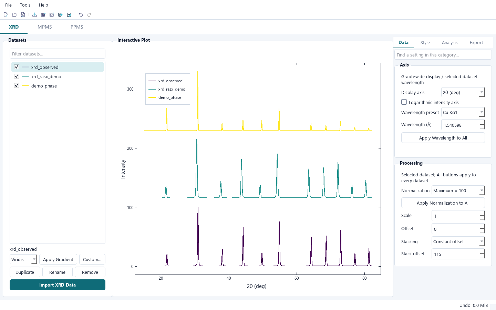

The main window contains:

- **Menu bar:** `File`, `Tools`, and `Help`.
- **Quick toolbar:** compact icons for New, Open, Save, Import, Export Data,
  Export Figure, Send to Igor Pro, Edit current plot in Graph Editor, Undo, and Redo.
  The graph-and-pencil icon opens an independent editable copy of the current plot.
- **Datasets:** visibility check boxes, the active editing selection, and a
  line/marker sample matching each plotted curve.
- **Interactive plot:** displayed data and analysis results.
- **Right panel:** module, dataset, style, and analysis controls.
- **Status bar:** operation and error summaries.

Dragging dataset rows changes both legend order and gradient color assignment.
Use the dataset context menu for `Duplicate`, `Rename`, and `Remove`. Removal
changes the session, so save first when the dataset may be needed later.

Top-level XRD/MPMS/PPMS navigation uses accent-underlined tabs. M–T/M–H, PPMS
measurement types, and heat-capacity/resistivity plot modes use segmented tabs,
giving each navigation level a consistent Light and Dark appearance.

Dataset names can be filtered above the list without changing visibility checks.
Selected-dataset diagnostics appear below it; hover a row for source and warning details.
The right panel groups existing controls under Data, Style, Analysis and Export;
empty categories are hidden. Lattice, occupancy, background and fitting controls are in Analysis.
Line/marker selectors show visual samples, and fill-color fields offer a palette.

`Undo` and `Redo` cover import, duplication, removal, names, ordering,
visibility, styles, and analysis settings. Rapid UI signals are coalesced into
one operation and up to 20 operations are retained. Immutable arrays are shared.
If older array revisions exceed 256 MiB, history is cleared with a notification;
current data is never removed. Graph Editor has its own independent history. `New Session` and
`Open Session` clear history. External source files and files already exported
are never edited by Undo/Redo. The peak-fitting window also has a separate
`Undo Last Fit` for its pre-fit state.

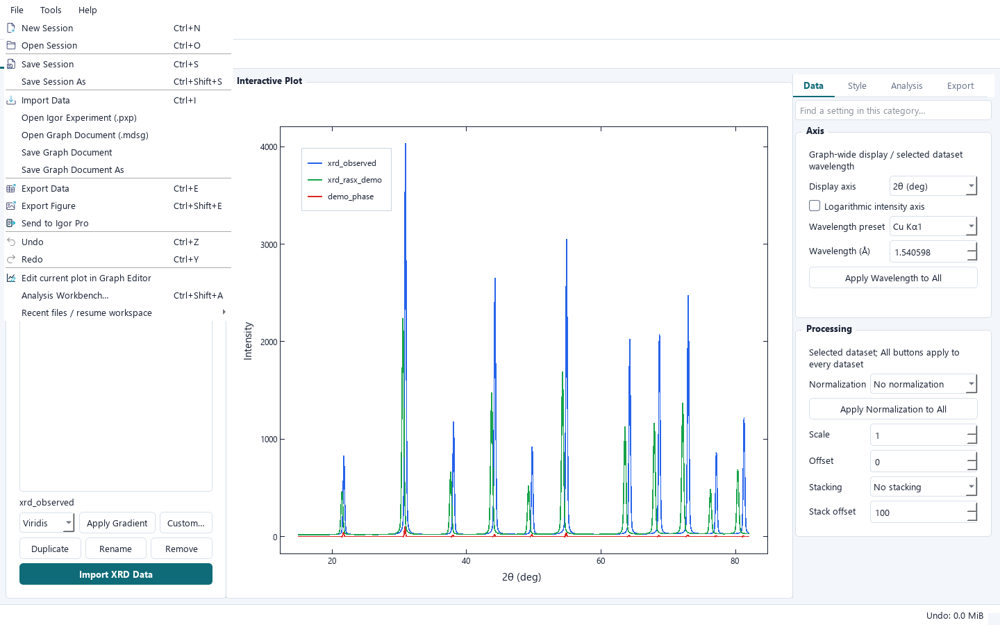

`Save Session As` and other less-frequent actions remain available in `File`,
even when they do not have toolbar icons.

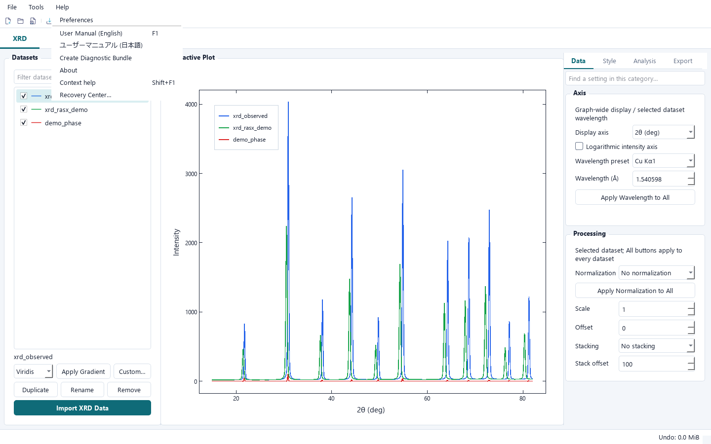

`Help` contains `Preferences`, `User Manual (English)`,
`ユーザーマニュアル (日本語)`, `Create Diagnostic Bundle`, and `About`.

### Panels and action buttons

The central plot receives extra space when the window grows. Drag the column dividers;
double-click one or choose **View → Reset layout** to restore usable widths. **View → Datasets panel**
and **View → Settings panel** show or hide either side, and **View → Focus plot** widens the graph.
The View menu is immediately left of Help; the previous row of display buttons has been removed.
These menu actions apply to the currently selected XRD / MPMS / PPMS workspace.
Panel widths and visibility are remembered. A saved session keeps its own column sizes.

The settings column keeps **Editing target** and the Data / Style / Analysis / Export
tabs visible. The target shows the file, Bridge when relevant, and branch; hover for
the complete path. Scope captions distinguish plot-wide, branch-specific and shared
sample settings. Scroll within the selected category. Use a section's arrow to fold
its body; hidden optional controls remain hidden when you expand it again.

Under Datasets, **Series colors** expands the optional palette controls. **Apply colors**
changes the selected series; Duplicate / Rename and Remove are separate action groups.
The short diagnostic has a **Details…** button for the complete message. Import remains
at the bottom. Color-panel and section expansion states are remembered.

In long Analysis pages, the bottom execution area stays visible and names the active
analysis. Clicking or focusing settings changes its target. Where several analyses are
available, choose the analysis in that area's list. The main Fit action runs only that
analysis on the selected dataset/branch; **Result details…** opens its current summary.
Clear/reset actions remain secondary. In MPMS and PPMS, **View → Residual panel** controls the
residual display independently of refreshing the plot; **View → Restore plot height** restores
its default proportions.

Primary operations use the accent color, supporting actions remain neutral, and deletion
uses a red outline. Stop becomes prominent only while an operation is running. Narrow
windows wrap related button groups together. In Search–Match, adopting/adding results is
separate from source/CIF information. Peak Fitting separates Undo, Reset, save/export and
Close; branch editing keeps Add / Use rows separate from Delete and automatic reset.
**Apply and close** commits branch changes and closes the dialog; Cancel discards them.

### 2.1 Interactive plot controls

Dropdowns and numeric fields do not change value with the mouse wheel, even while focused.
The wheel scrolls the surrounding panel. Change values by clicking, typing, using keyboard arrows
or the field's step buttons. Wheel zoom over a plot remains available.

In the default `Mouse mode: 3 button`, left-drag pans, the wheel zooms, and
right-drag zooms to a rectangular region. Right-click and choose `View All` to
auto-scale both axes. `Plot Options > Legends` toggles the legend. Top and right
spines and inward ticks are visible by default.

Right-click `Export...` to open the combined data/vector/raster/Igor export
dialog. Its plots reserve enough margin to keep the top and right spines and
ticks from being clipped.

### 2.2 Colors, lines, markers, and themes

Use `Line style`, `Line width`, `Marker`, `Marker size`, `Marker fill`, and the
color control for the selected dataset. Gradient presets assign colors in
dataset order; Custom Gradient accepts explicit start and end colors.

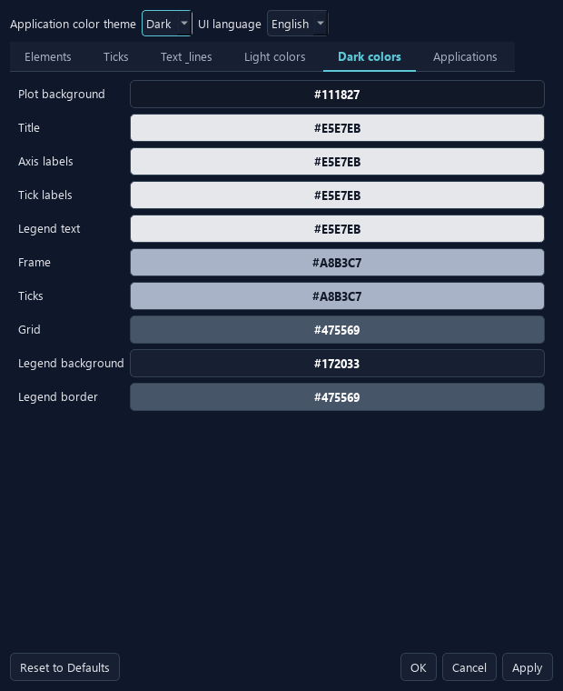

`Help > Preferences` contains the following Interactive plot pages:

- `Elements`: title, labels, legend, grid, and four spines.
- `Ticks`: major/minor ticks and optional fixed x/y intervals. Zero selects an
  interval automatically as the view changes.
- `Text & lines`: font sizes, spine/tick/grid widths, tick lengths, and opacity.
- `Light colors` and `Dark colors`: separate colors for backgrounds, text,
  spines, ticks, grid, and legend.
- `Applications`: the optional Igor Pro 10 executable.

`Apply` updates open plots without closing Preferences. `OK` applies and closes;
`Cancel` keeps the last applied state. Settings persist between launches. The
default Dark plot background is `#111827`. `Reset to Defaults` first asks for
confirmation, then resets the theme, plot settings, and external-application
path.

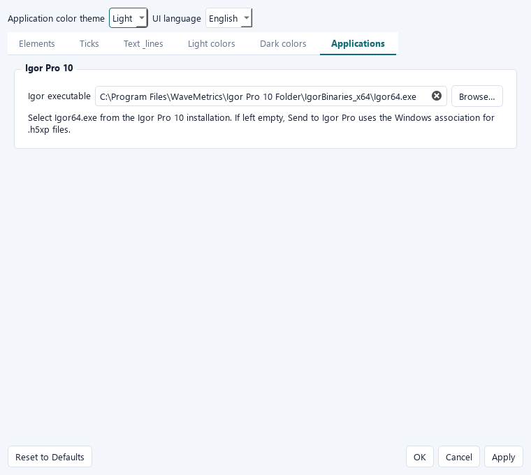

If specified, select `Igor64.exe` or `Igor.exe` and press `Apply` or `OK`.
Leaving the path empty uses the Windows `.h5xp` association.

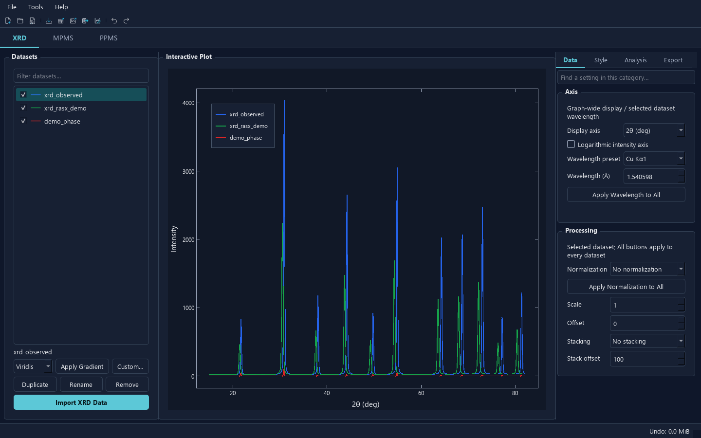

The custom outline icons use dark navy in Light mode and light slate in Dark
mode. Hovering adds a restrained background and shows the action and shortcut.

## 3. XRD

### 3.1 Importing measured data

1. Select `XRD`.
2. Choose `.xy`, `.dat`, `.txt`, `.csv`, or `.rasx` with `Import Data`.
3. For three or more numeric columns, select distinct x and y columns.
4. Select the new dataset and verify its right-panel settings.

Whitespace, commas, and semicolons are detected. Comments and nonnumeric rows
are skipped. At least two different numeric columns are required.

RASX is read directly as a ZIP container. The first and second columns of
`Data0/Profile0.txt` are 2θ and intensity. Missing, encrypted, corrupt, or
over-128-MiB profiles are rejected. Dataset behavior after import matches XY.

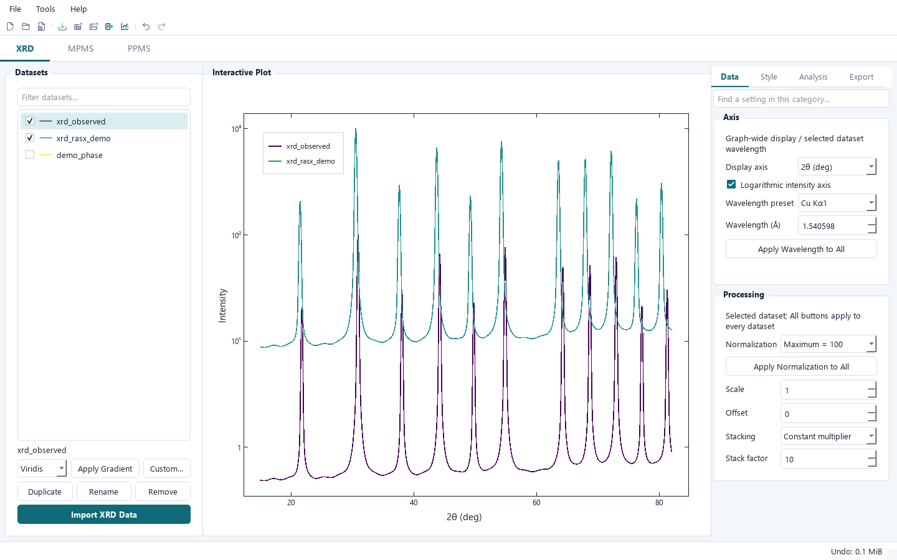

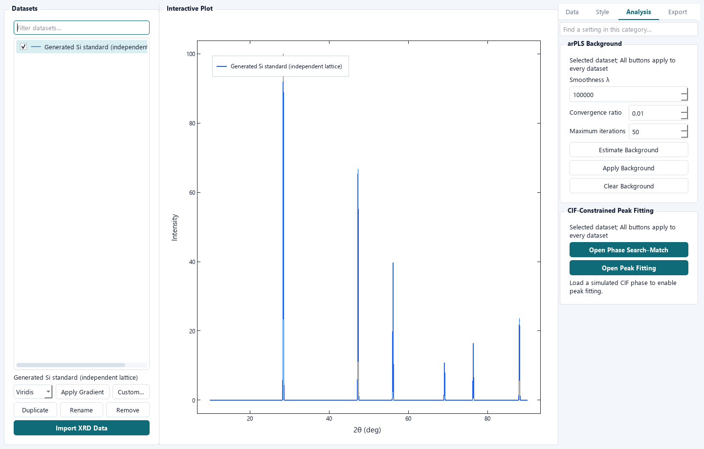

### 3.2 X axis, wavelength, normalization, and stacking

`X axis` provides `2θ`, `d`, `1/d`, and `TOF`. Angle-dispersive conversion uses
`d = λ / (2 sin θ)`. `Apply wavelength to all datasets` copies the selected
wavelength to every XRD dataset. TOF uses
`TOF = DIFA·d² + DIFC·d + TZERO` and requires DIFA or DIFC.

Normalization options are None, maximum to 1, maximum to 100, and integral
area; the adjacent action applies one mode to all datasets. Processing order is
background subtraction, normalization, Scale, then Offset.


`Log Y` requires positive displayed values. In log mode, Constant/Automatic
multiplier stacking multiplies datasets by successive positive `Stack factor`
values: factor 10 gives 1×, 10×, 100×. Linear mode uses additive offsets.

### 3.3 arPLS background

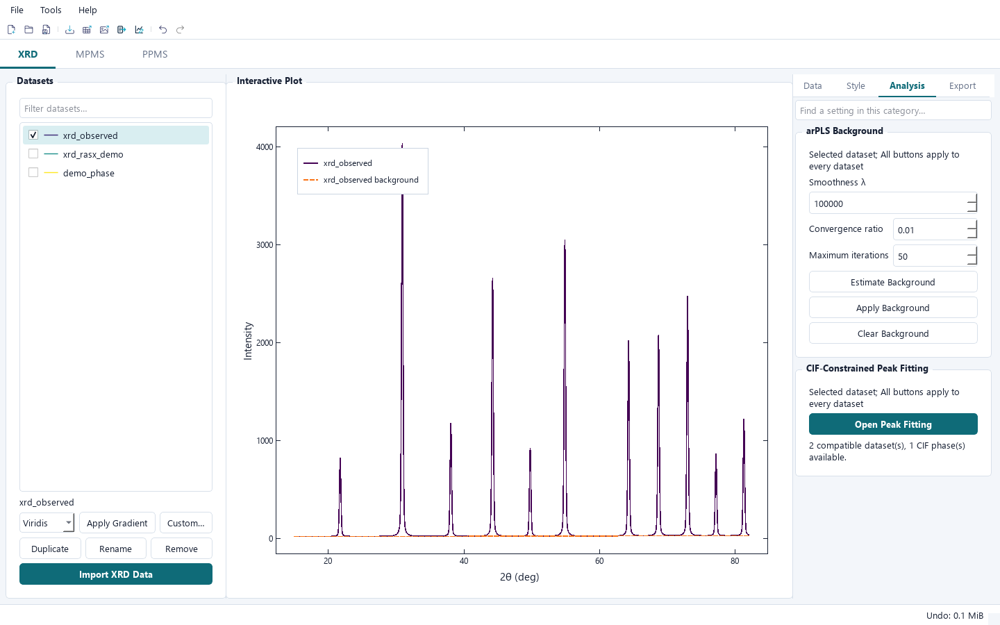

Select measured data, set arPLS parameters, and press `Estimate Background`.
Inspect the overlaid estimate, especially at sharp peaks, amorphous humps, and
measurement edges. `Apply Background` enables subtraction and removes the
preview line; `Clear Background` restores the uncorrected display. Larger λ
generally makes the baseline smoother. Use a convergence ratio between 0 and 1
and a positive iteration count.

### 3.4 CIF editing and simulation

1. Choose a CIF with `Import CIF`.
2. Review `Unit Cell`, `Atom Sites`, and `Simulation` in `CIF Editor`.
3. Edit the space group, cell, sites, wavelength, or 2θ range as needed.
4. Press `Apply and Simulate`.

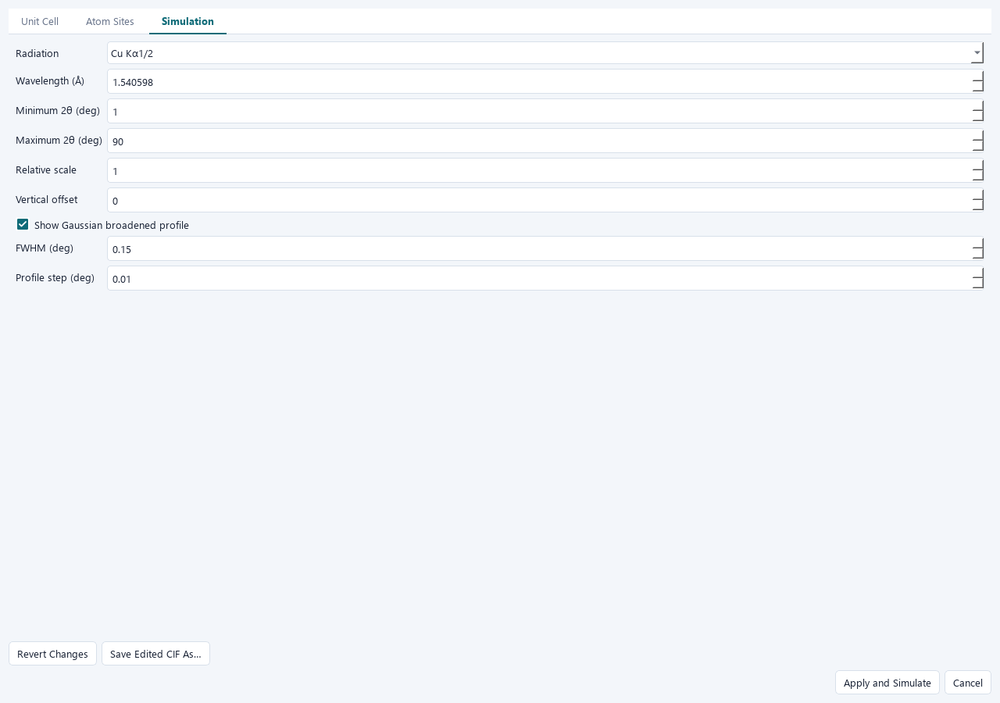

Crystal-system constraints are enforced: for example, tetragonal cells use
`a = b` and `α = β = γ = 90°`. `Revert Changes` restores the imported content.
`Save Edited CIF As…` writes a new file without overwriting the source.
Uncertainty notation such as `2.38(4)` is accepted and the central value is used.

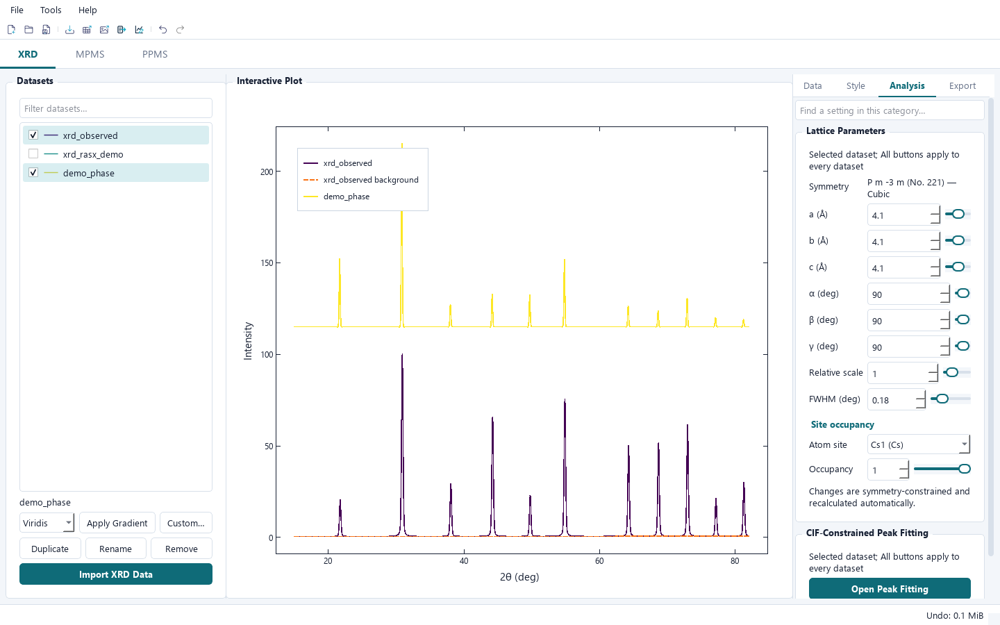

Lattice sliders update peak positions immediately from the current reciprocal
metric. After 90 ms without movement, or when the slider is released, one exact
pymatgen calculation replaces the preview. Obsolete background results are
discarded. `Relative scale` and `FWHM` share the live controls. The default
minimum 2θ is 1 degree. Numeric boxes permit ordinary caret insertion and apply
after Enter or focus change.

`Site occupancy` changes the selected site's occupancy between 0 and 1. A
site-resolved structure-factor cache updates intensities immediately; exact
calculation confirms the result after movement stops. The cache and edited CIF
state are retained in the session. Hovering a simulated peak shows hkl and d.

The simulation uses the selected wavelength and symmetric Gaussian broadening.
Its default is line only, without markers. Choose **Cu Kα1/2** in `Wavelength preset` to include
the doublet in broadened CIF profiles; the wavelength field shows Kα1.
The CIF Editor also provides **Simulation → Radiation**. Initial simulation, CIF editing and
Apply Wavelength to All retain the chosen radiation. Unbroadened displays also show both components. Instrument functions,
preferred orientation, and microstrain are not modeled automatically.

### 3.5 CIF-constrained peak fitting

This is single-phase whole-pattern fitting of one angle-dispersive XRD dataset
against one CIF phase. It uses iterative Le Bail intensity extraction and a
symmetric pseudo-Voigt profile. It is not Rietveld refinement.

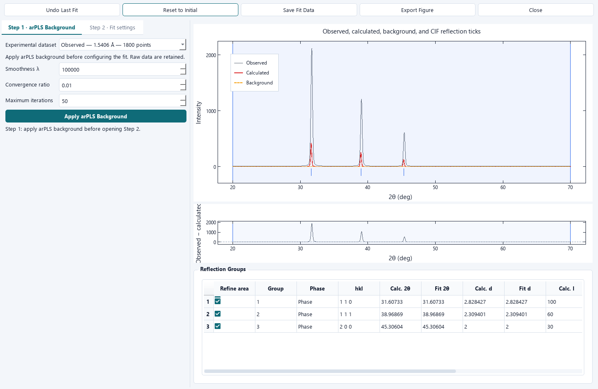

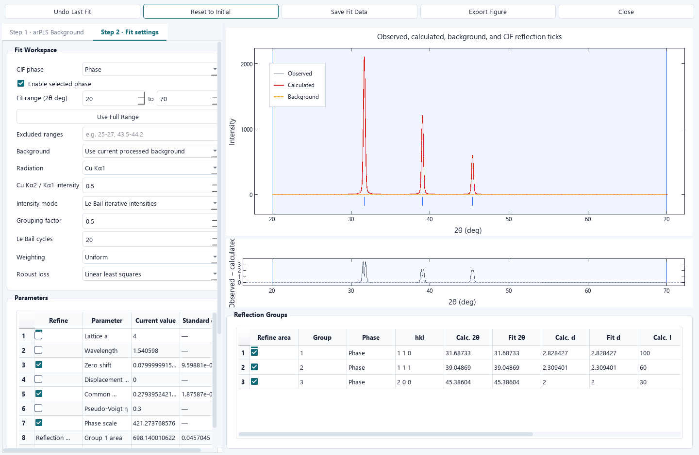

1. Import measured XRD and a CIF simulation.
2. Select the measurement and open `Peak Fitting`.
3. In **Step 1 · arPLS Background**, select the dataset and background smoothness, convergence ratio
   and iteration limit; press **Apply arPLS Background**. This uses the same arPLS as the main Analysis
   tab, subtracts the background and retains raw data. Completion enables Step 2.
4. In **Step 2 · Fit settings**, select the phase, radiation, `Fit range` and optional `Excluded ranges`.
   **Cu Kα1/2** fits a Bragg-constrained pair with an adjustable intensity ratio (default 0.5).
5. Select refinable structural/profile parameters and verify values and bounds.
6. In `Reflection Groups`, choose `Refine area` for each Le Bail group.
7. Press `Run Fit`; inspect progress, calculated pattern, and residual.
8. Apply only wanted values and export the fit data, figure, and log.

Reflection Groups always lists CIF Bragg peaks inside the Fit range and outside
Excluded ranges, including group, phase, hkl, calculated/fitted 2θ and d,
intensity/area, FWHM, and status. Editing either range refreshes the rows
immediately. Group-area refine controls are only in this table; the Parameters
table identifies those rows as managed by Reflection Groups.

The fit uses the arPLS background applied in Step 1 without estimating a second baseline.
Changing datasets or closing/reopening returns to Step 1. A fitted reflection area is the total
area of its two Cu components.

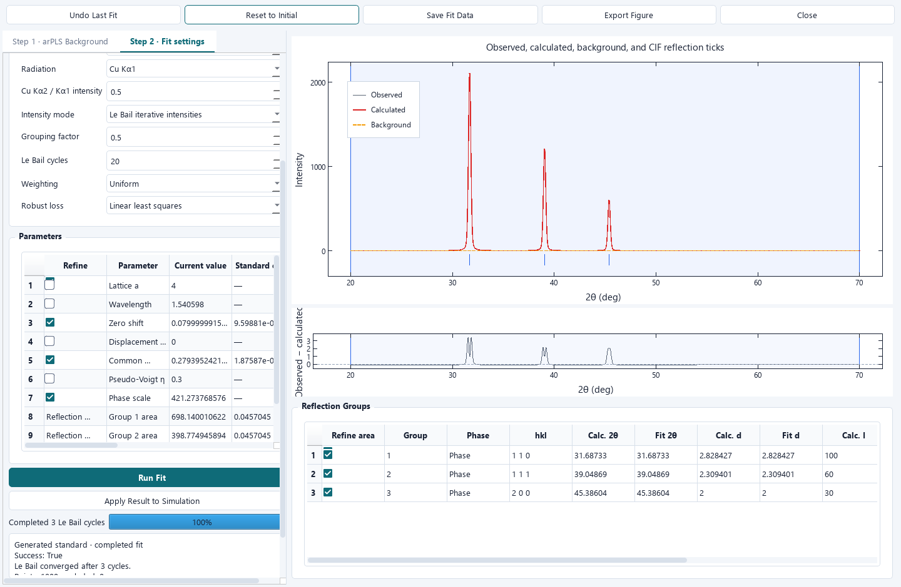

During calculation the button becomes red `Stop Fit`. Cancellation occurs at a
safe calculation boundary. Post-fit `Standard Error` follows `Current value`.
Missing or unstable errors can indicate inadequate range, correlation, bounds,
or signal.

Peak positions approximately follow
`2θcalc = 2 asin(λ/(2d)) + zero shift + displacement·cos(θ)`. The residual is
`observed − calculated`. A small Rwp alone does not validate a crystal structure.
`Undo Last Fit` restores the state immediately before the latest Run Fit.
`Reset to Initial` asks for confirmation before discarding ranges, options,
parameters, and the current result.

Current limitations are one phase and symmetric pseudo-Voigt profiles. Atomic
coordinates, occupancy, displacement parameters, preferred orientation,
anisotropic broadening, microstrain, and phase fractions are not refined. Do not
report the result as Pawley or Rietveld refinement.

### 3.6 Phase Search–Match with an offline reference database

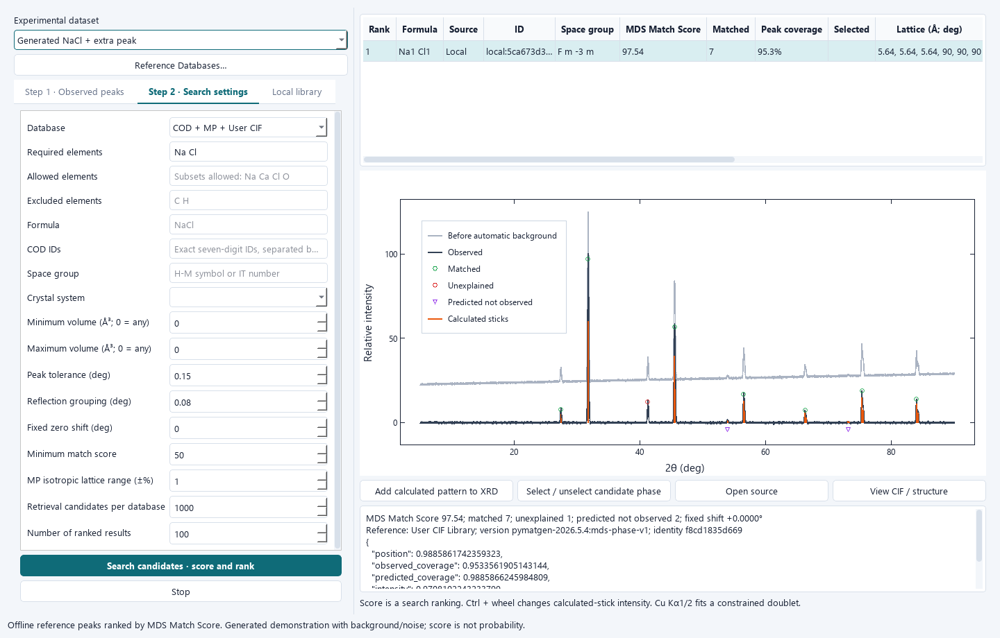

Search compares observed peaks with stored reference diffraction data. Normal searches need neither
CIF downloads nor recalculation of all COD structures. Element constraints are optional.

#### Install a reference database

1. Open **Open Phase Search–Match > Reference Databases…**.
2. **Open official download page** links to the [QualX COD inorganic dataset](https://zenodo.org/records/23297507).
   Download `cod_inorg.zip` and select **Install / Import ZIP…**. Allow space to expand the approximately
   319 MB archive. The database is supplied separately from the EXE.
3. Alternatively, select **Use database folder…** or **Use existing .sq database…**. Existing QualX
   installations can be referenced without copying. Keep all four companion files together.
4. Confirm **Ready**, entry count and version. **Verify** checks integrity; **Open Database Folder**
   opens the location. **Remove registration** retains the files. **Stop** cancels import/verification.

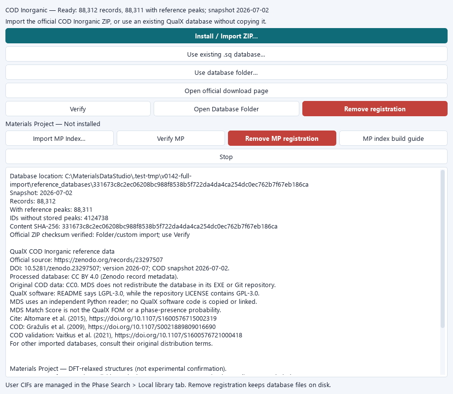

The 2026-07 distribution contains 88,312 IDs. One entry, COD 4124738, has no stored reference peaks;
88,311 can therefore participate in diffraction matching. Database Information exposes source,
version, content identity and terms. The processed dataset is CC BY 4.0; original COD data are CC0.
Cite the references listed in that screen when reporting research using these data.

#### Step 1: review observed peaks

1. Select an experimental XRD dataset and open **Analysis > CIF-Constrained Peak Fitting >
   Open Phase Search–Match**. The current experimental selection is the default.
2. Confirm radiation, wavelength and 2θ limits in **Step 1 · Observed peaks**. **Cu Kα1/2** is the
   first/default radiation. Change it to match the actual measurement when necessary.
3. The teal **Detect peaks** estimates/subtracts background, evaluates noise and fits peaks without
   changing source data. Pale gray shows intensity before automatic subtraction. **Use fitted peaks**
   reuses a saved fit belonging to the same dataset.
4. Cu doublets use a joint Gaussian fit with constrained positions, one physical reflection per pair,
   and Kα1 centers for matching. Representative wavelengths are 1.540598 Å and 1.544426 Å; the default
   Kα2/Kα1 ratio is 0.5. `Cu Kα average` remains a single effective wavelength.
5. Increase `Minimum signal / noise` or `Detection prominence` to suppress noise. **Advanced detection
   settings…** exposes smoothing/noise σ, minimum/maximum FWHM, peak σ, background smoothness and
   Cu intensity ratio. Smoothing σ, peak σ and FWHM are degrees; noise σ uses measured intensity units.
   Noise σ = 0 estimates noise; Peak σ = 0 fits the width, while a positive value fixes it. Re-run
   **Detect peaks** after changes. A red **Stop** is available during detection.
6. Uncheck peaks to exclude them. **Step 2** becomes accessible only after successful detection or
   reuse of fitted peaks. Reopening the window or changing dataset returns to Step 1.

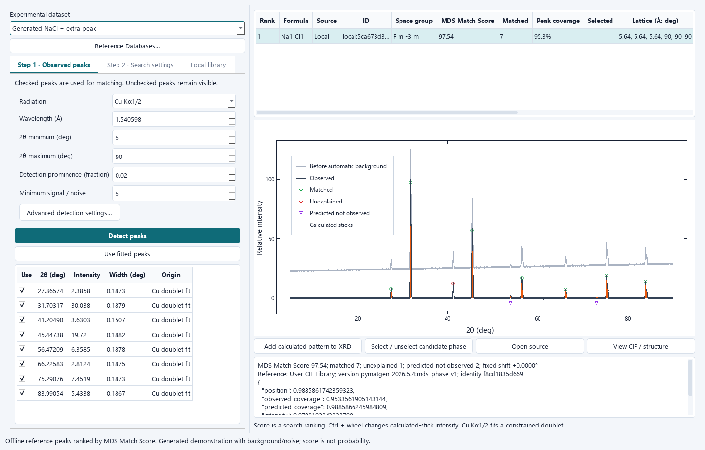

#### Step 2: search candidates

1. Database defaults to **COD + MP + User CIF**; **COD**, **MP** and **User CIF** are also available.
   Installed sources are searched together and interleaved by MDS Match Score. Elements are optional: Required means all specified elements must occur;
   Allowed permits subsets. For example `Na Ca Cl O` includes Na–Cl phases. Excluded elements,
   formula, exact COD IDs, space group, crystal system and volume filters are supported.
2. Confirm tolerance, reflection grouping and fixed zero shift. `Retrieval candidates per database`
   controls detailed matching (default 1,000); `Number of ranked results` controls retained rankings
   (default 100). Increase these when investigating minor phases or broader candidate sets.
3. The teal **Search candidates · score and rank** and red **Stop** are inside Step 2. Search retrieves
   candidates from stored peaks, then evaluates MDS Match Score. Cancellation does not apply partial results.
4. Only phases with assigned reflections and score at/above `Minimum match score` (default 50) appear.
   Change the threshold without searching again. Different COD IDs/structures retain their identities
   even when formulae are identical.
5. Select a row to overlay its sticks. Green marks matched, red unexplained, gray excluded and purple
   triangles predicted-but-unobserved reflections. **Ctrl + mouse wheel** changes stick height only.
   **Open source** opens the reference entry. **View CIF / structure** fetches that single CIF only
   when requested: the reference database has no atomic coordinates.
6. **Select / unselect candidate phase** records adoption. **Add calculated pattern to XRD** creates
   an independent dataset. Reference-only sticks cannot edit atomic structures until the CIF is obtained.
   Add several phases for comparison using ordinary visibility and figure export controls.

From back to front, the search plot draws the faint pre-background curve, the corrected
measurement, peak markers and the selected phase sticks. Candidate changes and redraws retain
this order.

Use **Register CIF files… / folder…** in `Local library` for user structures. Registration copies
contents; re-register edited CIFs. Only user CIFs require calculation, with unchanged content/conditions
reused. Removed registrations disappear at the next search. User CIFs are never uploaded.

#### Saving and interpreting scores

Saving `.mdss` retains peaks/background, settings, reference version/identity, rankings, assignments,
adoption and reference sticks, without embedding the entire database. Saved results remain viewable
if the database is missing; new searches require registration.

**MDS Match Score** is a 0–100 ranking, not a probability or the QualX FOM. Weights are 35% position,
30% observed intensity coverage, 20% reference coverage and 15% intensity agreement. One-to-one
assignments penalize missing strong predictions; excluded peaks do not contribute. Inspect preferred
orientation, overlaps and non-Gaussian profiles. This feature does not perform simultaneous multiphase
optimization, quantitative phase fractions or unknown-cell indexing.

#### Combined COD and Materials Project search

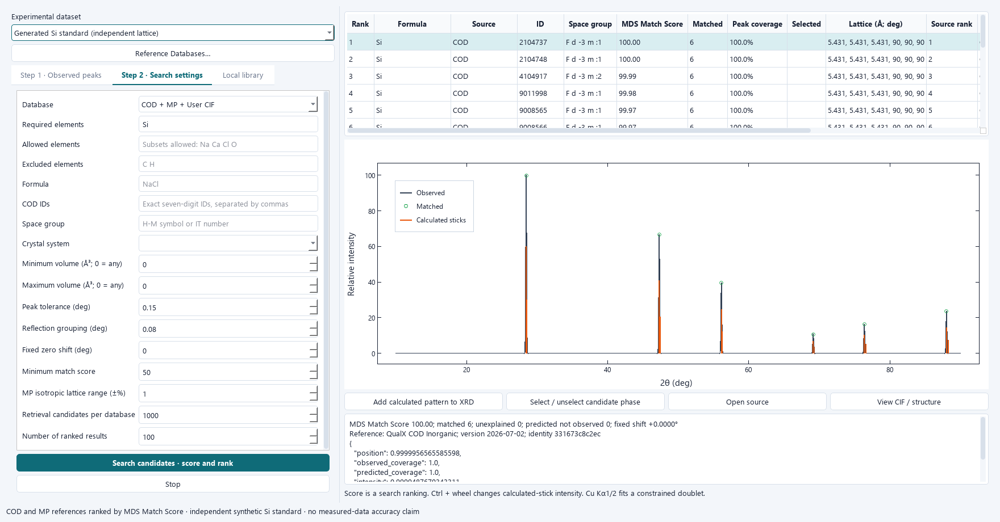

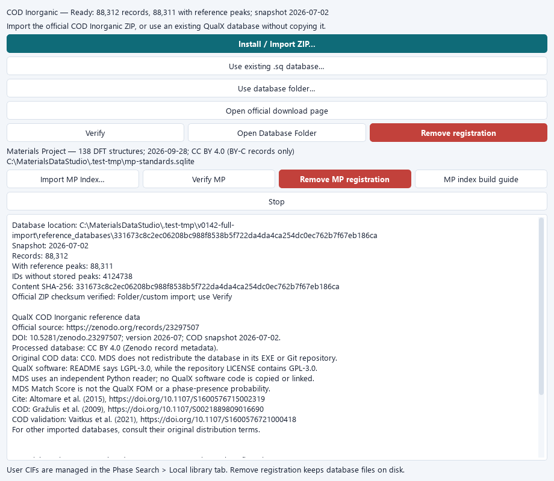

First register an index through **Reference Databases → Import MP Index…**.
Download the COD ZIP from GitHub Releases. MDS does not currently distribute MP database ZIPs, pending the contact about acknowledgements described in the MP Terms. The following MP import instructions apply only to lawfully obtained compatible indexes.
For COD, use **Reference Databases → Install / Import ZIP…**. For MP, put both ZIPs in one folder,
keep their names unchanged, and select either one in **Import MP Index…**. MDS restores and verifies
the complete database; manual extraction or joining is unnecessary. Missing/mixed/corrupt parts
produce an error and retain the previous registration. Existing SQLite indexes can also be registered.

**COD + MP + User CIF** searches installed sources on equal terms and sorts all results by
MDS Match Score, regardless of the number of COD matches. Missing sources are reported while
available sources continue. Choose **COD** for COD-only searches. Red registration-removal buttons
ask for confirmation and retain database files. The search window supports maximization.
If fewer than ten assigned candidates meet the score threshold, it is automatically lowered to show
up to ten available positive-score candidates. The actual cutoff and adjustment are displayed;
scores and chemical constraints are unchanged. You can still change the cutoff manually.

- MP candidates are labelled **MP — DFT-relaxed**, distinguishing computed structures from experimental references.
- **MP isotropic lattice range (±%)**, initially ±1%, permits a small DFT cell mismatch. The correction
  incurs a score penalty and appears as **Cell scale**. It is separate from **Fixed zero shift**.
- Matched/unexplained and other matching markers appear only in this search window, not in the main Interactive plot.
- Compare the combined ranking with **Source rank**. A shared **Possible group** marks similar composition,
  space group and cell, without proving structural identity or removing separate records.
- **Hull (eV/atom)** provides stability context; metastable candidates are not excluded.
- **View CIF / structure** shows the original local DFT structure; **Export selected CIF…** saves it.
  Search-scale corrections are recorded separately and are not silently applied to the exported structure.
- **Stop** is subdued while idle and highlighted during a search.

An MP match does not establish experimental phase identity. Inspect correction size, measurement range
and unmatched peaks. See the [Materials Project setup/build guide](https://github.com/tanabe0719/MaterialsDataStudio-public/blob/main/docs/phase_search/materials_project.md).

## 4. MPMS

### 4.1 DAT import and sample information

Open a Quantum Design DC DAT in `MPMS`. The importer reads `INFO, WEIGHT` from
`[Header]` and temperature, field, and moment from `[Data]`. Verify or correct
sample mass in mg. Applying a formula calculates molar mass and
`n = mass(mg)×10⁻³ / molar mass(g mol⁻¹)`.

### Selecting files and branches

Datasets shows the source file as a parent and ZFC/FC, field blocks or M–H sweeps as children.
Select a child to edit Style or Analysis. Visibility, appearance, fit settings and results are independent for each child.
Sample mass, formula and molar mass are shared across all branches from the same file.

Right-click the parent and choose `Manually configure branches…` to inspect the original data table and graph.
Select raw table rows or drag the graph interval; use `Add branch`, `Use selected rows`, or `Delete branch`.
Edit names and inclusive first/last rows directly in the branch list. Row numbers start at zero.
Use `mt` for M–T or `mh` for M–H in Mode. `Apply` commits; `Cancel` leaves the branches unchanged.
Removing a branch retains the parent's original data. Older session results remain on the parent and are not reassigned to a different subset.

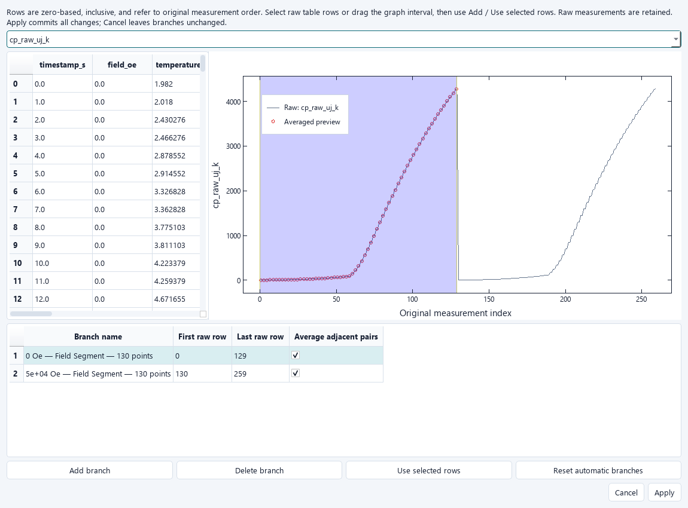

### 4.2 M–T, ZFC/FC, and Curie–Weiss

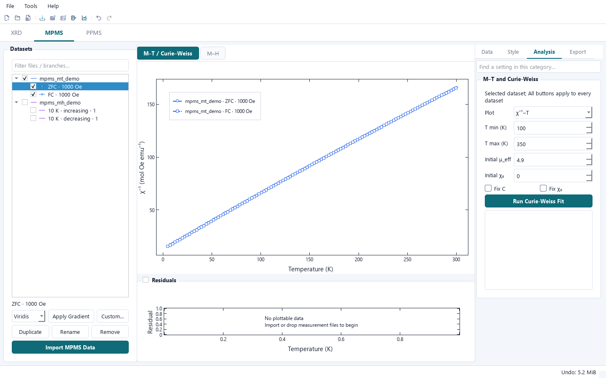

Choose `χ⁻¹–T`, `χ–T`, or `Raw M–T`. Molar susceptibility is
`χ = moment / (field × amount)`. Values near χ = 0 make χ⁻¹ diverge.

`Automatic` divides ZFC and FC in measurement order. The point immediately
before the first temperature decrease ends ZFC; the first decreasing point
starts FC. Right-click the parent file and choose `Manually configure branches…` when the automatic boundary does not match the protocol. `View All` restores both segments after zooming.

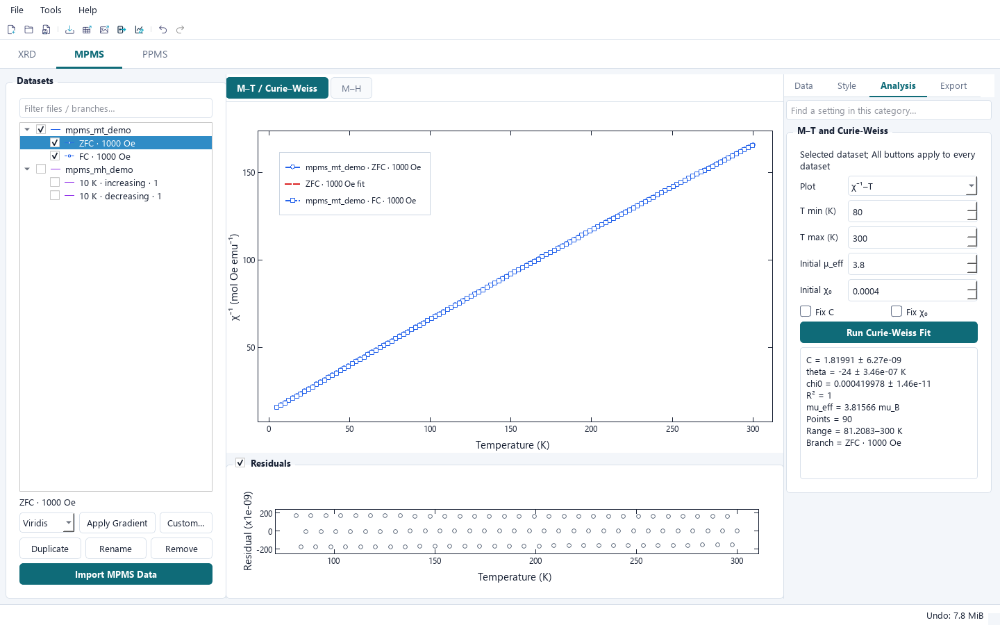

Select the FC or ZFC child in Datasets, set the temperature range in Analysis, optionally fix C or χ0, and fit
`χ = χ0 + C/(T−θ)`. The displayed inverse curve uses the inverse of the same
model. `μeff = √(8C)` assumes cgs molar susceptibility. Always inspect the fit
range and residual.

### 4.3 M–H

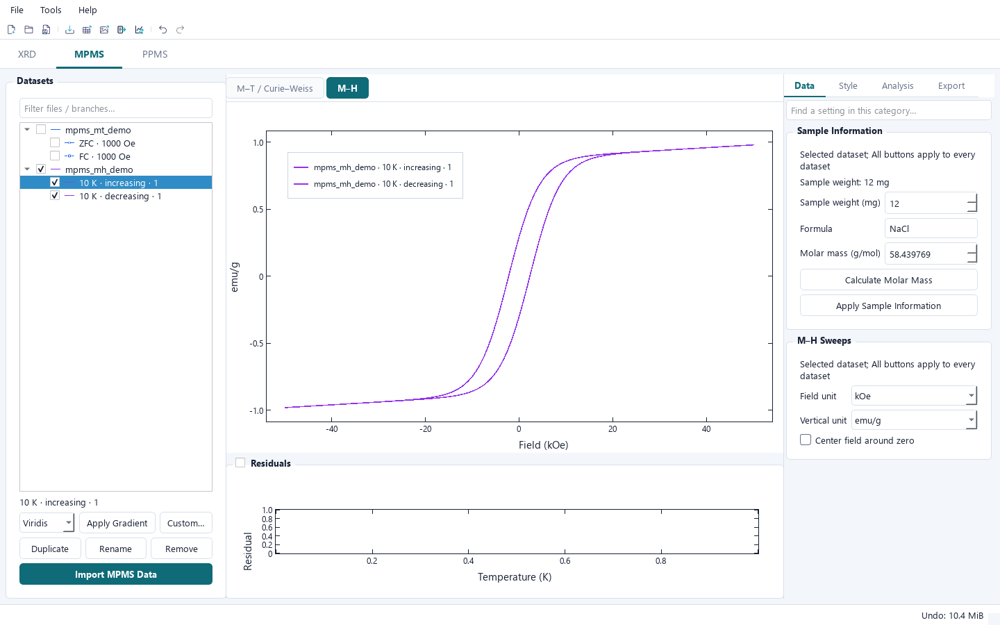

M–H detects field sweeps in acquisition order. Field units are Oe, kOe, or T;
magnetization units include emu, emu g⁻¹, emu mol⁻¹, and μB f.u.⁻¹. The
conversions are 1 kOe = 1000 Oe and 1 T = 10000 Oe. Mass and molar units require
correct sample information.

## 5. PPMS Heat Capacity

### 5.1 Import and preprocessing

In `PPMS > Heat Cap.`, import a DAT containing Field, Sample Temp, and Samp HC.
Formula and mass convert raw µJ K⁻¹ to J mol⁻¹ K⁻¹. Adjacent pairs within 0.1 K
and 100 Oe are averaged, including temperature, field and heat capacity.
Independent uncertainties propagate as sqrt(sigma1^2 + sigma2^2) / 2, not a simple mean.
An unmatched final point is retained, and exports preserve corresponding original row bounds.
Old averaging caches and fits are invalidated with a warning; re-run affected fits.
Initial branches split at adjacent field changes greater than 100 Oe. Add temperature intervals in the manual branch editor when needed.

Datasets shows field branches beneath the original file. Sample information is common to the file;
Style, analysis parameters and results belong to each selected child.
Right-click the parent to add, remove or rename branches, or split a temperature interval.
In this dialog, toggle `Average adjacent pairs` for each branch while inspecting the preview.
Averaging never crosses a branch boundary; disabling it uses the original individual measurements.

### 5.2 Cp–T and C/T–T²

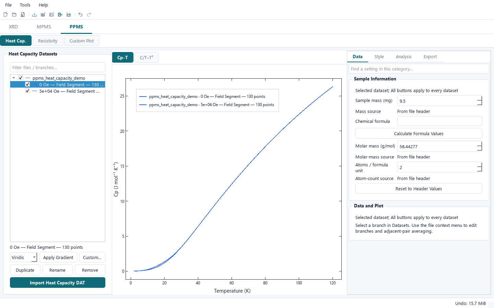

Switch with the `Cp–T` and `C/T–T²` tabs. Dataset color, line, marker, and
`Marker fill` work like other modules.

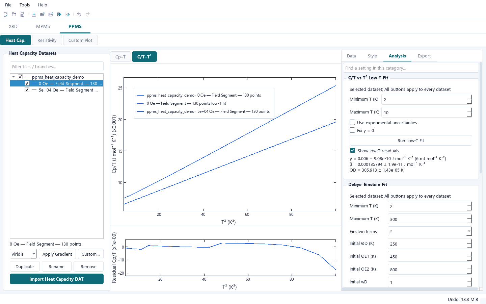

The low-temperature model is `Cp/T = γ + βT²`. `Fix gamma to 0` constrains γ.
For formula-unit atom count n,
`ΘD = [12π⁴nR/(5β)]^(1/3)`. β must be positive for a real Debye temperature.
Exclude transitions and other contributions that invalidate the linear model.

### 5.3 Debye–Einstein and entropy

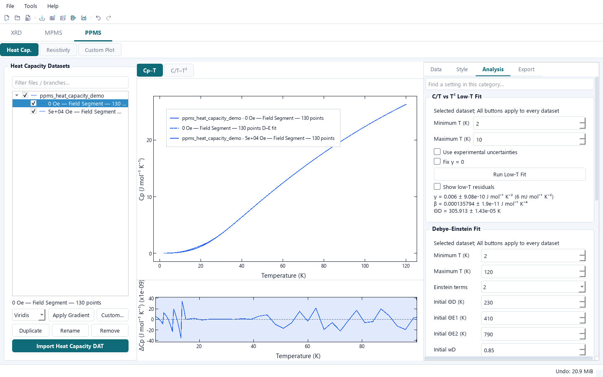

The lattice model is `Cp = γT + wD CD(T,ΘD) + Σwi CE(T,ΘEi)` with zero to two
Einstein terms. Parameters can be fixed or refined, with atom-count weight
constraints and fit/exclusion ranges. Inspect the residual.

Entropy integrates the displayed `ΔCp/T` by the trapezoidal rule after averaging
duplicate temperatures. It depends on the lattice reference, lower limit, and
treatment of unmeasured low-temperature data.

## 6. PPMS Electrical Resistivity

### 6.1 Import, Bridge, and geometry

`PPMS > Resistivity` detects resistance or resistivity columns for Bridges 1–4.
The available geometry correction is only `width × thickness / contact length`:
`ρ(Ω cm) = R(Ω) × width × thickness / contact length`. Keep all lengths in cm.
Input Ω m is multiplied by 100; mΩ cm is multiplied by 10⁻³.

Datasets has three levels: source file → Bridge → branch. Bridges containing only invalid values are omitted.
Select a child for geometry in Data, line/marker appearance in Style and fitting in Analysis.
There are no additional Bridge or branch selectors in the right column.
Right-click the source file to add, remove, rename or change branch bounds against the raw table and graph.
Manual Mode is `rho_t` for temperature sweeps or `rho_h` for field sweeps.

### 6.2 ρ–T, Arrhenius, and VRH

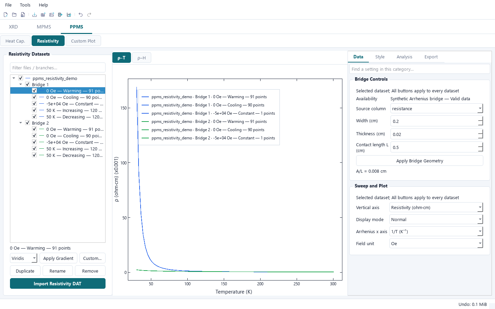

Switch between `ρ–T` and `ρ–H`. ρ–T segments use 0.05 K and ρ–H segments use
50 Oe to classify decreasing, constant, and increasing intervals.

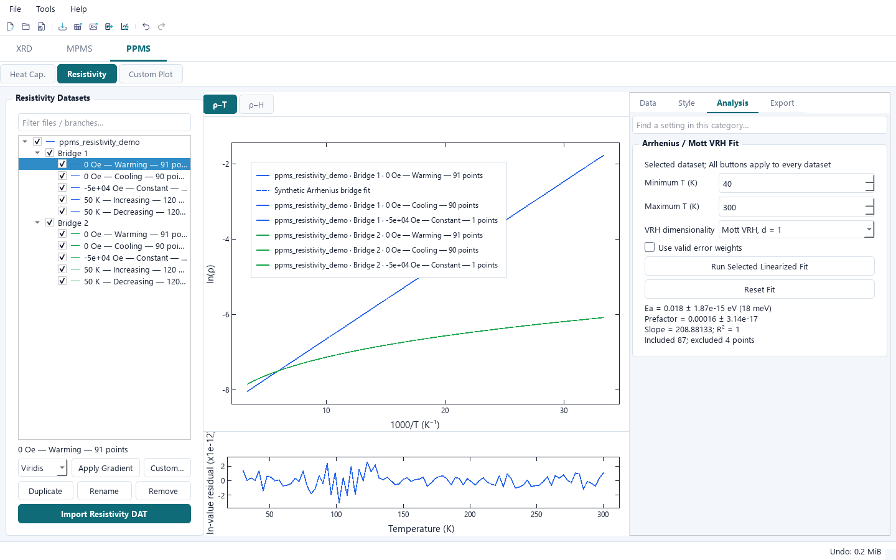

Arrhenius fitting uses `ln(ρ) = ln(ρ0) + Ea/(kBT)` and fits ln(ρ) against 1/T.
`Ea = slope × kB`, where `kB = 8.617333262×10⁻⁵ eV K⁻¹`.
`Run selected linearized fit` requires a child branch selected under its Bridge in Datasets, a temperature range, and positive finite data.

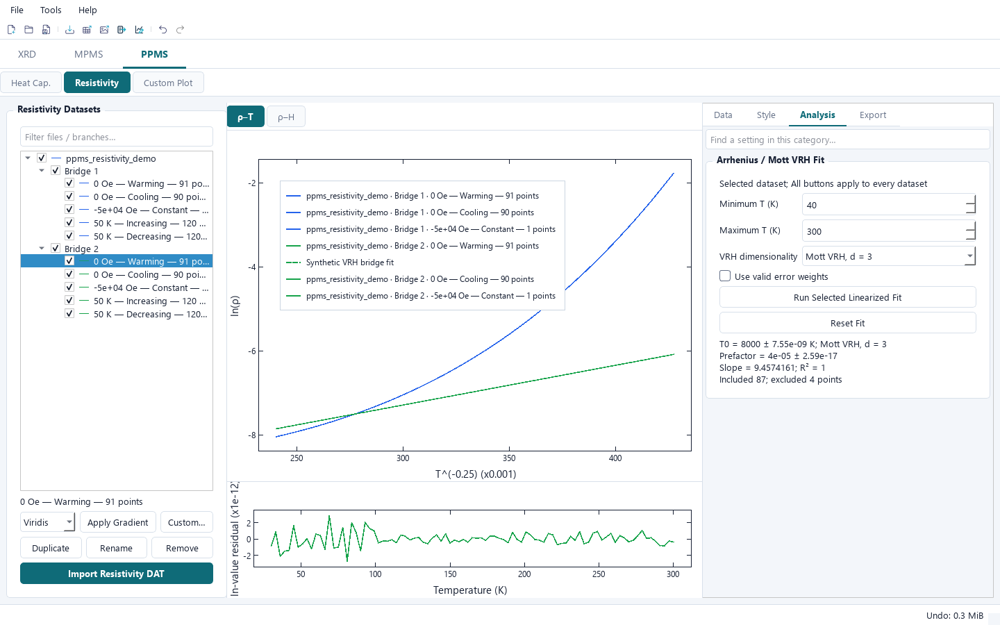

For Mott VRH dimension d, `p = 1/(d+1)` and
`ln(ρ) = ln(ρ0) + (T0/T)^p`; `T0 = slope^(1/p)`. Compare residual structure,
range, and physical transport mechanisms, not only R². Nonpositive values
cannot be logarithmically transformed.

### 6.3 ρ–H

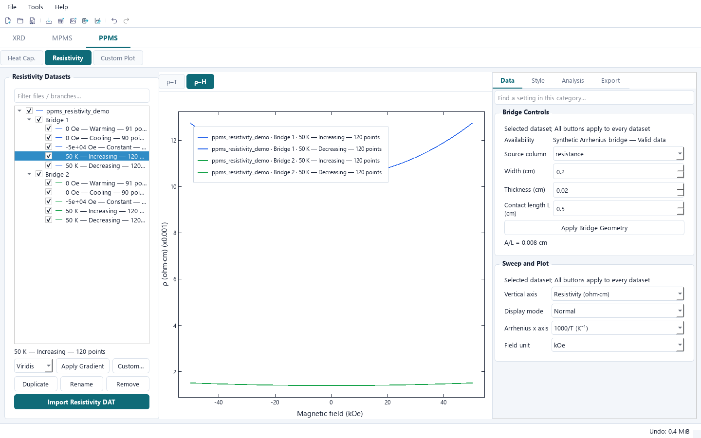

ρ–H compares field-sweep segments; changes of at most 50 Oe are constant. The
current version has no dedicated Hall coefficient, carrier density, or critical
temperature analysis.

## 7. PPMS Custom Plot

### 7.1 Importing an arbitrary DAT

Select `PPMS > Custom Plot` before dropping or opening a DAT. Heat-capacity DATs
opened here remain in Custom Plot. Sample weight comes from `[Header]`; every
`[Data]` column is retained. Formula-to-moles behavior matches MPMS.

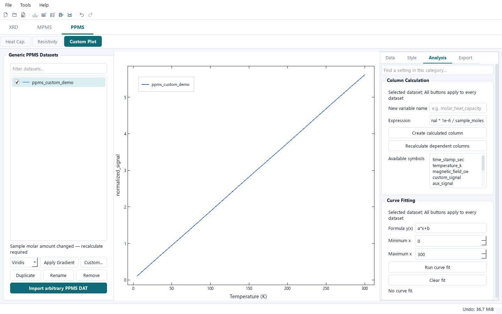

Duplicate, delete, or edit a selected working column. These operations do not
rewrite the source DAT.

### 7.2 Column Calculation

Name a column, copy symbols from the vertically scrollable `Available symbols`,
enter an expression, and calculate. Available functions include `abs`, `sqrt`,
`exp`, `log`, `log10`, `sin`, `cos`, `tan`, `minimum`, `maximum`, and `where`,
with constants `pi` and `e`. Arbitrary Python statements, attribute access, and
file operations are prohibited.

### 7.3 Curve Fitting

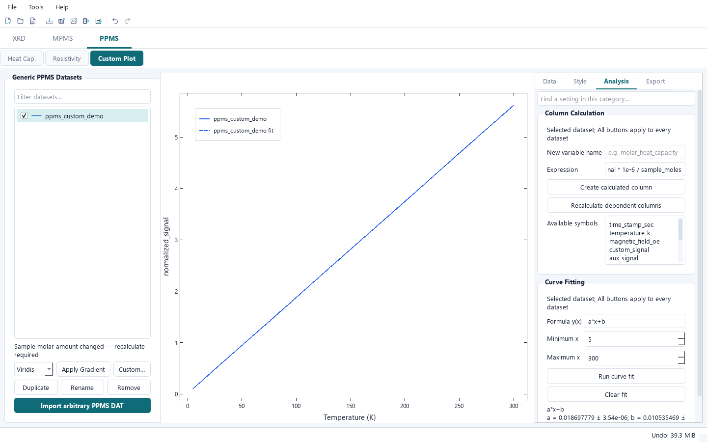

Choose numeric x/y columns, enter a formula such as `a*x + b`, and set the x
range. Unknown names become fitted parameters. Review values, standard errors,
R², curve, and residual. Strong nonlinearity, correlation, or singularities can
prevent convergence; dimensional consistency remains the user's responsibility.

## 8. Tools

`Tools` lists only implemented utilities: `Molecular Weight Calculator`,
`Shannon Radii`, `RASX Converter`, and `Graph Editor / Igor Import`.

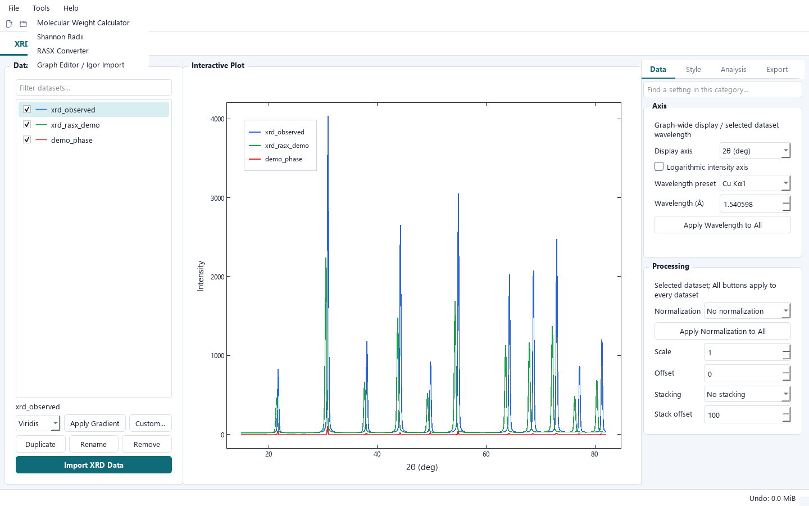

Tool windows are nonmodal, permit simultaneous main-window use and multiple
instances, and do not minimize with the main window. Their output files are not
part of session Undo/Redo.

### 8.1 Molecular Weight Calculator

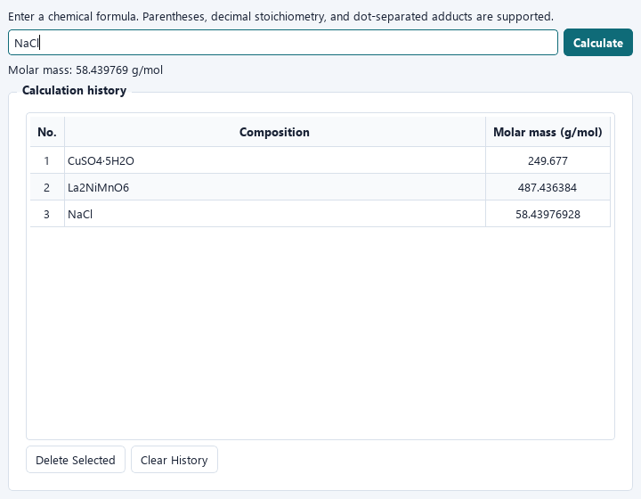

`Calculate` uses the shared formula parser and atomic masses. Formula and molar
mass are appended to `Calculation history`; remove rows with `Delete Selected`
or erase the list with `Clear History`. The history lasts only for that tool
window. Parentheses, decimal stoichiometry, and middle-dot adducts such as
`CuSO4·5H2O` are supported.

### 8.2 Shannon Radii

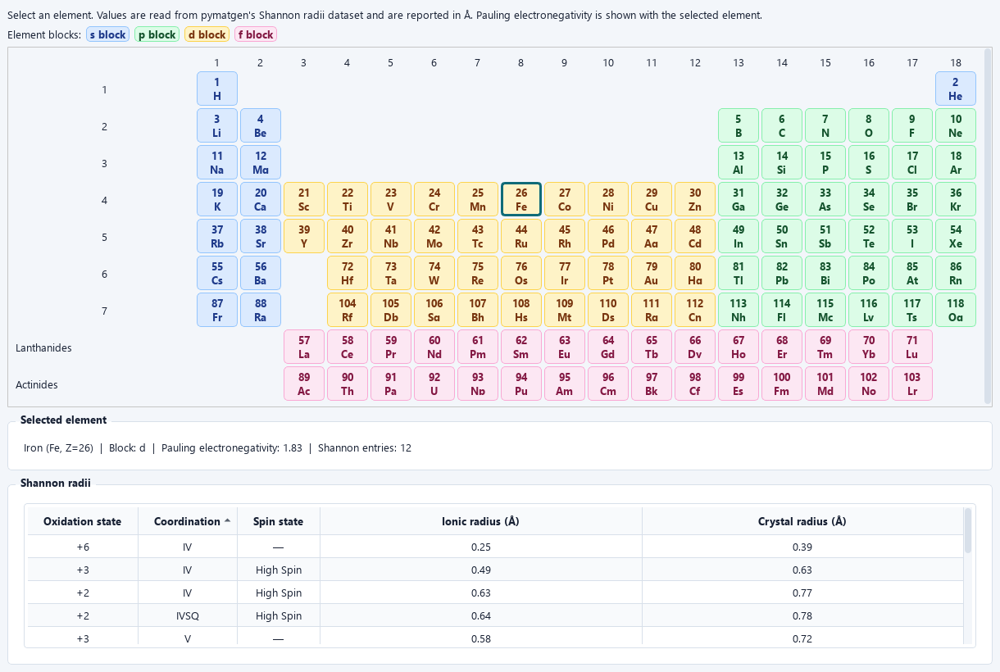

Select an element to list oxidation state, Coordination, spin state, ionic
radius, and crystal radius in Å from pymatgen's bundled
`Element.data["Shannon radii"]`. The periodic table is colored by s/p/d/f block,
and the element summary includes Pauling electronegativity from
`Element.data["X"]`.

Click any table header to sort. Coordination sorts by the numeric value of its
Roman numeral (I, II, III, IV, …), including pymatgen's suffixed coordination
labels, rather than lexicographically. Alternating rows and content-aware widths
keep the table readable.

### 8.3 RASX Converter

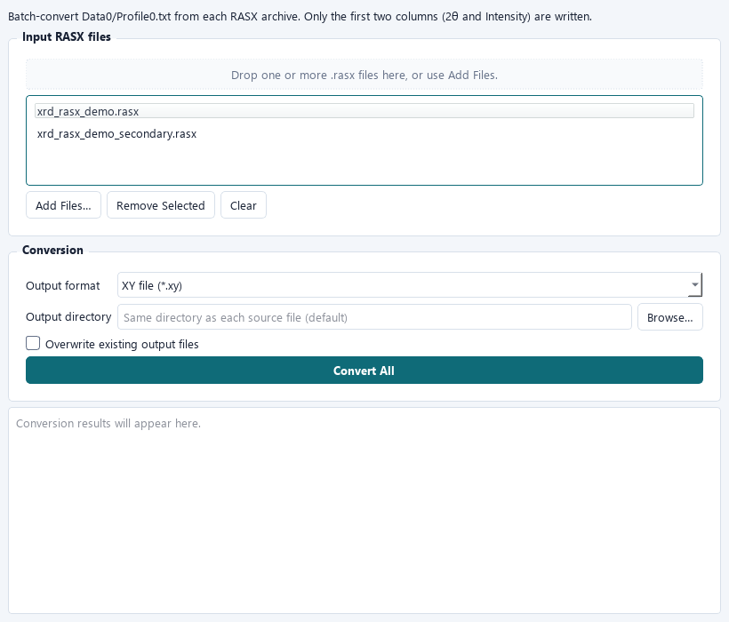

Drop `.rasx` files or use `Add Files…`, choose XY (default) or DAT, optionally
select a common output folder, then press `Convert All`. The safe XRD RASX parser
writes the first two Profile0 columns as tab-delimited 2θ and intensity. Source
files are unchanged. Existing outputs are skipped unless `Overwrite existing
output files` is deliberately enabled. Review each success/failure in the log.

### 8.4 Igor PXP Viewer

The independent **Graph Viewer / Graph Editor** imports Igor experiments and supports
wave/table browsing, graph editing, drawing, calculations, fitting and figure/data export.
The original experiment stays unchanged; editable work is saved separately as `.mdsg`.

Open **Tools > Graph Editor / Igor Import**, or drop `.pxp`, `.mdsg`, `.h5xp` or `.ipf`
onto the main window. IPF opens a conversion preview, never automatic execution.
Use **File > Edit current plot in Graph Editor** or the graph-and-pencil toolbar
icon to transfer the current main plot without requiring Igor Pro.

For all detailed instructions, open the viewer's **Help > Graph Viewer Manual (English)**
(F1) or its Japanese manual. Python, allowed modules and the mds API are under
**Help > Python / mds Help…** in the same viewer.

## 9. Sessions

The Windows distribution registers MDS as an available handler for `.mdss` sessions and `.mdsg` graph documents.
Choose Materials Data Studio for each extension in Windows Settings → Apps → Default apps.
Preferences → Applications → `Register MDS / open Windows Default Apps` also opens this setup.
After selecting the defaults, double-click files in Explorer to open them. The S and G icons distinguish the document types.
If you move the application folder, launch MDS from its new location to update registration.


A `.mdss` session stores imported data, display state, and analysis settings.
`New Session`, `Open Session`, and `Save Session` are in both File and the quick
toolbar; `Save Session As` is in File.

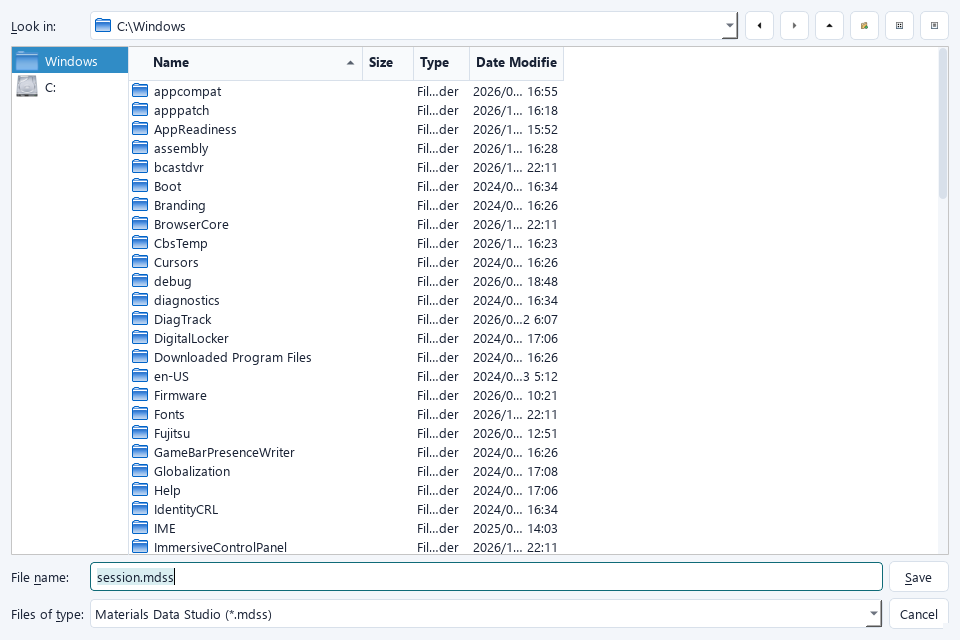

Sessions are ZIP containers holding JSON, NumPy arrays, and required source
content without Python pickle. Unsafe paths, missing required arrays, newer
schemas, excessive member counts or expansion sizes, large manifests, and
extreme compression ratios are rejected before extraction. Legacy `.mdsession`
files remain readable; new files use `.mdss`.

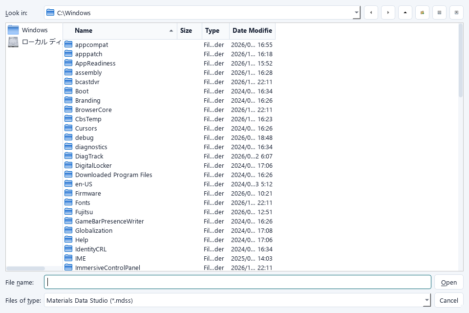

Keep source instrument DAT/CIF files, the application version, and exported
results beside long-term session archives.

### 9.1 Automatic recovery

An unsaved workspace containing data is copied to the application recovery area
about every 60 seconds. Atomic saving is used without changing the normal save
path. Saving, New, Open, and normal shutdown remove the current recovery copy.
The next launch offers a copy left by a process that is no longer running.
Independent candidates are offered newest first. No keeps a candidate and offers the next;
Cancel preserves all remaining candidates. Failed recovery copies are never deleted automatically,
and successfully recovered originals remain until explicit saving or clean closing.
Old copies are not removed merely because of age. Windows process queries send no signals
and check process start time against the snapshot to detect reused PIDs.
Recovery does not replace normal saving.

### 9.2 Source repository and publication safety

Do not commit measurements, sample names, unpublished conditions, sessions,
exports, credentials, keys, or environment files. `.gitignore` excludes common
private-data and build paths. `docs/demo_data/` contains synthetic manual/test
data. Materials Data Studio processes locally and has no telemetry or automatic
upload, but files manually placed in cloud or GitHub locations follow those
services' access rules. Inspect `git status` before every commit.

## 10. In-application User Manuals

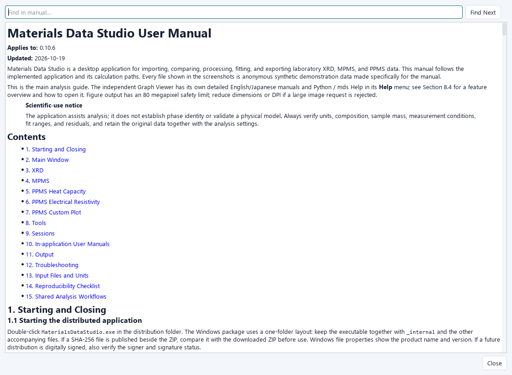

F1 or `Help > User Manual (English)` opens this English manual by default.
`Help > ユーザーマニュアル (日本語)` opens the Japanese edition in the same
searchable reader. Enter text in `Find in manual…` and press Enter or
`Find Next`. Search wraps at the end and reports `Match found`,
`Wrapped to start`, or `No matches` without closing the window.

The linked Contents navigate within the selected language edition. Images are
bundled and require no network connection. External web links, if present, open
with the default browser.

## 11. Output

### 11.1 Numeric data

`File > Export Data`, Ctrl+E, and Interactive plot `Export...` open the same
`Export Interactive Plot` dialog. The `Data` page initially selects all visible
curves. Deselect unwanted curves, choose CSV or TSV, and save. Each curve uses
named x/y columns; shorter curves leave blank cells.

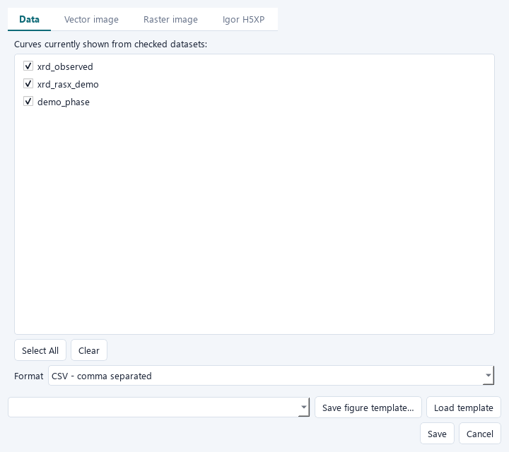

### 11.2 Figures

`Export Figure` uses the module's publication-figure controls. Select size,
DPI, file type, and transparent background where available. SVG and PDF preserve
vectors; PNG, TIFF, and JPEG are raster formats. Verify labels, units, crop,
legend, line widths, and resolution after export.

### 11.3 Interactive plot context-menu export


The combined dialog has four pages:

- `Data`: CSV or TSV for selected visible curves.
- `Vector image`: SVG or PDF, physical width/height, and transparency.
- `Raster image`: PNG, TIFF, or JPEG, physical size, DPI, and transparency.
  JPEG disables transparency.
- `Igor H5XP`: saves editable waves, trace styles, axes, ranges, legend, and a
  native Igor graph without launching Igor.

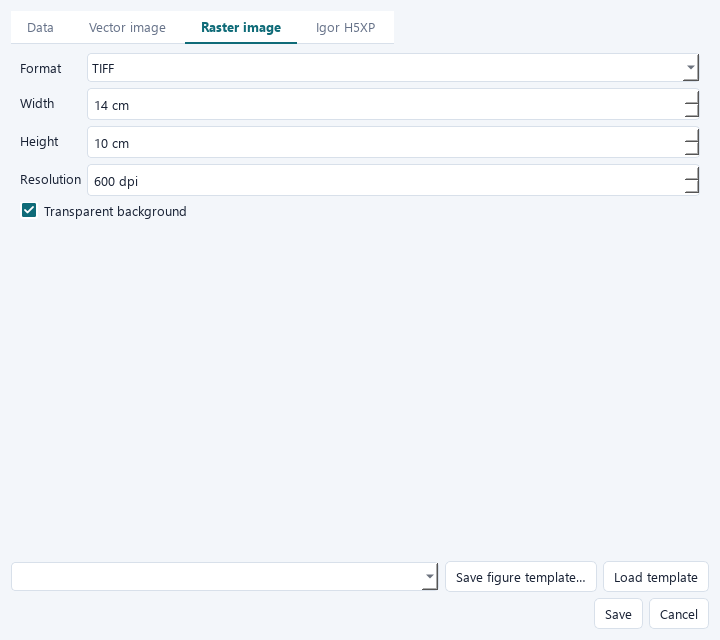

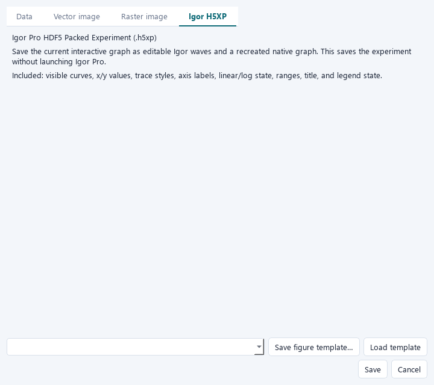

Image export uses the visible x/y range and the active Light/Dark plot settings.

### 11.4 Send to Igor Pro

`File > Send to Igor Pro` or the toolbar icon immediately to the right of Export
Figure converts the current XRD/MPMS/PPMS Interactive plot into an HDF5 Packed
Experiment (`.h5xp`) and opens it in Igor Pro 10 without a destination dialog.
Visible x/y values, names, lines, markers, colors, labels, legend, fixed ranges,
and linear/log state become editable Igor waves and a native graph. Visible XRD
CIF phases include Bragg-position waves and marker traces.

Transferred graphs set all ticks inward (`tick=2`), show top/right frames
(`mirror=1`), and omit units from tick labels (`tickUnit=1`). Other explicitly
mapped settings and Igor defaults remain unchanged.

Configure Igor in `Help > Preferences > Applications`, or leave it blank to use
the Windows association. Each transfer writes a unique temporary file below
`%TEMP%\MaterialsDataStudio\IgorTransfer`. Files older than seven days are
cleaned on a later transfer. A generation error prevents launch; a launch error
retains the valid file and reports its path. Send to Igor does not change the
MDS session or Undo/Redo state. Save the experiment from Igor when required.

## 12. Troubleshooting

### A file does not import

- XRD needs at least two numeric columns and distinct nonnegative x/y indices.
- MPMS needs `[Data]`, temperature, field, moment, and required weight metadata.
- Heat Capacity needs Field, Sample Temp, and Samp HC.
- Resistivity needs a Bridge resistance or resistivity column.
- Try an untouched copy of the instrument output if a spreadsheet changed its
  delimiter, column names, or numeric notation.

### A plot is empty or a curve disappears

1. Check dataset visibility.
2. Right-click and select `View All`.
3. Check Scale, Offset, and fixed axis ranges.
4. On Log Y, verify that displayed values are positive.
5. Temporarily remove normalization/background processing.
6. Verify the selected MPMS/PPMS segment and plot tab.

### CIF simulation or peak fitting cannot start

- Verify a valid CIF simulation and an angle-dispersive 2θ measurement. TOF is
  not currently supported by CIF-constrained fitting.
- Check positive finite wavelength, range, lattice, and FWHM.
- Include enough measured points and visible reflections.
- Wait for a requested Stop Fit to complete before rerunning.

### A fit is unstable

- Use physically plausible initial values and bounds.
- Refine fewer correlated parameters at once.
- Inspect background, edges, foreign peaks, and outliers.
- Compare fit ranges, standard errors, and systematic residuals.
- Do not select a model solely by R² or Rwp.

### Igor does not start

- Check that Preferences points to the current `Igor64.exe`.
- With an empty path, check the Windows `.h5xp` association.
- Open the retained temporary file manually from Igor to isolate launch issues.
- Ensure at least one curve is visible.

### Open Session reports an error

- Use `.mdss` or legacy `.mdsession` without manual unzip/repack/renaming.
- A session from a newer version may not open in an older version.
- Copy the session to a local writable folder and retry.
- Reimport original DAT/CIF files if corruption is suspected.

### Recovering after an abnormal exit

Choose `Yes` in `Recover Session`, verify data and settings, then use
`Save Session As`. No prompt can mean the workspace was clean, contained no
data, ended before the 60-second interval, or closed normally. For reports, use
`Help > Create Diagnostic Bundle` and inspect the ZIP for private information.

### An output file cannot be found

Check the dialog folder, name, extension, format, and overwrite prompt. Avoid
read-only locations or actively syncing folders and test a local writable work
folder.

### Some RASX files fail conversion

Review FAILED lines for missing/corrupt/encrypted `Data0/Profile0.txt`. Resolve
existing-output or duplicate-base-name conflicts before deliberately enabling
overwrite.

## 13. Input Files and Units

| Module | Main input | Required information | Main units |
|---|---|---|---|
| XRD | XY/DAT/TXT/CSV/RASX, CIF | numeric x/y, CIF structure | degree, Å, Å⁻¹, arbitrary intensity |
| MPMS | Quantum Design DC DAT | temperature, field, moment, weight | K, Oe, emu, mol |
| Heat Cap. | PPMS DAT | Field, Sample Temp, Samp HC | Oe, K, µJ K⁻¹, J mol⁻¹ K⁻¹ |
| Resistivity | PPMS DAT | temperature/field, Bridge columns | K, Oe, Ω, Ω cm |
| Custom Plot | PPMS-style DAT | `[Data]` and column names | inherited from source columns |
| Tools / RASX Converter | RASX | `Data0/Profile0.txt` | degree, arbitrary intensity |

Names alone cannot guarantee units. Compare the instrument export settings and
header. Users are responsible for units of calculated columns and custom fits.

## 14. Reproducibility Checklist

Retain together:

1. Unmodified instrument DAT/XY files and every CIF used.
2. The `.mdss` session.
3. Numeric Export Data output and exported figures.
4. XRD peak-fit results and analysis logs.
5. Formula, sample mass, dimensions, units, ranges, and fixed parameters.
6. The Materials Data Studio version.

## 15. Shared Analysis Workflows

### 15.1 Results, recipes and sample information

Open `File > Analysis Workbench` (Ctrl+Shift+A). Check the datasets to include.
`Results & comparison` displays values, standard errors, units, point counts,
conditions, source hashes and clearly marked superseded results. Copy the table
or export CSV. Select a parameter and scalar measurement condition to create an
independent comparison graph. Conditions can be entered in Sample Registry.

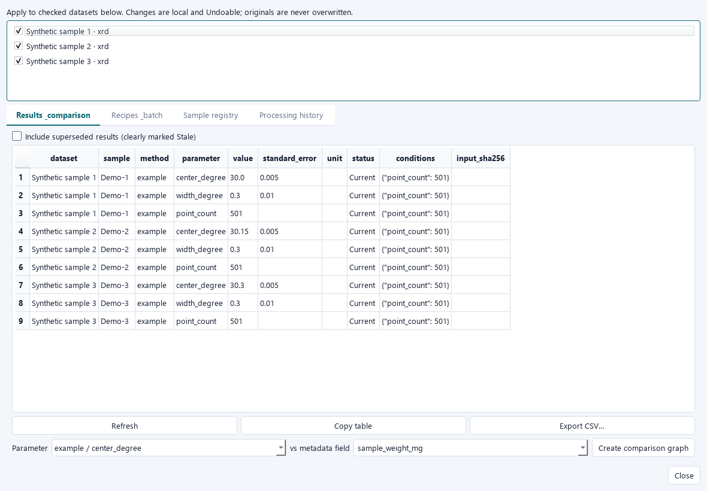

`Recipes & batch` captures processing settings and recorded analysis operations.
Use `Add operation` for an ordered, whitelisted operation, or inspect the JSON
parameters. No Python or Igor source is executed by recipes. Save as `.mdsr`,
load it later, check the batch preview, then use `Preview result (no changes)`.
The preview uses a detached dataset: it does not modify the session. Run the
checked datasets only after verifying columns, physical units, fit ranges and
source-specific manual boundaries. Each dataset commits after its complete
recipe succeeds; Stop does not roll back datasets already completed. Undo is
available in the main window. Queued/running jobs are invalidated by New/Open/Undo.

Supported recipe operations include settings, arPLS, background removal, derived
columns, dependent-column refresh and the existing Curie-Weiss, low-temperature,
Debye-Einstein, Arrhenius, Mott-VRH and expression fitting functions. Typed
MPMS/heat-capacity/transport inputs use each target's own sample amount, geometry
and selected segment. Sample mass/composition are not copied by default.
Generic input columns bind by their names; ambiguous or missing bindings fail
without partly modifying that dataset. Frozen, manually edited calculated
columns are not silently overwritten. Whole-pattern XRD fitting retains its
dedicated configuration, reflection table and result logs.

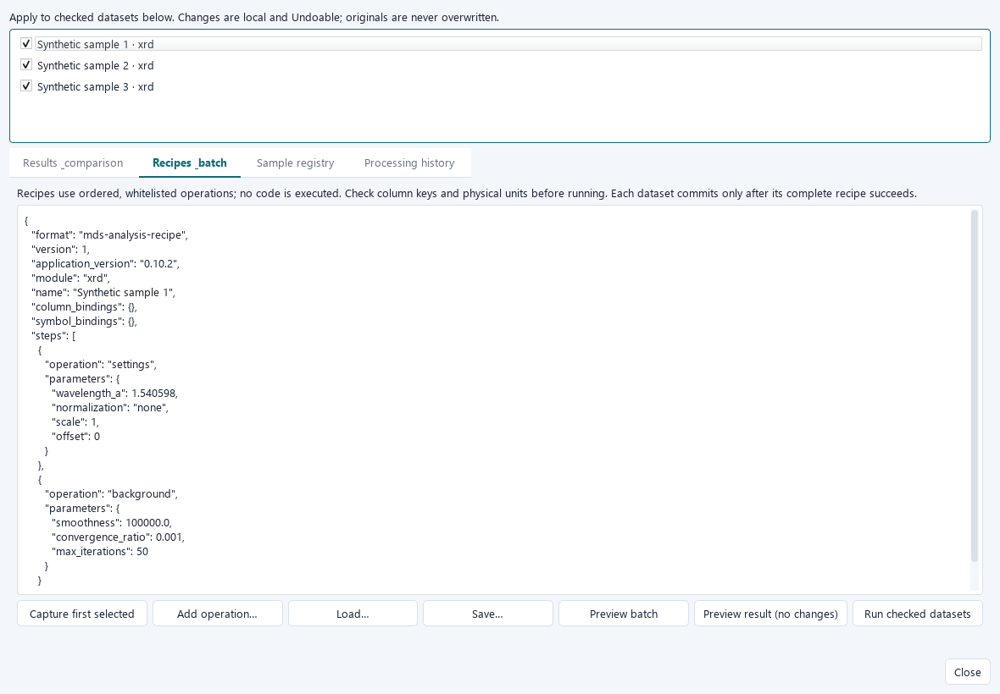

`Sample registry` links measurements across modules using a Sample ID. Enter
formula, mass in mg, dimensions in mm, notes and scalar Conditions JSON. Linking
alone does not change formula/mass/dimensions. Check the explicit override box
to replace those defaults in selected measurements; this invalidates fits.
Source file bytes and headers remain unchanged. Derived columns are marked
stale after their inputs change. Use `Recalculate dependent columns` in Custom
Plot; edited calculated columns become frozen snapshots rather than live formulas.

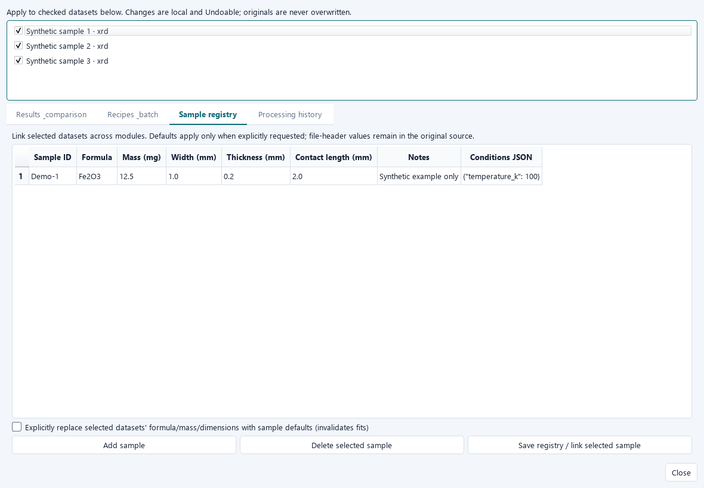

### 15.2 Import, dataset organization and graphical ranges

Ordinary two-column .xy/.dat diffraction data go directly to the plot without a preview.
Text data with three or more columns provide a table preview for X/Y/sigma, delimiter, first numeric
row and units. A sigma column must be distinct, finite and positive. Radian
2theta values are converted to degrees explicitly. Save named instrument
templates; RASX retains its fixed first-two-column convention.

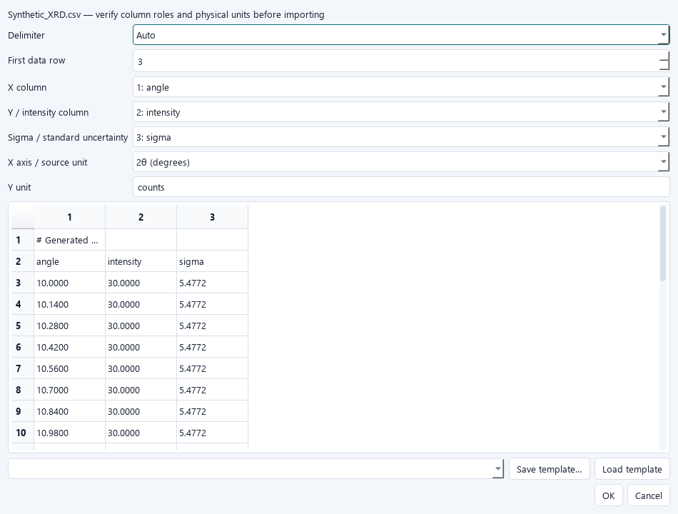

Ctrl/Shift-select dataset rows, then right-click for bulk visibility, styles,
duplication, removal and tags. Filtering also searches tags. The measurement-order
overview shows temperature/field and existing segment boundaries without deleting
raw points. Settings cards show their application scope. Search within a category;
click a card title to collapse it. TOF parameters appear when needed.

The plot context menu's `Edit fit range (drag handles)` links the displayed region
to numeric fit bounds. C/T-T-squared and linearized transport views convert
coordinates back to physical temperature. Heat-capacity exclusions can be added
from the draggable region. XRD whole-pattern fitting keeps its existing linked
fit/excluded regions and reflection-group updates.

### 15.3 Graph Editor integration

Transfer the displayed plot with **File > Edit current plot in Graph Editor** or
its toolbar icon. The independent editor also provides image ROI/profiles and
reviewed sharing copies. See **Help > Graph Viewer Manual** inside that editor
for operating details and confidentiality limits.

### 15.4 Output, recovery, language and independent windows

The unified Export dialog owns figure size, DPI, transparency and named figure
templates. Last image options are retained. Templates include plot appearance;
loading one affects that export without silently changing global Preferences.
Main and Graph Editor Undo histories stay independent, count retained originals
as well as arrays and display their retained-memory estimate in the status bar.
This is not total process RAM. Large text and export operations run off the GUI
thread; non-interruptible writes do not advertise an immediate Stop.

`Help > Recovery Center` lists retained session and graph copies, timestamps,
sizes and metadata. Recovery opens unsaved working copies. Keep is the default;
deletion requires confirmation and does not delete original measurements.
Active owners are excluded where identifiable; legacy graph copies have unknown
ownership. Nothing expires merely because it is old. Diagnostic output previews
the exact captured logs and can redact local Windows paths before saving.

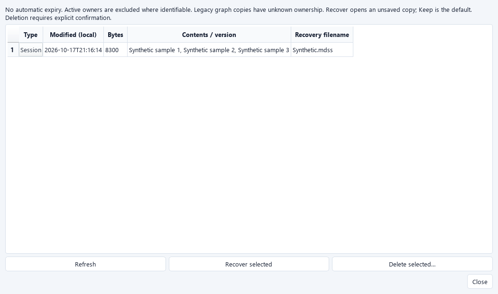

Preferences provides optional Japanese UI captions; scientific symbols, model
codes, data names and numerical expressions retain their original meaning.
English remains the default. `Recent files / resume workspace` reopens saved
sessions/documents; `Context help` (Shift+F1) opens the relevant manual section.
Floating Command/Procedure windows can be moved between monitors. `Dock back`
reattaches the existing content without reusing floating screen coordinates;
the running sandbox/procedure is not replaced by this docking operation.

Graph Editor's `File > Processing history / command recipe…` shows persisted GUI
operations and successful mutating MDS commands. Copy the command recipe into
Command Window for review and explicit replay. Descriptive GUI history is not an
executable script; imported Igor history and procedures are never run automatically.

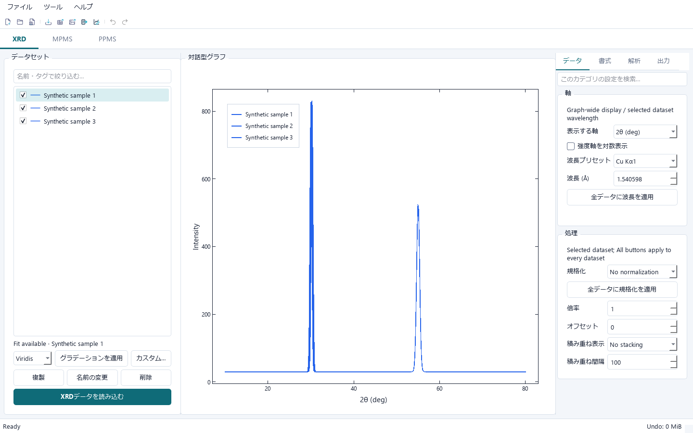
